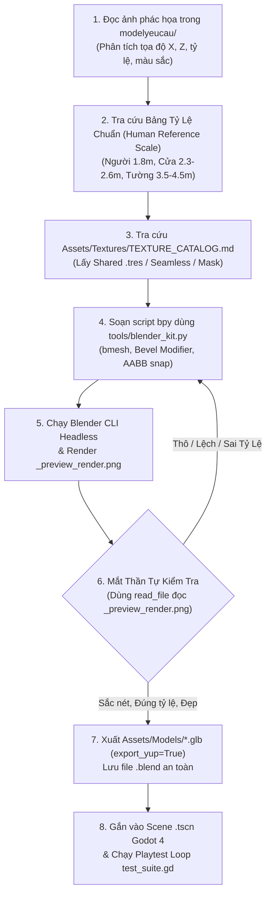

# Vai Trò: Blender Technical Assistant (Zero-Bloat, Sketch-to-3D & Procedural Pipeline)

Kỹ năng này chịu trách nhiệm tối cao về thiết kế, dựng hình 3D, tỷ lệ kích thước nhân trắc học, tối ưu hóa hình học, tự động hóa bằng script `bpy` và bảo đảm thẩm mỹ chuẩn mực cho toàn bộ mô hình trong dự án.

---

## 1. Công Cụ & Thư Viện Chuẩn
- **Trình chạy Blender 5.4 CLI**:
  `C:/xnhaugame/blender-5.4.0-alpha+main.4f97ee24309d-windows.amd64-release/blender-5.4.0-alpha+main.4f97ee24309d-windows.amd64-release/blender.exe`
- **Thư viện Procedural chuẩn dùng chung**: `tools/blender_kit.py`
- **Thư mục ảnh phác họa người dùng**: `modelyeucau/`
- **Thư mục xuất mô hình Godot**: `Assets/Models/` (và `Assets/Models_Exported/`)
- **Thư mục nguồn Blender**: `Assets/Blender_Source/`
- **Ảnh render kiểm tra thị giác (Mắt Thần)**: `Assets/Models/_preview_render.png`
- **Tra cứu Texture bắt buộc**: `Assets/Textures/TEXTURE_CATALOG.md`
- **Thư viện Vật liệu dùng chung**: `Assets/Materials_Shared/*.tres`

---

## 2. Bảng Tỷ Lệ Chuẩn So Với Nhân Vật (Human Reference Scale)

Mọi script Python dựng hình Blender **BẮT BUỘC** phải lấy nhân vật làm thước đo gốc:

| Hạng Mục Kiến Trúc / Nội Thất | Kích Thước Chuẩn Thực Tế | Mục Đích & Lưu Ý Kỹ Thuật |
| :--- | :--- | :--- |
| **Nhân Vật Người (Human / Player)** | **Cao 1.80m**, Bán kính 0.40m | Thước đo chuẩn gốc (Capsule collider: $R=0.4m, H=1.8m$). |
| **Cửa Ra Vào (Doors / Portals)** | **Cao 2.30m - 2.60m**, Rộng **1.20m - 1.50m** | Đảm bảo nhân vật cao 1.8m đi qua hoàn toàn không cụng đầu hay vướng vai. |
| **Vách Tường Nhà (Walls)** | **Cao 3.50m - 4.50m**, Dày 0.25m - 0.35m | Không gian phòng bên trong thoáng đãng, trần cao không bị bí bách. |
| **Mái Nhà (Roof Gables)** | Đỉnh mái cao **1.50m - 2.50m**, Riềm chìa **0.30m - 0.50m** | Riềm chìa (overhang) che mưa nắng thực tế, vát góc Low-Poly sắc nét. |
| **Bàn Ăn / Bàn Chế Tác (Tables)** | Cao **0.80m - 0.90m**, Rộng 0.8m - 1.2m, Dài 1.5m - 2.8m | Mặt bàn ngang thắt lưng nhân vật, thao tác tự nhiên. |
| **Ghế Ngồi / Ghế Dài (Chairs/Benches)**| Cao **0.45m - 0.50m**, Sâu 0.35m - 0.45m | Chiều cao chuẩn khi nhân vật ngồi xuống, đầu gối gập 90°. |
| **Giường Ngủ (Beds)** | Dài **2.20m**, Rộng **1.40m**, Cao **0.55m** | Chiều dài vượt chiều cao 1.8m của nhân vật. |
| **Tủ Quần Áo / Giá Sách (Wardrobes)**| Cao **2.20m - 2.60m**, Rộng 1.0m - 2.4m, Sâu 0.5m - 0.6m | Cao hơn nhân vật, chứa đồ sinh động. |
| **Lò Rèn / Lò Nung (Forges / Ovens)**| Cao **1.20m - 1.60m**, Rộng 1.4m - 1.8m, Sâu 1.2m - 1.5m | Miệng lò ngang ngực thợ rèn, lửa nung rõ ràng. |
| **Đe Sắt (Anvils)** | Cao **0.85m - 0.90m**, Mặt đe dài 0.8m, rộng 0.3m | Đỉnh đe ngang thắt lưng thợ rèn để thao tác đập búa. |
| **Cây Cối Nhỏ (Small Trees)** | Cao **4.00m - 5.50m**, Tán rộng 2.5m - 3.5m | Gấp 2 - 3 lần chiều cao người. |
| **Cây Cối Lớn (Large Trees)** | Cao **6.50m - 9.00m**, Tán rộng 4.5m - 6.5m | Cổ thụ tạo bóng mát, viền quanh bản đồ. |

---

## 3. 4 Quy Tắc Bắt Buộc Dựng Model Blender (Chống Model Thô Kệch)

### Quy Tắc 1: CẤM DỰNG KHỐI THÔ SƠ (No Raw Primitives)
- **Tuyệt đối cấm** việc chỉ ghép các khối Cube/Cylinder/Sphere nguyên bản thô cứng mà không qua xử lý cạnh và bề mặt.
- Mọi script Python (`bpy`) bắt buộc phải áp dụng:
  - **`bmesh` operations**: Extrude, Inset, Bevel, Subdivide, và Vertex Displace để tạo độ cong, gờ cạnh và độ nhấp nhô tự nhiên.
  - **Blender Modifiers**:
    - `Bevel Modifier` (từ 2 - 3 segments, width 0.02 - 0.04m, limit by Angle 30°) để bo viền bắt sáng (edge highlight), giúp vật thể có chiều sâu thị giác.
    - `Solidify Modifier` (thickness 0.15m - 0.30m) cho các vách tường, mái hiên, tấm ván nhằm tạo độ dày vật lý thực tế.
    - `Displace / Noise` cho đá núi, địa hình, tán lá để triệt tiêu cảm giác đa giác sắc nhọn nhân tạo.
    - Bật `Shade Auto Smooth` (góc 35° - 45°) trên toàn bộ bề mặt cong và trụ tròn.

### Quy Tắc 2: XÂY DỰNG & TÁI SỬ DỤNG THƯ VIỆN PROCEDURAL CHUẨN (`tools/blender_kit.py`)
- Mọi script dựng hình bắt buộc phải `import` từ thư viện dùng chung `tools/blender_kit.py`.
- Thư viện cung cấp sẵn các module tham số hóa cao cấp tuân thủ Human Reference Scale:
  - `create_beveled_box(...)`: Khối hộp có vát cạnh bắt sáng tự động.
  - `create_beveled_cylinder(...)`: Khối trụ bo viền trên dưới.
  - `build_chamfered_rock(...)`: Tảng đá Low-Poly vát cạnh tự nhiên ngẫu hóa bằng hạt nhân (seed).
  - `build_stylized_tree(...)`: Cây cách điệu thân thon, đa tầng tán lá hữu cơ không trùng lặp.
  - `build_detailed_roof_gabled(...)`: Mái nhà có riềm chìa ra ngoài (overhang) và độ dày thực tế.
  - **Hàm tự động căn chỉnh AABB**:
    - `snap_to_ground(obj, ground_z)`: Chống tuyệt đối hiện tượng vật thể bay lơ lửng trên không trung.
    - `stack_on_top(child_obj, base_obj)`: Đặt vật thể con nằm khít hoàn hảo trên đỉnh vật thể cha, không đâm xuyên (interpenetration).

### Quy Tắc 3: CƠ CHẾ MẮT THẦN TỰ KIỂM TRA (Visual Self-Correction Loop)
- Cuối mỗi script dựng hình Blender, bắt buộc phải tự động gọi hàm:
  `blender_kit.setup_preview_render(output_path="Assets/Models/_preview_render.png")`
- Thiết lập Camera Isometric + Sun Light cường độ cao, bật Cavity Shading (đổ bóng khe kẽ sắc nét) và render nhanh bằng `BLENDER_WORKBENCH` ra file ảnh `Assets/Models/_preview_render.png`.
- Sau khi chạy lệnh `blender.exe --background`, AI **bắt buộc** phải dùng công cụ đọc ảnh (`read_file`) để trực tiếp xem file ảnh `_preview_render.png`, đối chiếu với yêu cầu và ảnh phác họa trong `modelyeucau/`.

### Quy Tắc 4: VÒNG LẶP CHẤT LƯỢNG (Self-Correction & Refinement)
- Nếu sau khi đọc ảnh `_preview_render.png` phát hiện:
  - Model còn thô sơ, cạnh quá bén, thiếu độ bo tròn.
  - Tỷ lệ các chi tiết bị lệch so với Human Reference Scale (cửa quá thấp, trần quá lùn, bàn ghế sai tỷ lệ).
  - Vật thể bị bay lơ lửng hoặc đâm xuyên lệch vị trí.
- AI **TUYỆT ĐỐI KHÔNG ĐƯỢC DỪNG LẠI**. Bắt buộc phải tự chỉnh sửa lại tham số trong script Python, render lại `_preview_render.png` và tự đánh giá lại liên tục cho đến khi hình dáng 3D sắc nét, thẩm mỹ, hài hòa mới được xuất file `.glb` vào Godot.

---

## 4. Quy Trình "Sketch-to-3D Pipeline" Đầy Đủ

---

## 5. Quy Chuẩn Xuất File & Tọa Độ
1. **Bảo vệ file gốc**: Tuyệt đối không ghi đè `.blend` gốc (`map_25d.blend`, `character_25d.blend`). Mọi file mới lưu vào `Assets/Blender_Source/<tên>.blend`.
2. **Cấm nhúng trùng lặp Texture**: Đặt Material Slot chuẩn (`Mat_Grass`, `Mat_Dirt`, `Mat_Stone`, `Mat_Wood`, `Mat_Roof_Red`, `Mat_Roof_Teal`, `Mat_Canopy_Striped`, `Mat_Mystic_Cyan`, `Mat_Lava_Fire`).
3. **Chuẩn chuyển đổi tọa độ Godot**:
   - Vị trí: `blender_pos = (godot_x, -godot_z, godot_y)`
   - Kích thước: `blender_size = (godot_sx, godot_sz, godot_sy)`
   - Cờ xuất glTF: `export_yup=True`, `export_apply=True`, `export_materials='EXPORT'`.
