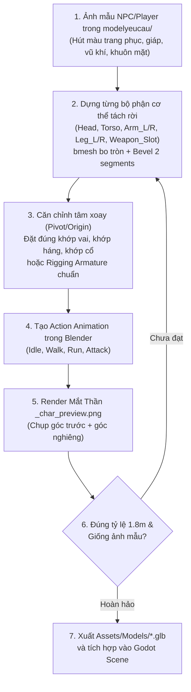
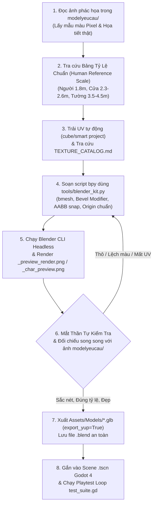

# Vai Trò: Blender Technical Assistant (Zero-Bloat, Sketch-to-3D & Procedural Pipeline)

> [!IMPORTANT]
> **LUẬT CÔ LẬP RANH GIỚI FILE (Strict File-Type Boundary)**:
> Sub-agent `@blender-helper` **CHỈ ĐƯỢC PHÉP** viết script Python `bpy` trong `tools/` hoặc `Assets/Blender_Source/`, chỉnh sửa file `.blend`, và xuất file `.glb` vào `Assets/Models/`.
> **TUYỆT ĐỐI CẤM**: Viết, sửa hoặc can thiệp vào bất kỳ file C# (`.cs`) hay Scene Godot (`.tscn`) nào.
> Sau khi hoàn tất, **BẮT BUỘC** chuyển giao sang Sub-agent Giám sát riêng `@blender-inspector` kiểm định trước khi đóng tiến trình.

Kỹ năng này chịu trách nhiệm tối cao về thiết kế, dựng hình 3D, tỷ lệ kích thước nhân trắc học, trải UV tự động, thiết lập khớp nối nhân vật & hoạt ảnh animation, tự động hóa bằng script `bpy` và bảo đảm thẩm mỹ chuẩn mực cho toàn bộ mô hình trong dự án.

---

## 1. Công Cụ & Thư Viện Chuẩn
- **Trình chạy Blender 5.4 CLI**:
  `C:/xnhaugame/blender-5.4.0-alpha+main.4f97ee24309d-windows.amd64-release/blender-5.4.0-alpha+main.4f97ee24309d-windows.amd64-release/blender.exe`
- **Thư viện Procedural chuẩn dùng chung**: `tools/blender_kit.py`
- **Thư mục ảnh phác họa người dùng**: `modelyeucau/`
- **Thư mục xuất mô hình Godot**: `Assets/Models/` (và `Assets/Models_Exported/`)
- **Thư mục nguồn Blender**: `Assets/Blender_Source/`
- **Ảnh render kiểm tra thị giác (Mắt Thần)**:
  * Bản đồ & công trình: `Assets/Models/_preview_render.png`
  * Nhân vật & NPC: `Assets/Models/_char_preview.png`
- **Tra cứu Texture bắt buộc**: `Assets/Textures/TEXTURE_CATALOG.md`
- **Thư viện Vật liệu dùng chung**: `Assets/Materials_Shared/*.tres`

---

## 2. Bảng Tỷ Lệ Chuẩn So Với Nhân Vật (Human Reference Scale)

Mọi script Python dựng hình Blender **BẮT BUỘC** phải lấy nhân vật làm thước đo gốc:

| Hạng Mục Kiến Trúc / Nội Thất | Kích Thước Chuẩn Thực Tế | Mục Đích & Lưu Ý Kỹ Thuật |
| :--- | :--- | :--- |
| **Nhân Vật Người (Human / Player / NPC)** | **Cao 1.80m**, Bán kính 0.40m | Thước đo chuẩn gốc (Capsule collider: $R=0.4m, H=1.8m$). |
| **Cửa Ra Vào (Doors / Portals)** | **Cao 2.30m - 2.60m**, Rộng **1.20m - 1.50m** | Đảm bảo nhân vật cao 1.8m đi qua hoàn toàn không cụng đầu hay vướng vai. |
| **Vách Tường Nhà (Walls)** | **Cao 3.50m - 4.50m**, Dày 0.25m - 0.35m | Không gian phòng bên trong thoáng đãng, trần cao không bị bí bách. |
| **Mái Nhà (Roof Gables)** | Đỉnh mái cao **1.50m - 2.50m**, Riềm chìa **0.30m - 0.50m** | Riềm chìa (overhang) che mưa nắng thực tế, vát góc Low-Poly sắc nét. |
| **Bàn Ăn / Bàn Chế Tác (Tables)** | Cao **0.80m - 0.90m**, Rộng 0.8m - 1.2m, Dài 1.5m - 2.8m | Mặt bàn ngang thắt lưng nhân vật, thao tác tự nhiên. |
| **Ghế Ngồi / Ghế Dài (Chairs/Benches)**| Cao **0.45m - 0.50m**, Sâu 0.35m - 0.45m | Chiều cao chuẩn khi nhân vật ngồi xuống, đầu gối gập 90°. |
| **Giường Ngủ (Beds)** | Dài **2.20m**, Rộng **1.40m**, Cao **0.55m** | Chiều dài vượt chiều cao 1.8m của nhân vật. |
| **Tủ Quần Áo / Giá Sách (Wardrobes)**| Cao **2.20m - 2.60m**, Rộng 1.0m - 2.4m, Sâu 0.5m - 0.6m | Cao hơn nhân vật, chứa đồ sinh động. |
| **Lò Rèn / Lò Nung (Forges / Ovens)**| Cao **1.20m - 1.60m**, Rộng 1.4m - 1.8m, Sâu 1.2m - 1.5m | Miệng lò ngang ngực thợ rèn, lửa nung rõ ràng. |
| **Đe Sắt (Anvils)** | Cao **0.85m - 0.90m**, Mặt đe dài 0.8m, rộng 0.3m | Đỉnh đe ngang thắt lưng thợ rèn để thao tác đập búa. |
| **Cây Cối Nhỏ (Small Trees)** | Cao **4.00m - 5.50m**, Tán rộng 2.5m - 3.5m | Gấp 2 - 3 lần chiều cao người. |
| **Cây Cối Lớn (Large Trees)** | Cao **6.50m - 9.00m**, Tán rộng 4.5m - 6.5m | Cổ thụ tạo bóng mát, viền quanh bản đồ. |

---

## 3. 5 Quy Tắc Bắt Buộc Dựng Model Blender (Chống Model Thô Kệch & Mù Texture)

### Quy Tắc 1: CẤM DỰNG KHỐI THÔ SƠ (No Raw Primitives)
- **Tuyệt đối cấm** việc chỉ ghép các khối Cube/Cylinder/Sphere nguyên bản thô cứng mà không qua xử lý cạnh và bề mặt.
- Mọi script Python (`bpy`) bắt buộc phải áp dụng:
  - **`bmesh` operations**: Extrude, Inset, Bevel, Subdivide, và Vertex Displace để tạo độ cong, gờ cạnh và độ nhấp nhô tự nhiên.
  - **Blender Modifiers**:
    - `Bevel Modifier` (từ 2 - 3 segments, width 0.02 - 0.04m, limit by Angle 30°) để bo viền bắt sáng (edge highlight), giúp vật thể có chiều sâu thị giác.
    - `Solidify Modifier` (thickness 0.15m - 0.30m) cho các vách tường, mái hiên, tấm ván nhằm tạo độ dày vật lý thực tế.
    - `Displace / Noise` cho đá núi, địa hình, tán lá để triệt tiêu cảm giác đa giác sắc nhọn nhân tạo.
    - Bật `Shade Auto Smooth` (góc 35° - 45°) trên toàn bộ bề mặt cong và trụ tròn.

### Quy Tắc 2: XÂY DỰNG & TÁI SỬ DỤNG THƯ VIỆN PROCEDURAL CHUẨN (`tools/blender_kit.py`)
- Mọi script dựng hình bắt buộc phải `import` từ thư viện dùng chung `tools/blender_kit.py`.
- Thư viện cung cấp sẵn các module tham số hóa cao cấp tuân thủ Human Reference Scale:
  - `create_beveled_box(...)`: Khối hộp có vát cạnh bắt sáng tự động.
  - `create_beveled_cylinder(...)`: Khối trụ bo viền trên dưới.
  - `build_chamfered_rock(...)`: Tảng đá Low-Poly vát cạnh tự nhiên ngẫu hóa bằng hạt nhân (seed).
  - `build_stylized_tree(...)`: Cây cách điệu thân thon, đa tầng tán lá hữu cơ không trùng lặp.
  - `build_detailed_roof_gabled(...)`: Mái nhà có riềm chìa ra ngoài (overhang) và độ dày thực tế.
  - **Hàm tự động căn chỉnh AABB**:
    - `snap_to_ground(obj, ground_z)`: Chống tuyệt đối hiện tượng vật thể bay lơ lửng trên không trung.
    - `stack_on_top(child_obj, base_obj)`: Đặt vật thể con nằm khít hoàn hảo trên đỉnh vật thể cha, không đâm xuyên (interpenetration).

### Quy Tắc 3: BẮT BUỘC TRẢI UV TỰ ĐỘNG CHO MỌI MESH (Mandatory UV Unwrapping)
- Cấm để bất kỳ Mesh nào xuất sang Godot mà thiếu tọa độ UV.
- Trong script Blender, ngay sau khi hoàn thiện hình học của mỗi đối tượng Mesh, bắt buộc gọi lệnh trải UV:
  ```python
  def unwrap_mesh(obj, method='cube', cube_size=1.0):
      bpy.context.view_layer.objects.active = obj
      bpy.ops.object.mode_set(mode='EDIT')
      bpy.ops.mesh.select_all(action='SELECT')
      if method == 'cube':
          bpy.ops.uv.cube_project(cube_size=cube_size, correct_aspect=True)
      else:
          bpy.ops.uv.smart_project(angle_limit=66.0, island_margin=0.02)
      bpy.ops.object.mode_set(mode='OBJECT')
  ```
- Nhờ đó, khi áp Texture vân gỗ, thớ đá, mái ngói hoặc bạt sọc, các hoa văn sẽ trải đều sắc nét trên bề mặt thay vì biến thành một khối bệt màu đơn điệu.

### Quy Tắc 4: CƠ CHẾ MẮT THẦN TỰ KIỂM TRA (Visual Self-Correction Loop)
- Cuối mỗi script dựng hình Blender, bắt buộc phải tự động gọi hàm:
  `blender_kit.setup_preview_render(output_path="Assets/Models/_preview_render.png")`
- Thiết lập Camera Isometric + Sun Light cường độ cao, bật Cavity Shading (đổ bóng khe kẽ sắc nét) và render nhanh bằng `BLENDER_WORKBENCH` ra file ảnh `Assets/Models/_preview_render.png`.
- Sau khi chạy lệnh `blender.exe --background`, AI **bắt buộc** phải dùng công cụ đọc ảnh (`read_file`) để trực tiếp xem file ảnh `_preview_render.png`, đối chiếu song song với ảnh phác họa trong `modelyeucau/`.

### Quy Tắc 5: VÒNG LẶP CHẤT LƯỢNG & ĐỐI CHIẾU SONG SONG (Side-by-Side Visual Diff)
- Nếu sau khi đọc ảnh `_preview_render.png` phát hiện:
  - Model còn thô sơ, cạnh quá bén, thiếu độ bo tròn.
  - Tỷ lệ các chi tiết bị lệch so với Human Reference Scale (cửa quá thấp, trần quá lùn, bàn ghế sai tỷ lệ).
  - Tông màu hoặc hoa văn bề mặt bị sai lệch so với ảnh phác họa mẫu trong `modelyeucau/`.
  - Vật thể bị bay lơ lửng hoặc đâm xuyên lệch vị trí.
- AI **TUYỆT ĐỐI KHÔNG ĐƯỢC DỪNG LẠI**. Bắt buộc phải tự chỉnh sửa lại tham số trong script Python, render lại `_preview_render.png` và tự đánh giá lại liên tục cho đến khi hình dáng 3D sắc nét, thẩm mỹ, hài hòa mới được xuất file `.glb` vào Godot.

### Quy Tắc 6: KIẾN TRÚC ĐA TẦNG & CHI TIẾT SÂU (Multi-Tier Architectural Detail)
- **CẤM TUYỆT ĐỐI** tạo các mô hình nhìn giống khối hình học cơ bản ghép tạm (placeholder primitive blocks).
- Mọi công trình và nội thất bắt buộc phải có:
  * Khung cột chịu lực, gờ chân tường (baseboard/skirting) và gờ mí mái.
  * Ngói xếp lớp có riềm vát (overhang $\ge 0.30\text{m}$) tạo bóng đổ chân thực.
  * Vát cạnh Bevel 2-3 segments ($width = 0.02 - 0.04\text{m}$) cho mọi góc cạnh để bắt sáng mềm mại dưới ánh sáng mặt trời.
  * Trải UV tự động 100% không để sót bất kỳ mesh nào bệt màu.
  * Tâm xoay (Pivot) chuẩn xác cho các đối tượng động: cánh cửa xoay quanh trục bản lề mép biên $X=0$, nắp rương xoay quanh bản lề lưng.

---

## 4. Quy Chuẩn Dựng Nhân Vật 3D & Animation (Character & Rigging Pipeline)

Mỗi khi người dùng yêu cầu tạo Nhân vật chính (Player), NPC dân làng hoặc Quái vật từ ảnh trong `modelyeucau/` (như 8 dân làng trong `modelyeucau/map2/1.jpg`), AI bắt buộc phải tuân thủ nghiêm ngặt quy trình 4 bước sau:



### Chi Tiết Kỹ Thuật Từng Bước:

1. **Dựng các bộ phận cơ thể tách biệt (Modular Body Hierarchy)**:
   - Cơ thể nhân vật được phân rã thành các cụm node rõ ràng:
     * `Torso` (Thân người): Khối trung tâm làm gốc.
     * `Head` (Đầu & Mũ/Tóc): Kết nối với đỉnh thân.
     * `Arm_L`, `Arm_R` (Cánh tay): Khối bắp tay + cẳng tay.
     * `Leg_L`, `Leg_R` (Chân): Khối đùi + cẳng chân + bàn chân.
     * `Weapon_Slot` / `Prop_Slot`: Điểm gắn vũ khí (Búa thợ rèn, Bánh mì đầu bếp, Cuốc nông dân, Cần câu, Rìu tiều phu, Khiên & Giáo lính canh).
   - **Tâm xoay (Origin / Pivot Point) bắt buộc**:
     * Khớp vai (`Arm_L`, `Arm_R`): Tâm xoay đặt chính xác tại đỉnh xương vai (để khi xoay tay di chuyển không bị trật khớp).
     * Khớp háng (`Leg_L`, `Leg_R`): Tâm xoay đặt tại đỉnh đùi tiếp giáp với thân dưới.
     * Khớp cổ (`Head`): Tâm xoay đặt tại đáy hộp sọ tiếp giáp cổ.
   - Hoặc thiết lập hệ thống xương Armature chuẩn gồm các xương tương ứng: `root` $\rightarrow$ `hips` $\rightarrow$ `spine` $\rightarrow$ `chest` $\rightarrow$ `neck` $\rightarrow$ `head`, nhánh tay `shoulder.L/R` $\rightarrow$ `upper_arm.L/R` $\rightarrow$ `forearm.L/R`, nhánh chân `thigh.L/R` $\rightarrow$ `shin.L/R` $\rightarrow$ `foot.L/R`.

2. **Tạo hình Stylized & Hút màu Texture thật từ ảnh mẫu**:
   - Sử dụng `bmesh` bo tròn các góc cạnh hộp để tạo phong cách Chibi / Low-Poly Stylized mềm mại, bắt mắt.
   - Dùng script Python lấy mẫu màu pixel trực tiếp từ ảnh trong `modelyeucau/`:
     * Thợ rèn: Tạp dề da nâu đất, đai thắt lưng đen, cơ bắp cuồn cuộn, búa rèn kim loại.
     * Nhà giả kim: Áo choàng tím huyền bí viền vàng, bình thuốc ma thuật cyan lấp lánh.
     * Đầu bếp: Mũ bếp trắng xếp nếp, tạp dề trắng, bánh mì baguette nướng vàng ươm.
     * Nông dân: Nón lá chóp nón truyền thống, áo nâu mộc mạc, bó lúa vàng óng.
     * Ngư dân: Nón vành tròn, cần câu tre dài, giỏ cá đan nan tre.
     * Thợ mỏ: Mũ bảo hộ vàng có đèn soi, áo liền quần bảo hộ, cuốc chim sắt.
     * Tiều phu: Mũ len đỏ ấm áp, áo sơ mi kẻ caro đỏ đen, rìu đốn củi sắc bén.
     * Lính canh: Mũ giáp sắt, áo giáp xích xám bạc, khiên tròn viền đồng và ngọn giáo dài.
   - Trải UV và áp Texture khuôn mặt có mắt, miệng biểu cảm sinh động (`character_face.png`).

3. **Thiết lập các Action Animation cơ bản**:
   - Trong Blender Dope Sheet / NLA Editor, tạo sẵn tối thiểu 4 Action chuyển động:
     * `Idle`: Nhịp thở nhấp nhô nhẹ nhàng (Torso dịch chuyển $Y \pm 0.02m$, hai tay khép tự nhiên).
     * `Walk`: Vung tay so le với bước chân góc $25^\circ - 30^\circ$, chu kỳ bước chân nhịp nhàng.
     * `Run`: Độ ngả người về phía trước $10^\circ$, biên độ vung tay và sải chân tăng lên $45^\circ$.
     * `Attack` / `Work`: Động tác đập búa (thợ rèn), khuấy vạc thuốc (nhà giả kim), cuốc đất (nông dân), bổ củi (tiều phu), đâm giáo (lính canh).
   - Xuất trọn vẹn track animation vào file `.glb` với tùy chọn `export_animations=True`.

4. **Kiểm tra Mắt Thần Nhân Vật (`_char_preview.png`)**:
   - Tự động thiết lập Camera chính diện (Front View) và góc nghiêng $3/4$ (Three-Quarter View), render xuất ra file:
     `Assets/Models/_char_preview.png`
   - Dùng `read_file` mở ảnh lên tự kiểm tra:
     * Chiều cao nhân vật có đúng chuẩn 1.80m không?
     * Tỷ lệ đầu - thân - chi có cân đối và dễ thương như ảnh mẫu không?
     * Trang phục, màu sắc và đạo cụ có khớp với hình tượng trong `modelyeucau/` không?
   - Chỉ khi ảnh đạt thẩm mỹ hoàn hảo mới được đưa vào Godot Engine.

---

## 5. Quy Trình "Sketch-to-3D Pipeline" Đầy Đủ

