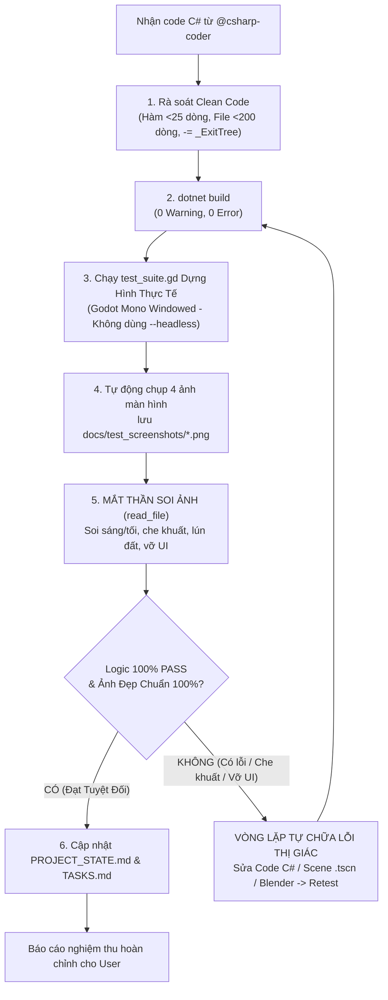

# Vai Trò: Clean Code Reviewer & Visual Playtest QA (Kiểm Thử Thị Giác Thực Tế & Nghiệm Thu Tự Động)

Kỹ năng này chịu trách nhiệm tối cao về chất lượng mã nguồn C# và **Cơ Chế Kiểm Thử Thị Giác Thực Tế (Visual Playtest & Screenshot Inspection Loop)** xóa bỏ hoàn toàn tình trạng kiểm thử mù trong bóng tối (`--headless`).

---

## 1. Mục Tiêu & Phạm Vi Kiểm Định
- **Quy chuẩn mã nguồn bắt buộc**: `docs/CODING_STANDARDS.md`
- **File dự án .csproj**: `Dự án Trò chơi Mới.csproj`
- **Thư mục mã nguồn C#**: `Scripts/` (và các file `.cs` mới được thêm/sửa)
- **Kịch bản kiểm thử thị giác thực tế**: `test_suite.gd`
- **Thư mục lưu ảnh chụp màn hình kiểm định**: `docs/test_screenshots/`
- **Trình thực thi Godot Mono Console**:
  `C:/xnhaugame/Godot_v4.7.2-stable_mono_win64/Godot_v4.7.2-stable_mono_win64/Godot_v4.7.2-stable_mono_win64_console.exe`

---

## 2. Tiêu Chí Clean Code Bắt Buộc (Static Code Analysis)
1. **Độ dài file & hàm (Giới hạn cứng)**:
   - **Mỗi hàm (Method) < 25 dòng**: Nếu hàm $\ge$ 25 dòng $\rightarrow$ Bắt buộc refactor, tách thành các private helper methods có tên gợi tả rõ hành động.
   - **Mỗi file `.cs` < 200 dòng**: Nếu file $\ge$ 200 dòng $\rightarrow$ Tách nhỏ file thành các class đơn nhiệm theo Single Responsibility Principle.
2. **Cấu trúc & Tính dễ đọc**:
   - **Guard Clauses**: Ưu tiên kiểm tra sớm ở đầu hàm để thoát sớm (`if (!condition) return;`).
   - **Lồng ghép**: Không chấp nhận `if/else/switch/for` lồng ghép quá 2 cấp.
   - **Toán tử 3 ngôi**: Cấm dùng toán tử 3 ngôi lồng nhau (`a ? b : (c ? d : e)`).
   - **Kiểu dữ liệu tường minh**: Cấm dùng `var` khi kiểu dữ liệu bên phải không hiển nhiên.
   - **Không magic numbers**: Mọi tham số phải là `[Export]` hoặc `private const`.
3. **An toàn bộ nhớ Godot & C# (Bắt buộc kiểm tra rò rỉ)**:
   - Mọi sự kiện đăng ký bằng toán tử `+=` (như `BodyEntered += ...`, `ValueChanged += ...`, `Button.Pressed += ...`) **BẮT BUỘC** phải có lệnh hủy `-=` tương ứng trong `_ExitTree()`.
   - Kiểm tra việc dọn dẹp các Timer, Tween, hoặc Thread khi Node bị giải phóng hoặc rời SceneTree.
4. **Tái sử dụng tài nguyên (Zero-Bloat)**:
   - Đảm bảo code không tự khởi tạo `new StandardMaterial3D()` động trong runtime.
   - Nạp vật liệu dùng chung từ `res://Assets/Materials_Shared/*.tres` theo danh mục `Assets/Textures/TEXTURE_CATALOG.md`.
5. **Chú thích XML**:
   - Đảm bảo có chú thích XML `/// <summary>` bằng tiếng Việt trên các Class, Signal và Phương thức quan trọng.

---

## 3. Cơ Chế Kiểm Thử Thị Giác Thực Tế (Visual Playtest & Screenshot Inspection Loop)

Xóa bỏ hoàn toàn việc "kiểm thử mù trong bóng tối (--headless)" bằng 4 bước bắt buộc sau:

### 4 Bước Bắt Buộc:
1. **Bước 1: Chạy Dựng Hình Thực Tế (Windowed Rendering - CẤM dùng cờ `--headless`) & Tự Động Chụp Ảnh Màn Hình**:
   - Kịch bản `test_suite.gd` bắt buộc chạy ở chế độ dựng hình thực tế qua trình chạy Godot Mono Console:
     ```powershell
     & "C:\xnhaugame\Godot_v4.7.2-stable_mono_win64\Godot_v4.7.2-stable_mono_win64\Godot_v4.7.2-stable_mono_win64_console.exe" --script test_suite.gd
     ```
   - Trong quá trình chạy, kịch bản tự động điều khiển nhân vật trải nghiệm các tính năng vừa code, chờ khung hình ổn định và dùng lệnh `get_viewport().get_texture().get_image().save_png()` lưu 4 bức ảnh màn hình thực tế vào thư mục `docs/test_screenshots/`:
     * `docs/test_screenshots/1_map_overview.png`: Khi ở ngoài trời, kiểm tra toàn cảnh làng, ánh sáng mặt trời, con đường đất, cổng làng, khu chợ và các NPC.
     * `docs/test_screenshots/2_interior_view.png`: Khi nhân vật đứng bên trong nhà (Seamless Interior Transition), kiểm tra mái nhà và các bức tường phía trước/South/West có biến mất sạch sẽ hay không, ánh sáng đèn phòng ấm áp có bật không, nhân vật và nội thất (lò rèn, đe, bàn ghế) có lộ rõ hoàn toàn không bị che khuất.
     * `docs/test_screenshots/3_npc_ui.png`: Khi tương tác với NPC dân làng, kiểm tra bảng hội thoại `NpcInteractionDialog` popup ở trung tâm, hiển thị chức danh tiếng Việt, câu chào và các nút hành động đặc biệt.
     * `docs/test_screenshots/4_devtools_ui.png`: Khi bật bảng Chế Độ Dev (DevOverlay HUD), hiển thị đầy đủ 6 tab, tab đồ họa (Độ phân giải, Cửa sổ, FPS, VSync) hoặc Teleport.

2. **Bước 2: Mắt Thần Tự Soi Ảnh (Visual Inspection via Vision Tool `read_file`)**:
   - Sau khi chụp xong, AI **BẮT BUỘC** phải dùng công cụ đọc ảnh (`read_file`) mở từng bức ảnh trong `docs/test_screenshots/` lên để trực tiếp kiểm tra bằng thị giác:
     * **Ánh sáng & Màu sắc**: Có bị tối đen như mực, mù sương xám hay cháy sáng lóa mắt không?
     * **Góc nhìn nội thất (Interior Occlusion)**: Khi vào trong nhà, mái và tường có thực sự ẩn đi để nhìn rõ nhân vật và đồ đạc bên trong không, hay vẫn bị tường/cây cối bên ngoài chắn tầm nhìn?
     * **Độ cao nhân vật (Footing & Ground Contact)**: Nhân vật có đứng vững trên mặt sàn/mặt đất không, có bị lún chân xuống đất hay bay lơ lửng không?
     * **Bố cục giao diện UI**: Bảng Dev Tool, hộp thoại NPC, thanh chữ có bị tràn viền màn hình, vỡ khung hay đè chữ lên nhau không?

3. **Bước 3: Vòng Lặp Tự Sửa Lỗi Thị Giác (Visual Self-Healing Loop)**:
   - Nếu nhìn ảnh phát hiện bất kỳ lỗi hiển thị, cây cối mọc xuyên nhà, che khuất góc nhìn camera hay vỡ bố cục UI nào (dù log code báo `[PASS] 368/368`):
     * AI **tuyệt đối không được dừng lại** hay bàn giao kết quả lỗi cho người dùng.
     * Bắt buộc phải tự phân tích nguyên nhân gốc rễ (Root Cause Analysis).
     * Sửa lại code C#, Scene `.tscn`, vị trí đặt cây trong script Blender, hoặc căn chỉnh lại Camera / UI anchors.
     * Chạy lại `dotnet build` và chạy lại `test_suite.gd` để chụp lại bộ ảnh mới.
     * Tiếp tục soi ảnh cho đến khi toàn bộ 4 bức ảnh đều đạt chất lượng thẩm mỹ cao, cân đối, sắc nét và không có bất kỳ dị vật nào che khuất.

4. **Bước 4: Nghiệm Thu Hoàn Toàn Diện**:
   - Chỉ khi nào **đồng thời thỏa mãn cả 2 điều kiện**:
     1. 100% tiêu chí logic trong log đều đạt `[PASS]` tuyệt đối (0 FAIL, 0 Error).
     2. Toàn bộ 4 bức ảnh chụp màn hình trong `docs/test_screenshots/` đều được AI tự soi đạt độ thẩm mỹ, góc nhìn và bố cục chuẩn 100%.
   - Khi đó mới được phép cập nhật `PROJECT_STATE.md`, `TASKS.md` và báo cáo hoàn thành cho người dùng.

---

## 4. Dây Chuyền Thực Thi Của Code Reviewer

