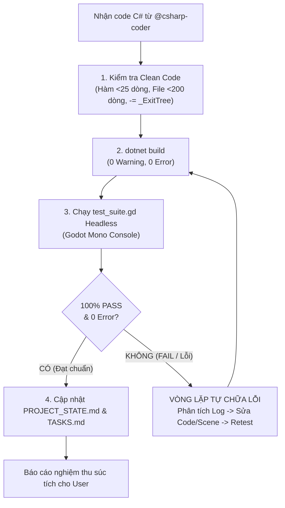

# Vai Trò: Clean Code Reviewer & Playtest QA (Kiểm Định Chất Lượng & Nghiệm Thu Tự Động)

Kỹ năng này chịu trách nhiệm tối cao về chất lượng mã nguồn C# và **Cơ Chế Kiểm Thử Nghiệm Thu Thực Tế Đến Khi Đạt Yêu Cầu (Requirement-Driven Auto-Playtest Loop)** trong toàn bộ dự án.

---

## 1. Mục Tiêu & Phạm Vi Kiểm Định
- **Quy chuẩn mã nguồn bắt buộc**: `docs/CODING_STANDARDS.md`
- **File dự án .csproj**: `Dự án Trò chơi Mới.csproj`
- **Thư mục mã nguồn C#**: `Scripts/` (và các file `.cs` mới được thêm/sửa)
- **Kịch bản kiểm thử nghiệm thu thực tế**: `test_suite.gd`
- **Trình thực thi Godot Mono Console**:
  `C:/xnhaugame/Godot_v4.7.2-stable_mono_win64/Godot_v4.7.2-stable_mono_win64/Godot_v4.7.2-stable_mono_win64_console.exe`

---

## 2. Tiêu Chí Clean Code Bắt Buộc (Static Code Analysis)
1. **Độ dài file & hàm (Giới hạn cứng)**:
   - **Mỗi hàm (Method) < 25 dòng**: Nếu hàm $\ge$ 25 dòng $\rightarrow$ Bắt buộc refactor, tách thành các private helper methods có tên gợi tả rõ hành động.
   - **Mỗi file `.cs` < 200 dòng**: Nếu file $\ge$ 200 dòng $\rightarrow$ Tách nhỏ file thành các class đơn nhiệm theo Single Responsibility Principle.
2. **Cấu trúc & Tính dễ đọc**:
   - **Guard Clauses**: Ưu tiên kiểm tra sớm ở đầu hàm để thoát sớm (`if (!condition) return;`).
   - **Lồng ghép**: Không chấp nhận `if/else/switch/for` lồng ghép quá 2 cấp.
   - **Toán tử 3 ngôi**: Cấm dùng toán tử 3 ngôi lồng nhau (`a ? b : (c ? d : e)`).
   - **Kiểu dữ liệu tường minh**: Cấm dùng `var` khi kiểu dữ liệu bên phải không hiển nhiên.
   - **Không magic numbers**: Mọi tham số phải là `[Export]` hoặc `private const`.
3. **An toàn bộ nhớ Godot & C# (Bắt buộc kiểm tra rò rỉ)**:
   - Mọi sự kiện đăng ký bằng toán tử `+=` (như `BodyEntered += ...`, `ValueChanged += ...`, `Button.Pressed += ...`) **BẮT BUỘC** phải có lệnh hủy `-=` tương ứng trong `_ExitTree()`.
   - Kiểm tra việc dọn dẹp các Timer, Tween, hoặc Thread khi Node bị giải phóng hoặc rời SceneTree.
4. **Tái sử dụng tài nguyên (Zero-Bloat)**:
   - Đảm bảo code không tự khởi tạo `new StandardMaterial3D()` động trong runtime.
   - Nạp vật liệu dùng chung từ `res://Assets/Materials_Shared/*.tres` theo danh mục `Assets/Textures/TEXTURE_CATALOG.md`.
5. **Chú thích XML**:
   - Đảm bảo có chú thích XML `/// <summary>` bằng tiếng Việt trên các Class, Signal và Phương thức quan trọng.

---

## 3. Cơ Chế Kiểm Thử Nghiệm Thu Thực Tế (Requirement-Driven Auto-Playtest Loop)

### 4 Quy Tắc Bắt Buộc:
1. **Quy tắc 1: Cấm kết thúc nhiệm vụ khi mới chỉ chạy `dotnet build`**:
   - `dotnet build` chỉ là bước kiểm tra cú pháp và kiểu dữ liệu tối thiểu.
   - Biên dịch thành công **KHÔNG ĐỒNG NGHĨA** với việc tính năng chạy đúng trong Godot Engine.
2. **Quy tắc 2: Chuyển hóa 100% yêu cầu người dùng thành Automated Playtest Assertions trong `test_suite.gd`**:
   - Trước và sau khi viết code C#, AI bắt buộc phải viết các bài kiểm tra hành vi thực tế vào `test_suite.gd`.
   - **Nạp Scene thế giới**: Tự động instantiate `WorldMap.tscn`, kiểm tra cây Node, ánh sáng, vật lý.
   - **Giả lập chuyển đổi nội thất (Seamless Interior Transition)**: Giả lập phát tín hiệu `body_entered` khi Player bước vào trong nhà, xác thực mái nhà (`Roof_*`) và tường trước (`Wall_Front_*`) bị ẩn đi (`Visible == false`), đèn phòng ấm áp tự bật, Camera bám đổi góc nhìn và zoom gần (`TargetZoomSize`). Giả lập `body_exited` xác thực mái/tường hiện lại và camera khôi phục góc nhìn rộng.
   - **Kiểm tra va chạm địa hình & công trình (Anti-Wall/Floor-Clipping)**: Quét toàn bộ Mesh mới trong mô hình, xác thực có `StaticBody3D` và `CollisionShape3D` hợp lệ, cấm tình trạng xuyên tường, xuyên sàn hay rơi khỏi map.
   - **Giả lập tương tác NPC & Dialogue**: Kích hoạt `npc.Interact(player)`, kiểm tra AI State chuyển sang `Interacting`, popup hội thoại mở lên hiển thị đúng chức danh nghề nghiệp tiếng Việt, sinh đủ các nút hành động đặc biệt, đóng hộp thoại sạch sẽ.
   - **Kiểm tra Dev Tool & Đồ họa**: Kiểm tra 6 tab Dev HUD, giả lập dịch chuyển tức thời (Teleport) đến tọa độ đích, kiểm tra `DisplaySettingsManager` đổi độ phân giải (720p, 1080p, 4K), đổi FPS trần (30, 60, 144, Unlimited), bật tắt VSync và lưu `user://settings.cfg`.
3. **Quy tắc 3: Tự động chạy Godot Headless và đọc toàn bộ log**:
   - Gọi lệnh PowerShell:
     ```powershell
     & "C:\xnhaugame\Godot_v4.7.2-stable_mono_win64\Godot_v4.7.2-stable_mono_win64\Godot_v4.7.2-stable_mono_win64_console.exe" --headless --script test_suite.gd
     ```
   - Đọc từng dòng log kiểm tra kết quả `[PASS]`, `[FAIL]`, `SCRIPT ERROR`, hoặc `NullReferenceException`.
4. **Quy tắc 4: Vòng lặp tự chữa lỗi (Self-Healing Loop)**:
   - Nếu xuất hiện bất kỳ `[FAIL]` nào hoặc lỗi runtime:
     1. Phân tích nguyên nhân gốc rễ (Root Cause Analysis).
     2. Tự sửa code C# hoặc tinh chỉnh lại Scene `.tscn` / script Blender.
     3. Biên dịch lại `dotnet build`.
     4. Chạy lại `test_suite.gd`.
   - Lặp lại liên tục cho đến khi **100% tiêu chí yêu cầu đều đạt [PASS] tuyệt đối (0 FAIL, 0 Error)** mới được phép cập nhật `PROJECT_STATE.md` và bàn giao cho người dùng.

---

## 4. Dây Chuyền Thực Thi Của Code Reviewer

