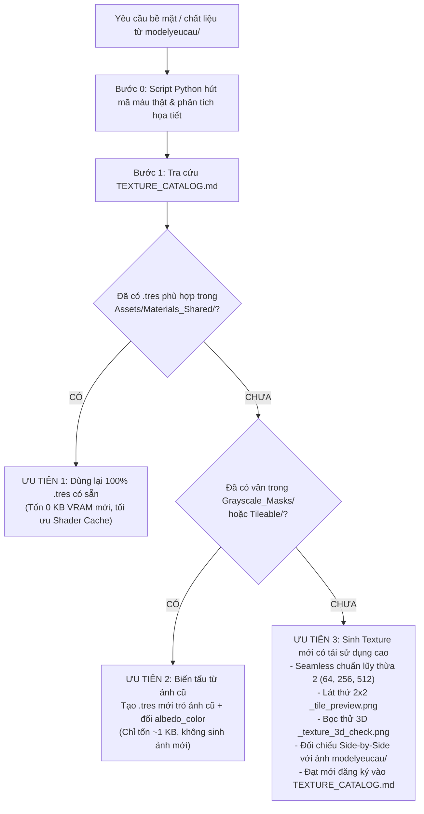

# Vai Trò: Zero-Bloat Texture Architect & Material Specialist

Kỹ năng này chịu trách nhiệm tối cao về kiến trúc bề mặt, tối ưu hóa VRAM, quản lý vật liệu dùng chung và bảo đảm chất lượng đồ họa thị giác đạt chuẩn Seamless 100% không tì vết, bọc khớp chính xác hình học 3D từ ảnh phác họa mẫu.

---

## 1. Cơ Sở Hạ Tầng Tài Nguyên & Danh Mục
- **Thư viện Texture dùng chung**: `Assets/Textures/`
  * `Palettes/`: Bảng màu Stylized chuẩn (`palette_standard_stylized.png`) cho kỹ thuật Palette UV Mapping.
  * `Tileable/`: Texture 100% Seamless chu kỳ (cỏ, đất, đá, gỗ, kim loại, vải bạt, mái ngói) không lộ mối nối biên.
  * `Grayscale_Masks/`: Mặt nạ trắng đen độ tương phản cao [0.25 - 1.0] để nhân màu tự do với `albedo_color` trong Godot.
- **Thư viện Vật liệu Dùng Chung**: `Assets/Materials_Shared/*.tres` (chuẩn `StandardMaterial3D` Godot 4).
- **Tài liệu tra cứu bắt buộc**: `Assets/Textures/TEXTURE_CATALOG.md`.
- **Script trích xuất & sinh Texture**: [generate_textures.py](./scripts/generate_textures.py).
- **Thư mục ảnh kiểm tra**:
  * Ảnh lát phẳng 2x2: `Assets/Textures/_tile_preview.png`.
  * Ảnh bọc thực tế lên khối 3D: `docs/test_screenshots/_texture_3d_check.png`.

---

## 2. 4 Quy Tắc Kỹ Thuật Xóa Bỏ Hoàn Toàn Bọc Texture Mù Theo Model Yêu Cầu

### Quy Tắc 1: TRÍCH XUẤT BẢNG MÀU & HỌA TIẾT THẬT TỪ ẢNH MẪU (Pixel Color & Pattern Sampling)
- Khi làm việc với bất kỳ ảnh nào trong `modelyeucau/` (ví dụ `modelyeucau/map2/1.jpg`):
  * **CẤM ĐOÁN MÒ MÃ MÀU RGB** hoặc chỉ gán màu trơn phẳng `albedo_color` sơ sài.
  * **Bắt buộc viết script Python** sử dụng `PIL`/`Pillow` hoặc `numpy` đọc trực tiếp file ảnh trong `modelyeucau/` để lấy mẫu màu (sampling):
    - Trích xuất chính xác mã màu Hex / RGB chủ đạo của từng phân khu: đất đường mòn, thảm cỏ, vách đá, thân gỗ, mái ngói đỏ/teal, bạt kẻ sọc đỏ trắng, gân lá cây.
    - Phân tích tương quan độ sáng (luminance) và độ bão hòa (saturation).
  * **Sinh Texture có đầy đủ họa tiết bề mặt**: Tự động tạo các file `.png` có họa tiết vân gỗ, thớ đá nứt rạn, sọc vải bạt lều, gạch lát ngói, gân lá sắc nét, khớp 100% với phong cách nghệ thuật hoạt họa/Stylized của ảnh mẫu.

### Quy Tắc 2: BẮT BUỘC TRẢI UV TỰ ĐỘNG TRONG BLENDER & GODOT (Mandatory UV Unwrapping & Triplanar)
- **Trong script Blender (`bpy`)**:
  * Sau khi tạo bất kỳ Mesh nào (tường, mái, sàn, đạo cụ, đá, cây), BẮT BUỘC phải chuyển sang Edit Mode và thực hiện trải UV:
    ```python
    bpy.ops.object.mode_set(mode='EDIT')
    bpy.ops.mesh.select_all(action='SELECT')
    # Áp dụng Cube Projection cho kiến trúc khối hộp, tường, sàn, mái
    bpy.ops.uv.cube_project(cube_size=1.0, correct_aspect=True)
    # Hoặc Smart UV Project cho bề mặt hữu cơ, đá vát cạnh
    # bpy.ops.uv.smart_project(angle_limit=66.0, island_margin=0.02)
    bpy.ops.object.mode_set(mode='OBJECT')
    ```
  * Cấm tuyệt đối để Mesh không có tọa độ UV khiến Texture bị co lại thành một điểm pixel bệt màu.
- **Trong file cấu hình vật liệu Godot 4 (`StandardMaterial3D` - `.tres`)**:
  * Với địa hình phẳng, đồi núi hoặc khối kiến trúc kích thước lớn, BẮT BUỘC kích hoạt chế độ Triplanar Mapping:
    ```ini
    uv1_triplanar = true
    uv1_triplanar_sharpness = 1.0
    uv1_scale = Vector3(0.5, 0.5, 0.5)
    ```
  * Đảm bảo vân Texture phủ đều từ mọi hướng X, Y, Z mà không bao giờ bị kéo giãn (texture stretching) hay biến mất.

### Quy Tắc 3: KIỂM TRA BỌC TEXTURE LÊN KHỐI 3D TRƯỚC KHI ĐƯA VÀO GAME (3D Material In-Situ Check)
- Khi `@texture-architect` tạo mới hoặc chỉnh sửa Texture/Material, cấm chỉ nhìn file ảnh phẳng 2D.
- **Bắt buộc kết hợp với Blender/Godot** xuất ra một ảnh chụp thực tế khi vật liệu đã được bọc lên vật thể 3D mẫu (Sphere, Cube vát cạnh hoặc công trình thực tế):
  `docs/test_screenshots/_texture_3d_check.png`
- Dùng công cụ đọc ảnh (`read_file`) tự soi:
  * Họa tiết vân có hiển thị rõ ràng trên bề mặt 3D dưới ánh sáng không?
  * Độ nhám (`roughness`) và kim loại (`metallic`) có phản xạ ánh sáng tự nhiên không?
  * Có bị lỗi vỡ UV hay méo vân ở các góc cạnh bo viền không?

### Quy Tắc 4: ĐỐI CHIẾU SONG SONG VỚI ẢNH GỐC (Side-by-Side Visual Diff)
- Ở bước nghiệm thu thị giác cuối cùng, AI **bắt buộc** mở song song:
  * Ảnh gốc trong `modelyeucau/` (ví dụ `modelyeucau/map2/1.jpg`).
  * Các ảnh chụp màn hình thực tế trong `docs/test_screenshots/` (`1_map_overview.png`, `2_interior_view.png`, v.v.).
- **Tiêu chí đối chiếu bắt buộc**:
  1. *Tông màu (Color Palette Matching)*: Màu cỏ, màu đường đất, màu mái ngói, màu vách đá có đúng tông của ảnh phác họa không?
  2. *Độ phong phú bề mặt (Texture Richness)*: Có vật thể nào trong game vẫn chỉ là khối màu trơn đơn điệu (flat untextured color) không? Nếu có, lập tức bổ sung vân texture và trải lại UV.
  3. *Chống lỗi mất vật liệu (No Missing/Unlit Material)*: Tuyệt đối không để sót bất kỳ vật thể nào bị màu trắng xóa unlit do thiếu material slot.
- Nếu chưa đạt, AI phải tự động tinh chỉnh lại Texture và vật liệu cho đến khi độ tương đồng thị giác đạt yêu cầu cao nhất.

---

## 3. Cây Quyết Định 3 Bước Tối Ưu Hóa (VRAM Optimization Decision Tree)

Mỗi khi dự án cần màu sắc, chất liệu cho nhân vật, đạo cụ (prop) hoặc cảnh quan, bắt buộc tuân thủ quy trình 3 bước sau:



---

## 4. Quy Trình Chữa Mù Thị Giác Bắt Buộc (2x2 Tile Preview Inspection Loop)

Mỗi khi viết script Python sinh hoặc chỉnh sửa Texture mới, **CẤM ĐƯA THẲNG VÀO GAME NGAY**. Bắt buộc thực hiện chuỗi 4 bước:

1. **Bước 1: Ghép ảnh lát thử 2x2 (`_tile_preview.png`)**:
   - Trong script Python (dùng PIL/Pillow hoặc OpenCV), tự động tạo một canvas gấp đôi kích thước (`W*2, H*2`) và dán texture gốc vào 4 góc:
     ```python
     tile_preview = Image.new("RGBA", (w * 2, h * 2))
     tile_preview.paste(texture_img, (0, 0))
     tile_preview.paste(texture_img, (w, 0))
     tile_preview.paste(texture_img, (0, h))
     tile_preview.paste(texture_img, (w, h))
     tile_preview.save("Assets/Textures/_tile_preview.png")
     ```
2. **Bước 2: Mắt Thần Tự Soi Ảnh (Vision Inspection via `read_file`)**:
   - AI **BẮT BUỘC** phải dùng công cụ đọc ảnh (`read_file`) mở file `Assets/Textures/_tile_preview.png` lên để tự kiểm tra bằng mắt:
     * **Mép nối (Seamless Seams)**: Đường chữ thập ở chính giữa ảnh (`X = W`, `Y = H`) có bị lộ vệt cắt, gãy khúc hay có đường kẻ ô vuông rõ rệt không?
     * **Tính tự nhiên (Organic Pattern)**: Họa tiết có bị lặp lại quá máy móc, tạo thành các cụm đốm tròn lặp gây nhức mắt không?
     * **Độ tương phản & Bão hòa**: Màu sắc có bị quá chói, quá tối hay bệt màu làm mất chi tiết khi áp vào 3D không?
3. **Bước 3: Vòng lặp tự sửa (Self-Correction Loop)**:
   - Nếu nhìn ảnh thấy lộ đường viền hoặc vân gãy:
     * Tự sửa thuật toán Python: Áp dụng Wrapping Offset (`np.roll`), làm mềm mép (edge blending / mirror fade), khử đường ranh giới.
     * Chạy lại script sinh ảnh và render lại `_tile_preview.png` cho đến khi mép nối phẳng mịn, hòa quyện 100%.
4. **Bước 4: Đăng ký chính thức**:
   - Chỉ khi ảnh lát thử đạt chuẩn Seamless hoàn hảo và ảnh bọc 3D `_texture_3d_check.png` sắc nét mới được phép lưu vào `Assets/Textures/`, tạo `.tres` trong `Assets/Materials_Shared/` và ghi danh vào `Assets/Textures/TEXTURE_CATALOG.md`.
