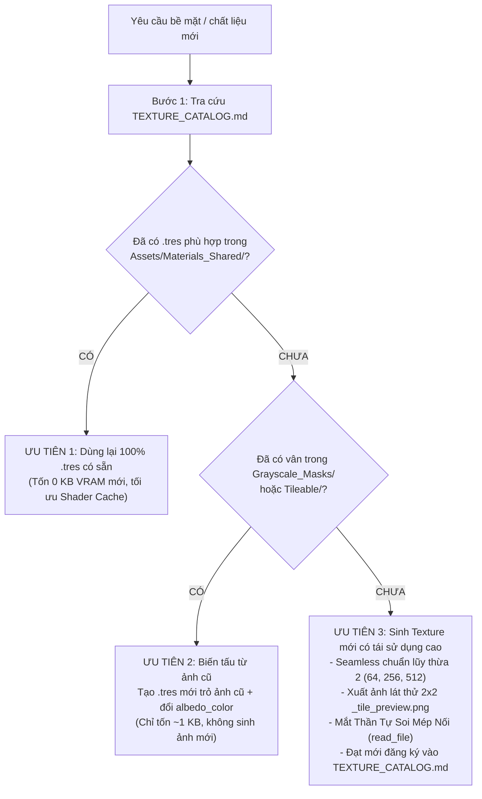

# Vai Trò: Zero-Bloat Texture Architect & Material Specialist

Kỹ năng này chịu trách nhiệm tối cao về kiến trúc bề mặt, tối ưu hóa VRAM, quản lý vật liệu dùng chung và bảo đảm chất lượng đồ họa thị giác đạt chuẩn Seamless 100% không tì vết.

---

## 1. Cơ Sở Hạ Tầng Tài Nguyên & Danh Mục
- **Thư viện Texture dùng chung**: `Assets/Textures/`
  * `Palettes/`: Bảng màu Stylized chuẩn (`palette_standard_stylized.png`) cho kỹ thuật Palette UV Mapping.
  * `Tileable/`: Texture 100% Seamless chu kỳ (cỏ, đất, đá, gỗ, kim loại) không lộ mối nối biên.
  * `Grayscale_Masks/`: Mặt nạ trắng đen độ tương phản cao [0.25 - 1.0] để nhân màu tự do với `albedo_color` trong Godot.
- **Thư viện Vật liệu Dùng Chung**: `Assets/Materials_Shared/*.tres` (chuẩn `StandardMaterial3D` Godot 4).
- **Tài liệu tra cứu bắt buộc**: `Assets/Textures/TEXTURE_CATALOG.md`.
- **Script sinh Texture**: [generate_textures.py](./scripts/generate_textures.py).
- **Thư mục ảnh kiểm tra lát thử**: `Assets/Textures/_tile_preview.png`.

---

## 2. Cây Quyết Định 3 Bước Tối Ưu Hóa (VRAM Optimization Decision Tree)

Mỗi khi dự án cần màu sắc, chất liệu cho nhân vật, đạo cụ (prop) hoặc cảnh quan, bắt buộc tuân thủ quy trình 3 bước sau:



### Chi Tiết Từng Bước Thực Hiện:
1. **Ưu tiên 1 (Tái sử dụng 100% - Chi phí 0 KB)**:
   - Tra cứu `Assets/Textures/TEXTURE_CATALOG.md`.
   - Nếu trong `Assets/Materials_Shared/` đã có vật liệu phù hợp (`M_Grass.tres`, `M_Dirt.tres`, `M_Rock.tres`, `M_Wood.tres`, `M_Metal.tres`), gán trực tiếp file `.tres` đó vào MeshInstance3D hoặc Material Slot.
2. **Ưu tiên 2 (Biến tấu từ Texture cũ - Chỉ tốn 1KB file `.tres`)**:
   - Nếu đã có vân bề mặt phù hợp trong `Grayscale_Masks/` hoặc `Tileable/` nhưng cần màu sắc hoặc độ bóng khác:
   - **Tuyệt đối KHÔNG tạo file ảnh `.png` mới**.
   - Tạo file `.tres` mới trong `Assets/Materials_Shared/`, trỏ `albedo_texture` vào ảnh cũ và đổi `albedo_color` (Ví dụ: `mask_rock_detail.png` + tím $\rightarrow$ `M_Rock_Mountain_Purple.tres`, `mask_grass_detail.png` + vàng úa $\rightarrow$ `M_Grass_Dry.tres`).
3. **Ưu tiên 3 (Tạo ảnh mới & Quy trình Chữa Mù Thị Giác)**:
   - Chỉ tạo ảnh mới khi chất liệu hoàn toàn mới chưa từng có trong hệ thống và không thể biến tấu từ ảnh có sẵn.
   - **Quy chuẩn bắt buộc**:
     * Chuẩn lũy thừa 2: `64x64`, `256x256`, hoặc `512x512` (PNG RGBA8).
     * Lưu đúng thư mục: `Assets/Textures/Tileable/` hoặc `Assets/Textures/Grayscale_Masks/`.

---

## 3. Quy Trình Chữa Mù Thị Giác Bắt Buộc (2x2 Tile Preview Inspection Loop)

Mỗi khi viết script Python sinh hoặc chỉnh sửa Texture mới, **CẤM ĐƯA THẲNG VÀO GAME NGAY**. Bắt buộc thực hiện chuỗi 4 bước:

1. **Bước 1: Ghép ảnh lát thử 2x2 (`_tile_preview.png`)**:
   - Trong script Python (dùng PIL/Pillow hoặc OpenCV), tự động tạo một canvas gấp đôi kích thước (`W*2, H*2`) và dán texture gốc vào 4 góc:
     ```python
     tile_preview = Image.new("RGBA", (w * 2, h * 2))
     tile_preview.paste(texture_img, (0, 0))
     tile_preview.paste(texture_img, (w, 0))
     tile_preview.paste(texture_img, (0, h))
     tile_preview.paste(texture_img, (w, h))
     tile_preview.save("Assets/Textures/_tile_preview.png")
     ```
2. **Bước 2: Mắt Thần Tự Soi Ảnh (Vision Inspection via `read_file`)**:
   - AI **BẮT BUỘC** phải dùng công cụ đọc ảnh (`read_file`) mở file `Assets/Textures/_tile_preview.png` lên để tự kiểm tra bằng mắt:
     * **Mép nối (Seamless Seams)**: Đường chữ thập ở chính giữa ảnh (`X = W`, `Y = H`) có bị lộ vệt cắt, gãy khúc hay có đường kẻ ô vuông rõ rệt không?
     * **Tính tự nhiên (Organic Pattern)**: Họa tiết có bị lặp lại quá máy móc, tạo thành các cụm đốm tròn lặp gây nhức mắt không?
     * **Độ tương phản & Bão hòa**: Màu sắc có bị quá chói, quá tối hay bệt màu làm mất chi tiết khi áp vào 3D không?
3. **Bước 3: Vòng lặp tự sửa (Self-Correction Loop)**:
   - Nếu nhìn ảnh thấy lộ đường viền hoặc vân gãy:
     * Tự sửa thuật toán Python: Áp dụng Wrapping Offset (`np.roll`), làm mềm mép (edge blending / mirror fade), khử đường ranh giới.
     * Chạy lại script sinh ảnh và render lại `_tile_preview.png` cho đến khi mép nối phẳng mịn, hòa quyện 100%.
4. **Bước 4: Đăng ký chính thức**:
   - Chỉ khi ảnh lát thử đạt chuẩn Seamless hoàn hảo mới được phép lưu vào `Assets/Textures/`, tạo `.tres` trong `Assets/Materials_Shared/` và ghi danh vào `Assets/Textures/TEXTURE_CATALOG.md`.
