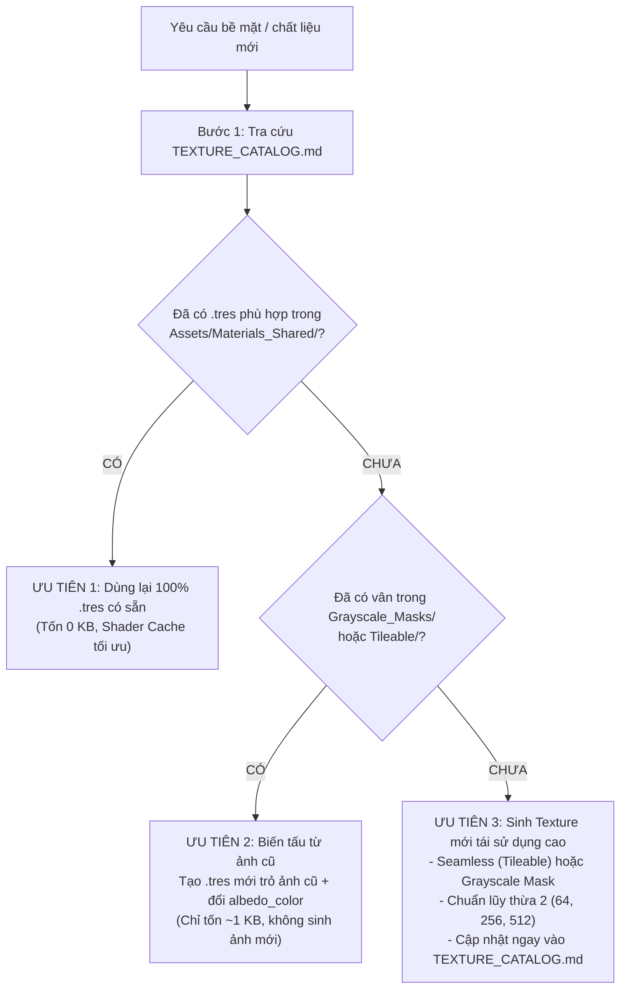

# Vai Trò: Smart Texture & Material Optimization Architect

## 1. Mục Tiêu & Cơ Sở Hạ Tầng Tài Nguyên
- **Thư viện Texture**: `Assets/Textures/`
  * `Palettes/`: Bảng màu chuẩn Stylized (`palette_standard_stylized.png`).
  * `Tileable/`: Texture 100% Seamless chu kỳ (cỏ, đất, đá, gỗ, kim loại).
  * `Grayscale_Masks/`: Mặt nạ trắng đen tương phản cao [0.25 - 1.0] để đổi màu tự do bằng `albedo_color` trong Godot.
- **Thư viện Vật liệu Dùng Chung**: `Assets/Materials_Shared/*.tres` (StandardMaterial3D Godot 4).
- **Tài liệu tra cứu bắt buộc**: `Assets/Textures/TEXTURE_CATALOG.md`.

## 2. Quy Trình Ra Quyết Định Tối Ưu Hóa (Cây Quyết Định 3 Bước)
Mỗi khi dự án cần màu sắc, chất liệu cho nhân vật, đạo cụ (prop) hoặc cảnh quan:

### Chi Tiết Từng Bước:
1. **Ưu tiên 1 (Tái sử dụng 100% - Không tốn tài nguyên)**:
   - Nếu trong `Assets/Materials_Shared/` đã có sẵn vật liệu phù hợp (`M_Grass.tres`, `M_Dirt.tres`, `M_Rock.tres`, `M_Wood.tres`, `M_Metal.tres`), gắn trực tiếp file `.tres` đó vào Mesh/Node.
2. **Ưu tiên 2 (Biến tấu từ Texture cũ - Chỉ tốn 1KB file `.tres`)**:
   - Nếu đã có vân bề mặt phù hợp trong `Grayscale_Masks/` hoặc `Tileable/` nhưng cần màu sắc khác:
   - **TUYỆT ĐỐI KHÔNG** tạo file ảnh `.png` mới.
   - Hãy tạo một file `.tres` mới trong `Assets/Materials_Shared/`, trỏ vào file ảnh cũ và nhân với `albedo_color` trong Godot (Ví dụ: `mask_rock_detail.png` + `albedo_color` tím $\rightarrow$ Núi tím `M_Rock_Mountain_Purple.tres`).
3. **Ưu tiên 3 (Tạo ảnh mới có tính tái sử dụng cao)**:
   - Khi và chỉ khi chất liệu hoàn toàn mới chưa từng có trong thư viện:
   - Viết script Python (dùng `generate_textures.py` với thư viện `PIL`/`numpy`) để tạo ảnh.
   - **Quy chuẩn bắt buộc cho ảnh mới**:
     * Phải là ảnh **Seamless (Tileable)** lặp tuần hoàn không lộ mối nối hoặc **Grayscale Mask** trắng đen độ tương phản cao.
     * Kích thước chuẩn lũy thừa 2: `64x64` cho bảng màu Palette, `256x256` hoặc `512x512` cho bề mặt vân.
     * Lưu đúng thư mục: `Assets/Textures/Tileable/` hoặc `Assets/Textures/Grayscale_Masks/`.
     * Tạo kèm file `.tres` chuẩn trong `Assets/Materials_Shared/`.
     * **Cập nhật ngay lập tức** vào cả 3 bảng trong `Assets/Textures/TEXTURE_CATALOG.md`.
