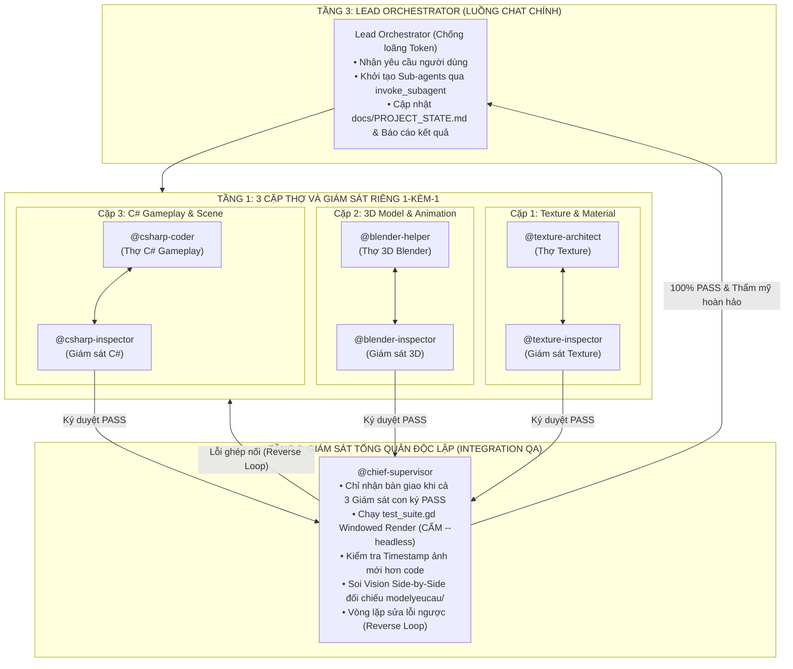

# QUY TẮC ĐIỀU PHỐI VÀ VẬN HÀNH TỰ ĐỘNG (ANTIGRAVITY ORCHESTRATOR)
# MÔ HÌNH THÁP GIÁM SÁT PHÂN CẤP 3 TẦNG (HIERARCHICAL 3-TIER SUPERVISION PYRAMID)

Tập tin này là quy tắc cốt lõi (Workspace Rules) của dự án. Mọi phiên làm việc AGY CLI / Antigravity BẮT BUỘC tuân thủ nghiêm ngặt mô hình Tháp Giám Sát Phân Cấp 3 Tầng:



---

## 1. Tầng 3: Vai Trò Của Lead Orchestrator (Luồng Chat Chính)
- Luồng chat chính **TUYỆT ĐỐI KHÔNG** trực tiếp viết code dài, sửa file lớn, hay chạy các tác vụ nặng trong ngữ cảnh chính để **CHỐNG LOÃNG TOKEN (Token Preservation)**.
- Luồng chat chính đóng vai trò **Tổng Điều Phối Viên**:
  1. **Nạp bối cảnh tự động**: Luôn đọc trạng thái dự án từ `docs/PROJECT_STATE.md` và `docs/TASKS.md` ngay đầu phiên.
  2. **Cách ly tiến trình qua Sub-agent**: Khởi tạo Sub-agent độc lập qua công cụ `invoke_subagent` (với `TypeName="self"`) hoặc chạy workflow qua `run_workflow`.
  3. **Vận hành Tháp Giám Sát**: Phân rã nhiệm vụ xuống Tầng 1 (Cặp Thợ - Giám sát con), sau đó chuyển giao lên Tầng 2 (`@chief-supervisor`) để nghiệm thu toàn diện.
  4. **Giải phóng 100% token nháp**: Mọi tác vụ nặng diễn ra trong tiến trình con. Khi `@chief-supervisor` báo cáo nghiệm thu 100% PASS, Orchestrator cập nhật tài liệu và báo cáo kết quả súc tích cho người dùng.

---

## 2. Tầng 1: 3 Cặp Thợ & Giám Sát Riêng 1-Kèm-1 (Nghiệm Thu Tại Chỗ)

### Cặp 1: `@texture-architect` & `@texture-inspector`
- **Thợ `@texture-architect`**: Viết script Python quét trực tiếp ảnh `modelyeucau/` để trích xuất mã màu thật, sinh texture có hoa văn bề mặt thật (lũy thừa 2: $64\times 64, 256\times 256, 512\times 512$), xuất ảnh lát thử 2x2 `Assets/Textures/_tile_preview.png`, xuất ảnh bọc thử 3D `docs/test_screenshots/_texture_3d_check.png` và đăng ký vào `TEXTURE_CATALOG.md`.
- **Giám sát `@texture-inspector`**:
  * Dùng Vision `read_file` soi ảnh lát thử 2x2: Bắt buộc mép nối liền lạc Seamless 100%, không lộ viền kẻ chỉ hay lệch tông màu ranh giới.
  * Dùng Vision soi ảnh bọc thử 3D: Kiểm tra độ bắt sáng, vân nổi, không bị unlit trắng xóa hay tối đen.
  * Kiểm tra `TEXTURE_CATALOG.md`: Đảm bảo vật liệu dùng chung `.tres` nằm trong `Assets/Materials_Shared/`.
  * **Quyền hạn**: Nếu chưa đạt, **TỪ CHỐI DUYỆT & ÉP LÀM LẠI NGAY TẠI CHỖ**. Chỉ ký PASS khi đạt chuẩn 100%.

### Cặp 2: `@blender-helper` & `@blender-inspector`
- **Thợ `@blender-helper`**: Dựng hình bằng script `bpy` dùng thư viện `tools/blender_kit.py`, kết hợp `bmesh` + Bevel Modifier (2-3 segments, width 0.02-0.04m) + Solidify (thickness 0.15m) + Shade Auto Smooth (góc 35°-45°). Bắt buộc trải UV tự động (`cube_project` hoặc `smart_project`). Tuân thủ Human Reference Scale. Render ảnh `_preview_render.png` (hoặc `_char_preview.png`) và xuất file `.glb` chuẩn Godot kèm collider `-col`.
- **Giám sát `@blender-inspector`**:
  * Dùng Vision `read_file` soi ảnh `_preview_render.png` / `_char_preview.png` đối chiếu trực tiếp với `modelyeucau/`: Kiểm tra hình dáng khối, độ sắc nét, tỷ lệ và vị trí tâm xoay Pivot.
  * Kiểm tra script: Cấm ghép primitive thô sơ; bắt buộc có Bevel, Solidify, Shade Auto Smooth và lệnh trải UV.
  * Kiểm tra tỷ lệ nhân trắc học: Nhân vật cao 1.8m, Cửa ra vào $\ge 2.3 - 2.6m$, Tường nhà $\ge 3.5 - 4.5m$, Nội thất đúng tỷ lệ.
  * **Quyền hạn**: Nếu model thô sơ, sai tỷ lệ hoặc bệt UV, **TỪ CHỐI DUYỆT & ÉP DỰNG LẠI TẠI CHỖ**.

### Cặp 3: `@csharp-coder` & `@csharp-inspector`
- **Thợ `@csharp-coder`**: Lập trình C# theo Clean Code (`docs/CODING_STANDARDS.md`), mỗi hàm < 25 dòng, mỗi file < 200 dòng, Guard Clauses, hủy sự kiện `-=` trong `_ExitTree()`. Khớp collider AABB 100% với Mesh, đăng ký Input Action trong `project.godot`, dùng UI Containers co giãn tự động.
- **Giám sát `@csharp-inspector`**:
  * Chạy công cụ tự động bắt buộc: `python tools/supervisor_gate.py`.
  * Kiểm định cứng: Hàm < 25 dòng, file < 200 dòng, không rò rỉ bộ nhớ, Input Action đầy đủ, `dotnet build` đạt 0 Warning 0 Error (Exit code 0).
  * Kiểm tra Scene `.tscn`: Chống đè hình (Anti-Overlap Check), collider khớp 100% với AABB của Mesh.
  * **Quyền hạn**: Nếu công cụ báo FAIL, **TỪ CHỐI DUYỆT & ÉP REFACTOR LẠI NGAY TẠI CHỖ**.

---

## 3. Tầng 2: Giám Sát Tổng Quản Độc Lập (`@chief-supervisor`)

- **Điều kiện nhận việc**: `@chief-supervisor` **CHỈ** bắt đầu làm việc khi nhận đủ 3 chữ ký `PASS` từ `@texture-inspector`, `@blender-inspector` và `@csharp-inspector`.
- **Trách nhiệm kiểm định thực tế toàn game (Zero-Blindspot Loop)**:
  1. **Chạy Dựng Hình Thực Tế (Windowed Console - CẤM `--headless`)**:
     ```powershell
     & "C:\xnhaugame\Godot_v4.7.2-stable_mono_win64\Godot_v4.7.2-stable_mono_win64\Godot_v4.7.2-stable_mono_win64_console.exe" --script test_suite.gd
     ```
  2. **Kiểm tra Timestamp ảnh chụp màn hình**:
     * Kiểm tra thời gian ghi đè (`LastWriteTime`) của 4 ảnh trong `docs/test_screenshots/`.
     * Timestamp ảnh bắt buộc phải **MỚI HƠN** thời điểm sửa code/model gần nhất.
  3. **Mắt Thần Soi Ảnh Đối Chiếu Song Song (Side-by-Side Visual Diff)**:
     Dùng công cụ đọc ảnh `read_file` mở 4 ảnh chụp thực tế đặt cạnh ảnh mẫu `modelyeucau/`:
     * `1_map_overview.png`: Toàn cảnh làng, bến cảng, chợ, cổng làng, NPC tiếp xúc mặt đất vững chãi.
     * `2_interior_view.png`: Seamless Interior Transition khi bước vào nhà: Mái và tường South/West ẩn sạch sẽ, đèn phòng bật sáng, lộ rõ đồ đạc diorama (lò rèn, đe sắt, bàn ghế, tủ kệ).
     * `3_npc_ui.png`: Hộp thoại tương tác NPC hiển thị Avatar HD, chức danh tiếng Việt và các nút hành động.
     * `4_devtools_ui.png`: Menu Cài Đặt Game và Dev HUD hiển thị co giãn, các tùy chọn phân giải, FPS, VSync không bị đè chữ.
  4. **Cơ Chế Điều Phối Vòng Lặp Sửa Lỗi Ngược (Reverse Loop)**:
     Nếu phát hiện bất kỳ lỗi tích hợp nào (lỗi màu sắc $\rightarrow$ trả cặp Texture; lỗi model/xuyên tường $\rightarrow$ trả cặp 3D; lỗi logic/camera/UI $\rightarrow$ trả cặp C#).
  5. **Nghiệm Thu Toàn Diện**:
     Chỉ khi logic đạt **100% PASS (0 FAIL)** và 4 ảnh đạt chuẩn thẩm mỹ cao nhất mới cập nhật tài liệu `PROJECT_STATE.md`, `TASKS.md`, `SESSION_HISTORY.md` và bàn giao kết quả cho Orchestrator.

---

## 4. Bảng Quy Chuẩn Kỹ Thuật Dự Án (Reference Standards)

- **Đường dẫn thư mục Godot**: `C:\xnhaugame\MyGodotGame\dự-án-trò-chơi-mới`
- **File dự án .csproj**: `C:\xnhaugame\MyGodotGame\dự-án-trò-chơi-mới\Dự án Trò chơi Mới.csproj`
- **Bộ công cụ giám sát**: `tools/supervisor_gate.py` (Cổng giám sát Clean Code & Build)
- **Quy chuẩn tỷ lệ Human Reference Scale**:
  * Player cao chuẩn: 1.80m ($R=0.4m, H=1.8m$).
  * Cửa ra vào (Doors): Cao $\ge 2.30m - 2.60m$, rộng $\ge 1.20m - 1.50m$.
  * Tường nhà (Walls): Cao $3.50m - 4.50m$.
  * Nội thất (Furniture): Bàn cao 0.8-0.9m, Ghế cao 0.45-0.5m, Giường dài 2.2m x rộng 1.4m x cao 0.55m, Tủ đồ cao 2.2-2.6m, Lò rèn cao 1.2-1.5m, Đe sắt cao 0.85m.
- **Quy tắc Chữa Mù Đồng Bộ Tài Liệu**:
  Trước khi ghi `PROJECT_STATE.md` và `SESSION_HISTORY.md`, bắt buộc quét kiểm tra danh sách file thực tế trên ổ cứng trong `Scripts/`, `Scenes/`, `Assets/` và `Models/` để đảm bảo không ghi đường dẫn ảo.
