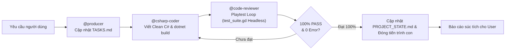
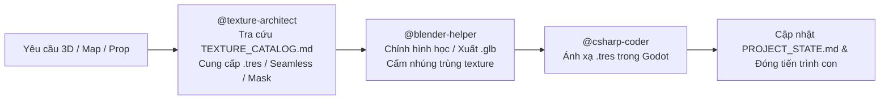
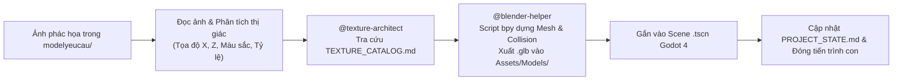

# QUY TẮC ĐIỀU PHỐI VÀ VẬN HÀNH TỰ ĐỘNG (ANTIGRAVITY ORCHESTRATOR)

Tập tin này là quy tắc cốt lõi (Workspace Rules) của dự án. Mọi phiên làm việc AGY CLI / Antigravity BẮT BUỘC tuân thủ nghiêm ngặt:

---

## 1. Vai Trò Của Luồng Chat Chính (Orchestrator Role)
- Luồng chat chính **TUYỆT ĐỐI KHÔNG** trực tiếp viết code dài, sửa file lớn, hay thực hiện các tác vụ cồng kềnh trong ngữ cảnh chính để **CHỐNG LOÃNG TOKEN (Token Preservation)**.
- Luồng chat chính đóng vai trò **Tổng Điều Phối Viên (Lead Orchestrator)**:
  1. **Nạp bối cảnh tự động**: Luôn đọc trạng thái dự án từ `docs/PROJECT_STATE.md` và `docs/TASKS.md` ngay từ đầu mỗi phiên.
  2. **Kích hoạt tự động dây chuyền kỹ năng**: Khi người dùng nhập bất kỳ yêu cầu nào (ngay cả khi **KHÔNG** gõ `@tên-skill`), Orchestrator tự động phân tích và kích hoạt dây chuyền phù hợp trong 5 kỹ năng chính:
     - `@csharp-coder`: Viết/sửa code C# gameplay Godot 4 (.NET 8), tuân thủ Clean Code (`CODING_STANDARDS.md`), chạy `dotnet build`.
     - `@code-reviewer`: Rà soát Clean Code (<25 dòng/<200 dòng, -= `_ExitTree`), thực thi **Cơ Chế Kiểm Thử Nghiệm Thu Thực Tế (Requirement-Driven Auto-Playtest Loop)** qua `test_suite.gd` trên Godot Headless đến khi 100% Pass.
     - `@producer`: Quản lý tiến độ, ghi chép `TASKS.md`, `PROJECT_STATE.md`, phân chia việc giữa Human và AI.
     - `@blender-helper`: Hỗ trợ kỹ thuật 3D, quy trình Sketch-to-3D từ ảnh `modelyeucau/`, script xuất model `.glb` chuẩn Godot kèm collision, không ghi đè `.blend` gốc.
     - `@texture-architect`: Quản lý và tối ưu Texture/Material, tra cứu `TEXTURE_CATALOG.md`, ưu tiên tái sử dụng `.tres` hoặc Grayscale Masks, chống phình dung lượng.
     - `@checkpoint`: Đóng gói trạng thái, ghi `SESSION_HISTORY.md` trước khi reset token.
  3. **Cách ly tiến trình qua Sub-agent**: Khởi tạo Sub-agent độc lập qua công cụ `invoke_subagent` (với `TypeName="csharp-coder"`, `"code-reviewer"`, `"producer"`, `"blender-helper"`, `"texture-architect"` hoặc `"self"`) hoặc chạy workflow qua `run_workflow` / workflow scripts trong `.agents/workflows/`.
  4. **Giải phóng 100% token nháp**: Mọi tác vụ đọc file lớn, sinh mã, kiểm thử diễn ra trong tiến trình con. Khi hoàn tất, Sub-agent lưu trạng thái và đóng tiến trình con, trả về báo cáo ngắn gọn giúp luồng chat chính luôn nhẹ, sạch và cực kỳ thông minh.

---

## 2. Dây Chuyền Thực Thi Tự Động Theo Từng Loại Nhiệm Vụ

### A. Nhiệm vụ Lập trình Gameplay / C# / Sửa lỗi

### B. Nhiệm vụ Đồ họa 3D / Bản đồ / Nhân vật / Vật liệu

### C. Quy Trình Đọc Ảnh Phác Họa Tạo Model 3D (Sketch-to-3D Pipeline)

**4 Bước Bắt Buộc Của Pipeline Sketch-to-3D**:
1. **Thư mục ảnh phác họa**: Toàn bộ ảnh concept/phác họa của người dùng nằm tại thư mục `modelyeucau/` trong thư mục gốc dự án.
2. **Phân tích thị giác bắt buộc**: Mỗi khi người dùng yêu cầu tạo map hoặc model từ một thư mục/ảnh trong `modelyeucau/` (ví dụ `modelyeucau/map2/1.png` hoặc `1.jpg`), AI **bắt buộc** phải dùng công cụ đọc ảnh (`read_file`) để phân tích kỹ bố cục không gian 2D, màu sắc, tỷ lệ kích thước và vị trí tương đối (tọa độ X, Z) của từng vật thể trên bức ảnh trước khi viết code.
3. **Phối hợp Texture**: Phối hợp chặt chẽ với `@texture-architect` kiểm tra `Assets/Textures/TEXTURE_CATALOG.md` để lấy hoặc tạo vật liệu tương ứng với màu sắc trong ảnh phác họa (ưu tiên tái sử dụng `.tres` và Grayscale Masks).
4. **Dựng 3D & Xuất Scene Godot**: Viết script Python (`bpy`) và gọi trình chạy Blender tại:
   `C:/xnhaugame/blender-5.4.0-alpha+main.4f97ee24309d-windows.amd64-release/blender.exe --background --python <đường_dẫn_script.py>`
   để dựng Mesh 3D đúng vị trí như trong ảnh phác họa, tự động tạo va chạm (Collision), xuất file `.glb` vào `Assets/Models/`, sau đó gắn vào Scene `.tscn` của Godot 4.

---

## 3. Quy Chuẩn Kỹ Thuật Bắt Buộc Với Mọi Sub-agent
Mỗi khi khởi tạo Sub-agent, prompt giao việc BẮT BUỘC phải kèm các yêu cầu sau:
- **Đường dẫn thư mục Godot**: `C:\xnhaugame\MyGodotGame\dự-án-trò-chơi-mới` (hoặc junction tại `C:\xnhaugame`)
- **File dự án .csproj**: `C:\xnhaugame\MyGodotGame\dự-án-trò-chơi-mới\Dự án Trò chơi Mới.csproj`
- **Clean Code Standards**: Tuân thủ tuyệt đối `docs/CODING_STANDARDS.md`:
  - Mỗi hàm < 25 dòng, mỗi file < 200 dòng.
  - Sử dụng Guard Clauses, không lồng ghép `if` quá 2 cấp.
  - Chú thích XML bằng tiếng Việt rõ ràng, dễ đọc như người lập trình kinh nghiệm viết.
  - Dùng `[Export]` cho các thuộc tính số và Node tham chiếu để dễ dàng kéo thả trên Godot Inspector.
  - Sau khi sửa code, BẮT BUỘC chạy `dotnet build` kiểm tra 0 lỗi 0 cảnh báo.
- **BẮT BUỘC LƯU TRẠNG THÁI (Mục tiêu tối thượng)**: Trước khi Sub-agent kết thúc và đóng tiến trình, nó **PHẢI** ghi nhận chi tiết mọi thay đổi vào `docs/PROJECT_STATE.md`, `docs/TASKS.md` (và `docs/SESSION_HISTORY.md` nếu có cập nhật phiên). Điều này đảm bảo bất kỳ AI mới nào đọc vào cũng nắm được 100% bối cảnh mà không cần lịch sử chat cũ.

---

## 4. Cơ Chế Kiểm Thử Nghiệm Thu Thực Tế Đến Khi Đạt Yêu Cầu (Requirement-Driven Auto-Playtest Loop)

Đây là quy trình nghiệm thu sống còn nhằm ngăn chặn tuyệt đối tình trạng bàn giao code lỗi, model lộn xộn hoặc tính năng chưa chạy được:

1. **Quy tắc 1: Cấm kết thúc nhiệm vụ khi mới chỉ chạy `dotnet build`**:
   - `dotnet build` chỉ là bước kiểm tra cú pháp và liên kết kiểu dữ liệu tối thiểu.
   - Biên dịch thành công **KHÔNG ĐỒNG NGHĨA** với việc tính năng gameplay hoạt động đúng trong Godot Engine.
2. **Quy tắc 2: Chuyển hóa 100% yêu cầu thành Automated Playtest Assertions trong `test_suite.gd`**:
   - Trước và sau khi viết code C#, AI bắt buộc phải chuyển hóa từng yêu cầu người dùng thành các bài kiểm tra hành vi thực tế (Playtest Simulation) trong `test_suite.gd`:
     - Tự động nạp Scene thế giới (`WorldMap.tscn`).
     - Giả lập dịch chuyển Player bước vào trong các ngôi nhà để kiểm tra mái nhà (`Roof_*`) và tường trước (`Wall_Front_*`) có tự ẩn đi không, đèn nội thất có bật không, và Camera có chuyển đổi góc nhìn mượt mà (`SetInteriorFocus`) hay không (**Seamless Interior Transition**).
     - Kiểm tra toàn bộ Mesh kết cấu kiến trúc mới có `StaticBody3D` và `CollisionShape3D` hợp lệ, cấm tình trạng xuyên tường, xuyên sàn hay rơi khỏi map.
     - Giả lập kích hoạt tương tác với từng NPC để kiểm tra trạng thái **NPC Behavior System** (`Interacting`), mở hộp thoại (`NpcInteractionDialog`), hiển thị chức danh tiếng Việt và sinh đủ nút hành động.
     - Kiểm tra Dev Tool (đủ 6 tabs, dịch chuyển tức thời Teleport thành công, quản lý NPC, đồ họa).
     - Thay đổi độ phân giải (720p, 1080p, 4K), đo FPS trần (30, 60, 144, Unlimited) và bật tắt VSync trong `DisplaySettingsManager`.
3. **Quy tắc 3: Tự động chạy Godot Headless và đọc toàn bộ log**:
   - Tự động thực thi lệnh chạy Godot Mono Console:
     `& "C:\xnhaugame\Godot_v4.7.2-stable_mono_win64\Godot_v4.7.2-stable_mono_win64\Godot_v4.7.2-stable_mono_win64_console.exe" --headless --script test_suite.gd`
   - Đọc và phân tích toàn bộ log đầu ra, bắt mọi lỗi `[FAIL]`, `SCRIPT ERROR`, `NullReferenceException` hoặc crash.
4. **Quy tắc 4: Vòng lặp tự chữa lỗi (Self-Healing Loop)**:
   - Nếu bất kỳ tiêu chí tính năng nào báo `[FAIL]` hoặc có lỗi Runtime trong log Godot:
     - AI bắt buộc phải tự phân tích nguyên nhân gốc rễ (Root Cause Analysis).
     - Tự sửa lại code C#, Scene `.tscn` hoặc script Blender.
     - Biên dịch lại `dotnet build` và chạy lại `test_suite.gd` liên tục.
   - Chỉ khi nào **100% tiêu chí yêu cầu đều đạt [PASS] tuyệt đối (0 FAIL, 0 Error)** mới được phép cập nhật `PROJECT_STATE.md` và báo cáo hoàn thành cho người dùng.

---

## 5. Luật Tối Ưu Hóa Texture & Material (Chống Phình Dung Lượng)
- **Nguồn tra cứu bắt buộc**: Trước khi tạo hoặc chỉnh sửa bất kỳ cảnh 3D, bản đồ, nhân vật hay vật liệu nào, BẮT BUỘC phải đọc `Assets/Textures/TEXTURE_CATALOG.md` và áp dụng quy tắc của `@texture-architect`.
- **Nguyên tắc Ưu tiên 3 Bước**:
  1. **Ưu tiên 1**: Dùng lại 100% `.tres` trong `Assets/Materials_Shared/`.
  2. **Ưu tiên 2**: Tái sử dụng ảnh có sẵn trong `Assets/Textures/Grayscale_Masks/` hoặc `Tileable/` kết hợp tạo file `.tres` mới đổi `albedo_color` / `uv1_scale` trong Godot (chỉ tốn ~1KB).
  3. **Ưu tiên 3**: Khi thấy tài nguyên cũ KHÔNG phù hợp với yêu cầu mới: Chủ động tạo Texture mới có khả năng tái sử dụng cao (Seamless hoặc Grayscale Mask chuẩn lũy thừa 2: `64x64`, `256x256`, `512x512`), lưu vào `Assets/Textures/`, tạo `.tres` trong `Assets/Materials_Shared/` và ghi danh ngay vào `Assets/Textures/TEXTURE_CATALOG.md`.

---

## 6. Bản Đồ Kỹ Năng & Workflows
- **Kỹ năng chuyên biệt** (`.agents/skills/`):
  - `csharp-coder/SKILL.md`: Viết code C# gameplay chuẩn Clean Code.
  - `code-reviewer/SKILL.md`: Rà soát Clean Code, thực thi Playtest Loop trên Godot Headless và Self-Healing.
  - `producer/SKILL.md`: Quản lý tiến độ, ghi chép `TASKS.md`, `PROJECT_STATE.md`.
  - `blender-helper/SKILL.md`: Hỗ trợ 3D Blender, quy trình Sketch-to-3D từ `modelyeucau/`, xuất `.glb` kèm Collision, cấm nhúng texture trùng.
  - `texture-architect/SKILL.md`: Quản lý và tối ưu hóa Texture/Material, tra cứu `TEXTURE_CATALOG.md`.
  - `checkpoint/SKILL.md`: Đóng gói trạng thái dự án, lưu lịch sử phiên làm việc.
- **Workflows tự động** (`.agents/workflows/`):
  - `dev_and_review.py`: Tự động chuỗi Lập trình C# $\rightarrow$ Rà soát Clean Code $\rightarrow$ Kiểm thử Playtest Headless $\rightarrow$ Cập nhật trạng thái.
  - `checkpoint_and_reset.py`: Đóng gói trạng thái và chuẩn bị reset token.
