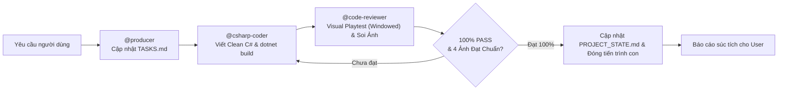
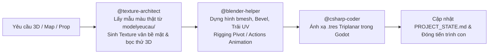
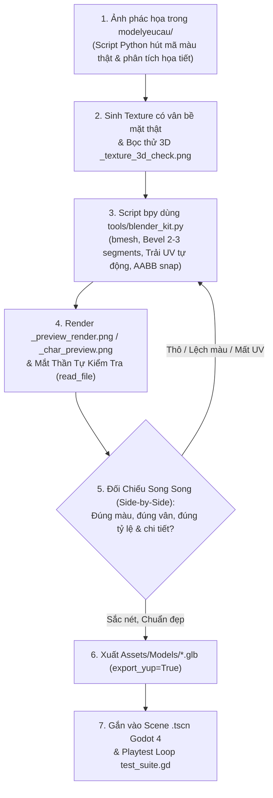

# QUY TẮC ĐIỀU PHỐI VÀ VẬN HÀNH TỰ ĐỘNG (ANTIGRAVITY ORCHESTRATOR)

Tập tin này là quy tắc cốt lõi (Workspace Rules) của dự án. Mọi phiên làm việc AGY CLI / Antigravity BẮT BUỘC tuân thủ nghiêm ngặt:

---

## 1. Vai Trò Của Luồng Chat Chính (Orchestrator Role)
- Luồng chat chính **TUYỆT ĐỐI KHÔNG** trực tiếp viết code dài, sửa file lớn, hay thực hiện các tác vụ cồng kềnh trong ngữ cảnh chính để **CHỐNG LOÃNG TOKEN (Token Preservation)**.
- Luồng chat chính đóng vai trò **Tổng Điều Phối Viên (Lead Orchestrator)**:
  1. **Nạp bối cảnh tự động**: Luôn đọc trạng thái dự án từ `docs/PROJECT_STATE.md` và `docs/TASKS.md` ngay từ đầu mỗi phiên.
  2. **Kích hoạt tự động dây chuyền kỹ năng**: Khi người dùng nhập bất kỳ yêu cầu nào (ngay cả khi **KHÔNG** gõ `@tên-skill`), Orchestrator tự động phân tích và kích hoạt dây chuyền phù hợp trong 5 kỹ năng chính:
     - `@csharp-coder`: Viết/sửa code C# gameplay Godot 4 (.NET 8), tuân thủ Clean Code (`CODING_STANDARDS.md`), tính toán AABB chống đè hình, đăng ký Input trong `project.godot`, dùng UI Containers, chạy `dotnet build`.
     - `@code-reviewer`: Rà soát Clean Code (<25 dòng/<200 dòng, -= `_ExitTree`), thực thi **Cơ Chế Kiểm Thử Thị Giác Thực Tế (Visual Playtest & Screenshot Inspection Loop)** qua `test_suite.gd` trên Godot Windowed (không dùng `--headless`), tự soi 4 ảnh chụp màn hình đến khi 100% Pass và thẩm mỹ hoàn hảo.
     - `@producer`: Quản lý tiến độ, ghi chép `TASKS.md`, `PROJECT_STATE.md`, quét kiểm tra tệp tin thực tế trên ổ cứng trước khi ghi tài liệu, phân chia việc giữa Human và AI.
     - `@blender-helper`: Hỗ trợ kỹ thuật 3D, tuân thủ Human Reference Scale (Người 1.8m, Cửa 2.3-2.6m, Tường 3.5-4.5m), quy trình Sketch-to-3D từ ảnh `modelyeucau/`, trải UV tự động (`cube_project`/`smart_project`), quy chuẩn dựng nhân vật & animation (Character & Rigging Pipeline), xuất model `.glb` chuẩn Godot kèm collision, không ghi đè `.blend` gốc.
     - `@texture-architect`: Quản lý và tối ưu Texture/Material, tra cứu `TEXTURE_CATALOG.md`, viết Python quét ảnh `modelyeucau/` lấy mẫu màu thật & sinh họa tiết bề mặt (vân gỗ, thớ đá, bạt sọc, gạch ngói), xuất ảnh lát thử 2x2 `_tile_preview.png`, xuất ảnh bọc thử 3D `_texture_3d_check.png` và đối chiếu song song với ảnh gốc.
     - `@checkpoint`: Đóng gói trạng thái, ghi `SESSION_HISTORY.md` trước khi reset token.
  3. **Cách ly tiến trình qua Sub-agent**: Khởi tạo Sub-agent độc lập qua công cụ `invoke_subagent` (với `TypeName="self"`) hoặc chạy workflow qua `run_workflow` / workflow scripts trong `.agents/workflows/`.
  4. **Giải phóng 100% token nháp**: Mọi tác vụ đọc file lớn, sinh mã, kiểm thử diễn ra trong tiến trình con. Khi hoàn tất, Sub-agent lưu trạng thái và đóng tiến trình con, trả về báo cáo ngắn gọn giúp luồng chat chính luôn nhẹ, sạch và cực kỳ thông minh.

---

## 2. Dây Chuyền Thực Thi Tự Động Theo Từng Loại Nhiệm Vụ

### A. Nhiệm vụ Lập trình Gameplay / C# / Sửa lỗi

### B. Nhiệm vụ Đồ họa 3D / Bản đồ / Nhân vật / Vật liệu

### C. Quy Trình Đọc Ảnh Phác Họa Tạo Model 3D (Sketch-to-3D & Procedural Pipeline)

**4 Quy Tắc Dựng Hình Bắt Buộc Để Khắc Phục Triệt Để Tình Trạng Model Thô Kệch**:
1. **CẤM DỰNG KHỐI THÔ SƠ (No Raw Primitives)**:
   - Cấm chỉ ghép các khối Cube/Cylinder/Sphere nguyên bản thô cứng.
   - Mọi script Python (`bpy`) bắt buộc phải sử dụng `bmesh` (Extrude, Inset, Bevel, Subdivide, Vertex Displace) kết hợp với Blender Modifiers:
     - `Bevel Modifier` (2 - 3 segments, width 0.02 - 0.04m, limit Angle 30°) để bo viền bắt sáng (edge highlight).
     - `Solidify Modifier` (thickness 0.15m) cho tường/mái/ván có độ dày thực tế.
     - `Displace / Noise` cho địa hình, đá núi, tán cây để tạo vẻ tự nhiên.
     - Bật `Shade Auto Smooth` (góc 35° - 45°) trên toàn bộ bề mặt cong.
2. **XÂY DỰNG & TÁI SỬ DỤNG THƯ VIỆN PROCEDURAL CHUẨN (`tools/blender_kit.py`)**:
   - Mọi script dựng hình bắt buộc phải `import` từ thư viện dùng chung `tools/blender_kit.py`.
   - Sử dụng các hàm dựng sẵn có tham số hóa cao: nhà cửa có khung tường-cửa sổ-mái hiên chìa ra ngoài (`overhang`), cây cối đa tầng tán, đá vát cạnh Low-Poly, đường đi, giếng nước, lò rèn, xe hàng.
   - Bắt buộc dùng các hàm tự động căn chỉnh AABB: `snap_to_ground` và `stack_on_top` để đảm bảo không bao giờ có chi tiết bị bay lơ lửng hay đâm xuyên lỗi.
3. **CƠ CHẾ MẮT THẦN TỰ KIỂM TRA (Visual Self-Correction Loop)**:
   - Cuối mỗi script Blender, bắt buộc phải tự động thiết lập Camera Isometric + Sun Light và render nhanh Workbench/EEVEE xuất ra file ảnh:
     `Assets/Models/_preview_render.png` (cho map/prop) hoặc `Assets/Models/_char_preview.png` (cho nhân vật/NPC).
   - Sau khi chạy lệnh Blender CLI:
     `C:/xnhaugame/blender-5.4.0-alpha+main.4f97ee24309d-windows.amd64-release/blender-5.4.0-alpha+main.4f97ee24309d-windows.amd64-release/blender.exe --background --python <script.py>`
     AI **bắt buộc** phải dùng công cụ đọc ảnh (`read_file`) để trực tiếp xem file ảnh render và đối chiếu song song với ảnh phác họa trong `modelyeucau/`.
4. **VÒNG LẶP CHẤT LƯỢNG**:
   - Nếu nhìn ảnh render thấy model bị thô kệch, sai tỷ lệ, lệch tâm, sai màu, bệt UV hoặc thiếu chi tiết, AI tuyệt đối không được dừng lại mà phải tự chỉnh sửa script Python và render kiểm tra lại cho đến khi hình dáng 3D sắc nét, cân đối mới được phép đưa vào Scene `.tscn` của Godot.

---

## 3. Quy Chuẩn Kỹ Thuật & Bộ 4 Quy Tắc Xóa Bỏ Điểm Mù (Zero-Blindspot Protocol)

Mọi Sub-agent khi thực thi nhiệm vụ BẮT BUỘC tuân thủ tuyệt đối các quy tắc xóa bỏ điểm mù sau:

1. **Chữa mù cho `@texture-architect` (Trích Xuất Màu Thật, Lát Thử 2x2 & Bọc Thử 3D)**:
   - **Trích xuất bảng màu thật**: Cấm đoán mò RGB hay tô màu trơn phẳng. Bắt buộc viết script Python quét trực tiếp file ảnh trong `modelyeucau/` để lấy mẫu màu Hex/RGB chuẩn của từng phân khu (đất, cỏ, đá, gỗ, mái ngói, bạt sọc, lá cây) và sinh Texture có đầy đủ họa tiết bề mặt (vân gỗ, thớ đá, gân lá, gạch lát).
   - **Lát thử 2x2**: Xuất ảnh lát thử 2x2 (`Assets/Textures/_tile_preview.png`) ghép từ 4 ô texture gốc, dùng `read_file` tự soi mép nối Seamless 100%.
   - **Bọc thử lên khối 3D**: Bắt buộc xuất ảnh chụp khi vật liệu đã bọc lên khối 3D (`docs/test_screenshots/_texture_3d_check.png`) để kiểm tra độ bắt sáng và hiển thị vân nổi.
   - **Đối chiếu song song (Side-by-Side Visual Diff)**: Mở song song ảnh gốc `modelyeucau/` và ảnh chụp màn hình trong game để đối chiếu màu sắc, triệt tiêu mọi vật thể bị bệt màu hoặc trắng xóa unlit.

2. **Chữa mù không gian, va chạm, phím bấm và UI cho `@csharp-coder`**:
   - **Chống đè hình bằng AABB (Anti-Overlap Check)**: Khi đặt các vật thể (nhà cửa, cây cối, NPC) vào Scene `.tscn`, cấm đoán mò tọa độ mà bắt buộc phải tính toán khung bao AABB thực tế của Mesh để đảm bảo khoảng cách giữa các công trình/vật thể không giao cắt hay chèn lấn nhau.
   - **Khớp Collider 100% với AABB**: Kích thước và tâm của `CollisionShape3D` dạng `BoxShape3D` phải khớp chuẩn xác 100% với AABB của Mesh (`Size = aabb.Size`, `Position = aabb.Position + aabb.Size / 2.0f`).
   - **Đăng ký Input Action**: Khi dùng bất kỳ Input Action nào trong C# (`Input.IsActionPressed`, `Input.GetVector`...), bắt buộc phải kiểm tra và đăng ký phím đó trong file `project.godot` trước.
   - **Thiết kế UI Co Giãn Tự Động**: Cấm gán chết tọa độ pixel cứng; bắt buộc dùng hệ thống Container (`VBoxContainer`, `HBoxContainer`, `PanelContainer`, `MarginContainer`) và Anchor của Godot để tự động co giãn đẹp mắt ở mọi độ phân giải từ 720p đến 4K.

3. **Chữa mù tỷ lệ kích thước & trải UV cho `@blender-helper`**:
   - **Human Reference Scale**: Mọi script dựng hình Blender bắt buộc phải tuân thủ quy ước:
     * **Nhân vật cao chuẩn**: 1.80m (Player Capsule $R=0.4m, H=1.8m$).
     * **Cửa ra vào (Doors)**: Cao tối thiểu 2.30m - 2.60m, rộng 1.20m - 1.50m.
     * **Tường nhà (Walls)**: Cao 3.50m - 4.50m.
     * **Nội thất (Furniture)**: Bàn ăn cao 0.8-0.9m, Ghế ngồi cao 0.45-0.5m, Giường dài 2.2m x rộng 1.4m x cao 0.55m, Tủ đồ cao 2.2-2.6m, Lò rèn cao 1.2-1.5m, Đe sắt cao 0.85m.
     * **Cây cối (Trees)**: Cây nhỏ cao 4.0-5.5m, Cây lớn cao 6.5-9.0m.
   - **Trải UV tự động bắt buộc**: Mọi Mesh tạo ra phải chạy `bpy.ops.uv.cube_project(cube_size=1.0)` hoặc `bpy.ops.uv.smart_project()`. Cấm xuất Mesh thiếu UV.
   - **Triplanar Mapping trong Godot**: Các file `.tres` dùng cho bề mặt địa hình/kiến trúc lớn phải bật `uv1_triplanar = true` để vân không bị méo.

4. **Chữa mù đồng bộ tài liệu cho `@producer` (Xác Thực Ổ Cứng Thực Tế)**:
   - Trước khi ghi `PROJECT_STATE.md` và `SESSION_HISTORY.md` cuối mỗi nhiệm vụ, bắt buộc phải quét kiểm tra danh sách file thực tế trong `Scripts/`, `Scenes/`, `Assets/` và `Models/` trên ổ cứng (dùng công cụ filesystem thực tế) để đảm bảo không bao giờ ghi sai tên file hay đường dẫn ảo.

- **Đường dẫn thư mục Godot**: `C:\xnhaugame\MyGodotGame\dự-án-trò-chơi-mới` (hoặc junction tại `C:\xnhaugame`)
- **File dự án .csproj**: `C:\xnhaugame\MyGodotGame\dự-án-trò-chơi-mới\Dự án Trò chơi Mới.csproj`
- **Clean Code Standards**: Tuân thủ tuyệt đối `docs/CODING_STANDARDS.md`:
  - Mỗi hàm < 25 dòng, mỗi file < 200 dòng.
  - Sử dụng Guard Clauses, không lồng ghép `if` quá 2 cấp.
  - Chú thích XML bằng tiếng Việt rõ ràng, dễ đọc như người lập trình kinh nghiệm viết.
  - Dùng `[Export]` cho các thuộc tính số và Node tham chiếu để dễ dàng kéo thả trên Godot Inspector.
  - Sau khi sửa code, BẮT BUỘC chạy `dotnet build` kiểm tra 0 lỗi 0 cảnh báo.
- **BẮT BUỘC LƯU TRẠNG THÁI**: Trước khi Sub-agent kết thúc và đóng tiến trình, nó **PHẢI** ghi nhận chi tiết mọi thay đổi vào `docs/PROJECT_STATE.md`, `docs/TASKS.md` và `docs/SESSION_HISTORY.md`.

---

## 4. Cơ Chế Kiểm Thử Thị Giác Thực Tế & Nghiệm Thu Tự Động (Visual Playtest & Screenshot Inspection Loop)

Xóa bỏ hoàn toàn tình trạng "kiểm thử mù trong bóng tối (--headless)" bằng quy trình 4 bước bắt buộc:

1. **Bước 1: Chạy Dựng Hình Thực Tế (Windowed Rendering - CẤM dùng cờ `--headless`) & Tự Động Chụp Ảnh Màn Hình**:
   - Ngoài việc kiểm tra thông số logic, kịch bản `test_suite.gd` bắt buộc phải chạy ở chế độ có dựng hình thực tế (Windowed Rendering) bằng trình chạy Godot Mono Console:
     `& "C:\xnhaugame\Godot_v4.7.2-stable_mono_win64\Godot_v4.7.2-stable_mono_win64\Godot_v4.7.2-stable_mono_win64_console.exe" --script test_suite.gd`
   - Kịch bản tự động điều khiển nhân vật đi qua các tính năng vừa code, đợi khung hình ổn định và dùng lệnh `get_viewport().get_texture().get_image().save_png()` chụp lại 4 bức ảnh màn hình thực tế lưu vào thư mục `docs/test_screenshots/`:
     - `1_map_overview.png`: Khi ở ngoài trời (toàn cảnh 2 map nối liền, con đường đất, cổng làng, khu chợ, NPC).
     - `2_interior_view.png`: Khi nhân vật đứng bên trong nhà (Seamless Interior Transition: mái và tường South/West ẩn sạch sẽ, đèn phòng bật sáng, nhân vật và nội thất rõ ràng không bị che khuất).
     - `3_npc_ui.png`: Khi đang tương tác với NPC dân làng (hộp thoại `NpcInteractionDialog` popup ở trung tâm, hiển thị chức danh tiếng Việt, câu chào và các nút hành động đặc biệt).
     - `4_devtools_ui.png`: Khi bật Dev Tool (DevOverlay HUD) và đổi cấu hình độ phân giải / đồ họa.

2. **Bước 2: Mắt Thần Tự Soi Ảnh & Đối Chiếu Song Song (Visual Inspection via `read_file`)**:
   - Sau khi chụp xong, AI **BẮT BUỘC** phải dùng công cụ đọc ảnh (`read_file`) mở từng bức ảnh trong `docs/test_screenshots/` lên đồng thời đối chiếu với ảnh gốc trong `modelyeucau/`:
     - **Tông màu & Họa tiết**: Có khớp với ảnh mẫu không, có chi tiết nào bị trơn phẳng đơn điệu hay mất UV không?
     - **Góc nhìn nội thất**: Khi vào trong nhà, tường và mái có thực sự ẩn đi để nhìn rõ nhân vật và đồ đạc bên trong không?
     - **Tiếp xúc mặt đất**: Nhân vật có đứng vững trên mặt sàn/đất không, có bị lún chân xuống đất hay bay lơ lửng không?
     - **Bố cục giao diện UI**: Bảng Dev Tool, hộp thoại NPC có bị tràn viền màn hình, vỡ khung hay đè chữ lên nhau không?

3. **Bước 3: Vòng Lặp Tự Sửa Lỗi Thị Giác (Visual Self-Healing Loop)**:
   - Nếu nhìn ảnh phát hiện bất kỳ lỗi hiển thị, vỡ màu, mất UV, che khuất camera hay vỡ bố cục UI nào (dù log code báo PASS):
     - AI tuyệt đối không được dừng lại mà phải tự sửa code C#, Scene `.tscn`, Texture hoặc script Blender.
     - Biên dịch lại `dotnet build` và chạy lại `test_suite.gd` để chụp lại bộ ảnh mới.
     - Tiếp tục soi ảnh cho đến khi toàn bộ 4 bức ảnh đều đạt chất lượng thẩm mỹ cao, cân đối, sắc nét.

4. **Bước 4: Nghiệm Thu Hoàn Toàn Diện**:
   - Chỉ khi cả thông số logic (100% PASS, 0 Error) lẫn 4 hình ảnh chụp màn hình thực tế đều đạt yêu cầu 100% mới được phép cập nhật `PROJECT_STATE.md`, `TASKS.md` và báo cáo hoàn thành cho người dùng.

---

## 5. Quy Chuẩn Dựng Nhân Vật 3D & Animation (Character & Rigging Pipeline)

Mỗi khi người dùng yêu cầu tạo Nhân vật chính (Player), NPC dân làng hoặc Quái vật từ ảnh trong `modelyeucau/`, AI bắt buộc phải tuân thủ nghiêm ngặt 4 bước:

1. **Dựng các bộ phận cơ thể tách biệt (Modular Body Hierarchy)**:
   - Dựng tách bạch: `Head`, `Torso`, `Arm_L`, `Arm_R`, `Leg_L`, `Leg_R`, và các điểm gắn đạo cụ/vũ khí `Weapon_Slot`.
   - **Tâm xoay (Origin / Pivot Point) bắt buộc**: Khớp vai đặt tại đỉnh xương vai, Khớp háng đặt tại đỉnh xương đùi tiếp giáp thân dưới, Khớp cổ đặt tại đáy hộp sọ tiếp giáp thân trên (hoặc thiết lập xương Armature chuẩn).
2. **Bo tròn Stylized & Hút màu Texture thật từ ảnh mẫu**:
   - Dùng `bmesh` bo tròn các góc cạnh để tạo phong cách hoạt họa mềm mại.
   - Viết script Python lấy mẫu màu pixel trực tiếp từ ảnh nhân vật trong `modelyeucau/` để tạo texture trang phục, tóc, áo giáp, vũ khí và trải UV mặt nhân vật (`character_face.png`).
3. **Tạo sẵn các Action Animation cơ bản**:
   - Trong Blender, tạo sẵn tối thiểu 4 Action chuyển động: `Idle` (nhịp thở nhấp nhô), `Walk` (vung tay so le bước chân), `Run` (ngả người sải chân nhanh), `Attack`/`Work` (thao tác đập búa, cuốc đất, vung rìu, đâm giáo).
   - Xuất đầy đủ tracks animation vào file `.glb`.
4. **Kiểm tra Mắt Thần Nhân Vật (`_char_preview.png`)**:
   - Render ảnh góc chính diện và góc nghiêng $3/4$ ra file `Assets/Models/_char_preview.png`.
   - Dùng `read_file` tự đối chiếu: Đảm bảo chiều cao chuẩn 1.80m, tỷ lệ cân đối, trang phục và đạo cụ khớp 100% với ảnh mẫu trong `modelyeucau/` trước khi tích hợp vào Scene của Godot.

---

## 6. Luật Tối Ưu Hóa Texture & Material (Chống Phình Dung Lượng & Bọc Texture Mù)
- **Nguồn tra cứu bắt buộc**: Trước khi tạo hoặc chỉnh sửa bất kỳ cảnh 3D, bản đồ, nhân vật hay vật liệu nào, BẮT BUỘC phải đọc `Assets/Textures/TEXTURE_CATALOG.md` và áp dụng quy tắc của `@texture-architect`.
- **Nguyên tắc Ưu tiên 3 Bước**:
  1. **Ưu tiên 1**: Dùng lại 100% `.tres` trong `Assets/Materials_Shared/`.
  2. **Ưu tiên 2**: Tái sử dụng ảnh có sẵn trong `Assets/Textures/Grayscale_Masks/` hoặc `Tileable/` kết hợp tạo file `.tres` mới đổi `albedo_color` / `uv1_scale` trong Godot (chỉ tốn ~1KB).
  3. **Ưu tiên 3**: Khi thấy tài nguyên cũ KHÔNG phù hợp với yêu cầu mới:
     - Viết script Python lấy mẫu màu thật từ ảnh `modelyeucau/`.
     - Sinh Texture có họa tiết vân bề mặt thật (chuẩn lũy thừa 2: `64x64`, `256x256`, `512x512`).
     - Lát thử 2x2 `_tile_preview.png` và bọc thử 3D `_texture_3d_check.png`.
     - Lưu vào `Assets/Textures/`, tạo `.tres` trong `Assets/Materials_Shared/` và ghi danh ngay vào `Assets/Textures/TEXTURE_CATALOG.md`.
