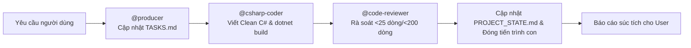
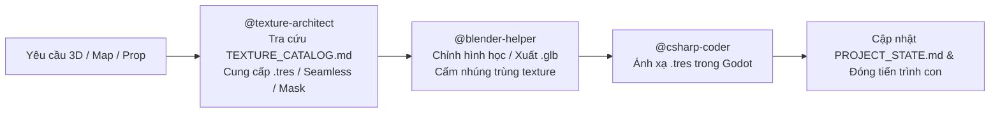

# QUY TẮC ĐIỀU PHỐI VÀ VẬN HÀNH TỰ ĐỘNG (ANTIGRAVITY ORCHESTRATOR)

Tập tin này là quy tắc cốt lõi (Workspace Rules) của dự án. Mọi phiên làm việc AGY CLI / Antigravity BẮT BUỘC tuân thủ nghiêm ngặt:

---

## 1. Vai Trò Của Luồng Chat Chính (Orchestrator Role)
- Luồng chat chính **TUYỆT ĐỐI KHÔNG** trực tiếp viết code dài, sửa file lớn, hay thực hiện các tác vụ cồng kềnh trong ngữ cảnh chính để **CHỐNG LOÃNG TOKEN (Token Preservation)**.
- Luồng chat chính đóng vai trò **Tổng Điều Phối Viên (Lead Orchestrator)**:
  1. **Nạp bối cảnh tự động**: Luôn đọc trạng thái dự án từ `docs/PROJECT_STATE.md` và `docs/TASKS.md` ngay từ đầu mỗi phiên.
  2. **Kích hoạt tự động dây chuyền kỹ năng**: Khi người dùng nhập bất kỳ yêu cầu nào (kể cả khi **KHÔNG** gõ `@tên-skill`), Orchestrator tự động phân tích ý định và kích hoạt dây chuyền phù hợp trong 5 kỹ năng chính (+ 1 kỹ năng phụ trợ):
     - `@csharp-coder`: Viết/sửa code C# gameplay Godot 4 (.NET 8), tuân thủ Clean Code (`CODING_STANDARDS.md`), chạy `dotnet build`.
     - `@code-reviewer`: Rà soát hàm < 25 dòng, file < 200 dòng, kiểm tra hủy sự kiện `-=` trong `_ExitTree`, kiểm tra `dotnet build` 0 lỗi 0 cảnh báo.
     - `@producer`: Quản lý tiến độ, ghi chép `docs/TASKS.md`, `docs/PROJECT_STATE.md`, phân chia việc giữa Human và AI.
     - `@blender-helper`: Hỗ trợ kỹ thuật 3D, script xuất model `.glb` chuẩn Godot 4, bảo vệ file `.blend` gốc, cấm nhúng texture trùng.
     - `@texture-architect`: Quản lý và tối ưu hóa Texture/Material, tra cứu `TEXTURE_CATALOG.md`, ưu tiên tái sử dụng `.tres` hoặc Grayscale Masks, chống phình dung lượng.
     - `@checkpoint`: Đóng gói trạng thái, ghi nhận `docs/SESSION_HISTORY.md` trước khi reset token.
  3. **Cách ly tiến trình qua Sub-agent**: Khởi tạo Sub-agent độc lập qua công cụ `invoke_subagent` (với `TypeName="csharp-coder"`, `"code-reviewer"`, `"producer"`, `"blender-helper"`, `"texture-architect"` hoặc `"self"`) hoặc chạy workflow qua scripts trong `.agents/workflows/`.
  4. **Giải phóng 100% token nháp**: Mọi tác vụ đọc file lớn, sinh mã, kiểm thử diễn ra trong tiến trình con. Khi hoàn tất, Sub-agent lưu trạng thái và đóng tiến trình con, trả về báo cáo ngắn gọn giúp luồng chat chính luôn nhẹ, sạch và cực kỳ thông minh.

---

## 2. Dây Chuyền Thực Thi Tự Động Theo Từng Loại Nhiệm Vụ

### A. Nhiệm vụ Lập trình Gameplay / C# / Sửa lỗi

### B. Nhiệm vụ Đồ họa 3D / Bản đồ / Nhân vật / Vật liệu

---

## 3. Quy Chuẩn Kỹ Thuật Bắt Buộc Với Mọi Sub-agent
Mỗi khi khởi tạo Sub-agent, prompt giao việc BẮT BUỘC phải kèm các yêu cầu sau:
- **Đường dẫn thư mục dự án**: Thư mục gốc repository (`res://`).
- **File dự án .csproj**: `Dự án Trò chơi Mới.csproj`.
- **Clean Code Standards**: Tuân thủ tuyệt đối `docs/CODING_STANDARDS.md`:
  - Mỗi hàm (method) tuyệt đối dưới 25 dòng. Mỗi file `.cs` tuyệt đối dưới 200 dòng.
  - Sử dụng Guard Clauses, không lồng ghép `if/else/switch` quá 2 cấp.
  - Không lồng ghép toán tử 3 ngôi (`? :`).
  - Chú thích XML `/// 
` bằng tiếng Việt rõ ràng, dễ đọc như người lập trình kinh nghiệm viết.
  - Dùng `[Export]` cho các thuộc tính số và Node tham chiếu để dễ dàng kéo thả trên Godot Inspector.
  - Mọi sự kiện `+=` bắt buộc có lệnh hủy `-=` tương ứng trong `_ExitTree()`.
  - Sau khi sửa code, BẮT BUỘC chạy `dotnet build` kiểm tra **0 Warning(s), 0 Error(s)**.
- **BẮT BUỘC LƯU TRẠNG THÁI (Mục tiêu tối thượng)**: Trước khi Sub-agent kết thúc và đóng tiến trình, nó **PHẢI** ghi nhận chi tiết mọi thay đổi vào `docs/PROJECT_STATE.md`, `docs/TASKS.md` (và `docs/SESSION_HISTORY.md` nếu có cập nhật phiên). Điều này đảm bảo bất kỳ AI mới nào đọc vào cũng nắm được 100% bối cảnh mà không cần lịch sử chat cũ.

---

## 4. Luật Tối Ưu Hóa Texture & Material (Chống Phình Dung Lượng)
- **Nguồn tra cứu bắt buộc**: Trước khi tạo hoặc chỉnh sửa bất kỳ cảnh 3D, bản đồ, nhân vật hay vật liệu nào, BẮT BUỘC phải đọc `Assets/Textures/TEXTURE_CATALOG.md` và áp dụng quy tắc của `@texture-architect`.
- **Nguyên tắc Ưu tiên 3 Bước**:
  1. **Ưu tiên 1**: Dùng lại 100% `.tres` trong `Assets/Materials_Shared/`.
  2. **Ưu tiên 2**: Tái sử dụng ảnh có sẵn trong `Assets/Textures/Grayscale_Masks/` hoặc `Tileable/` kết hợp tạo file `.tres` mới đổi `albedo_color` / `uv1_scale` trong Godot (chỉ tốn ~1KB).
  3. **Ưu tiên 3**: Khi thấy tài nguyên cũ KHÔNG phù hợp với yêu cầu mới: Chủ động tạo Texture mới có khả năng tái sử dụng cao (Seamless hoặc Grayscale Mask chuẩn lũy thừa 2: `64x64`, `256x256`, `512x512`), lưu vào `Assets/Textures/`, tạo `.tres` trong `Assets/Materials_Shared/` và ghi danh ngay vào `Assets/Textures/TEXTURE_CATALOG.md`.

---

## 5. Bản Đồ Kỹ Năng & Workflows
- **Kỹ năng chuyên biệt** (`.agents/skills/`):
  - `csharp-coder/SKILL.md`: Viết code C# gameplay chuẩn Clean Code.
  - `code-reviewer/SKILL.md`: Rà soát chất lượng code, giới hạn dòng, bắt memory leak.
  - `producer/SKILL.md`: Quản lý tiến độ, ghi chép `docs/TASKS.md`, `docs/PROJECT_STATE.md`.
  - `blender-helper/SKILL.md`: Hỗ trợ 3D Blender, xuất `.glb`, cấm nhúng texture trùng.
  - `texture-architect/SKILL.md`: Quản lý và tối ưu hóa Texture/Material, tra cứu `TEXTURE_CATALOG.md`.
  - `checkpoint/SKILL.md`: Đóng gói trạng thái dự án, lưu lịch sử phiên làm việc.
- **Workflows tự động** (`.agents/workflows/`):
  - `dev_and_review.py`: Tự động chuỗi Lập trình C# $\rightarrow$ Rà soát Clean Code $\rightarrow$ Kiểm tra build $\rightarrow$ Cập nhật trạng thái.
  - `asset_and_material_pipeline.py`: Tự động chuỗi Tối ưu Texture $\rightarrow$ Liên kết Blender $\rightarrow$ Xuất GLB.
  - `checkpoint_and_reset.py`: Đóng gói trạng thái và chuẩn bị reset token.
