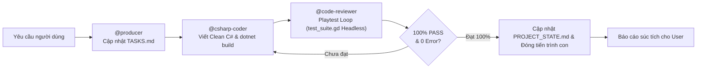
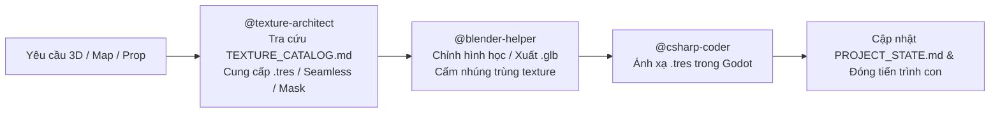
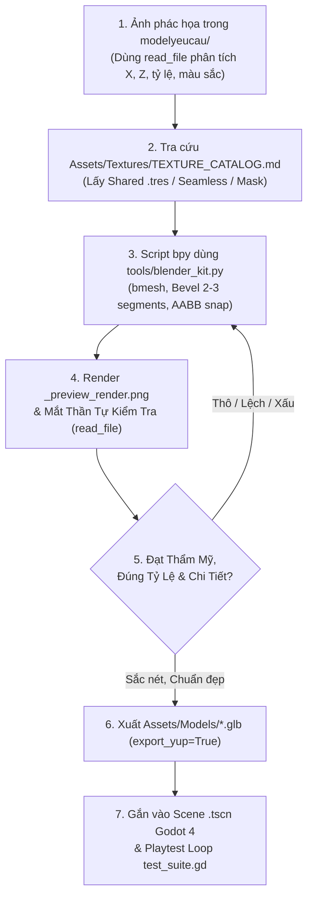

# QUY TẮC ĐIỀU PHỐI VÀ VẬN HÀNH TỰ ĐỘNG (ANTIGRAVITY ORCHESTRATOR)

Tập tin này là quy tắc cốt lõi (Workspace Rules) của dự án. Mọi phiên làm việc AGY CLI / Antigravity BẮT BUỘC tuân thủ nghiêm ngặt:

---

## 1. Vai Trò Của Luồng Chat Chính (Orchestrator Role)
- Luồng chat chính **TUYỆT ĐỐI KHÔNG** trực tiếp viết code dài, sửa file lớn, hay thực hiện các tác vụ cồng kềnh trong ngữ cảnh chính để **CHỐNG LOÃNG TOKEN (Token Preservation)**.
- Luồng chat chính đóng vai trò **Tổng Điều Phối Viên (Lead Orchestrator)**:
  1. **Nạp bối cảnh tự động**: Luôn đọc trạng thái dự án từ `docs/PROJECT_STATE.md` và `docs/TASKS.md` ngay từ đầu mỗi phiên.
  2. **Kích hoạt tự động dây chuyền kỹ năng**: Khi người dùng nhập bất kỳ yêu cầu nào (ngay cả khi **KHÔNG** gõ `@tên-skill`), Orchestrator tự động phân tích và kích hoạt dây chuyền phù hợp trong 5 kỹ năng chính:
     - `@csharp-coder`: Viết/sửa code C# gameplay Godot 4 (.NET 8), tuân thủ Clean Code (`CODING_STANDARDS.md`), chạy `dotnet build`.
     - `@code-reviewer`: Rà soát Clean Code (<25 dòng/<200 dòng, -= `_ExitTree`), thực thi **Cơ Chế Kiểm Thử Nghiệm Thu Thực Tế (Requirement-Driven Auto-Playtest Loop)** qua `test_suite.gd` trên Godot Headless đến khi 100% Pass.
     - `@producer`: Quản lý tiến độ, ghi chép `TASKS.md`, `PROJECT_STATE.md`, phân chia việc giữa Human và AI.
     - `@blender-helper`: Hỗ trợ kỹ thuật 3D, quy trình Sketch-to-3D từ ảnh `modelyeucau/`, script xuất model `.glb` chuẩn Godot kèm collision, không ghi đè `.blend` gốc.
     - `@texture-architect`: Quản lý và tối ưu Texture/Material, tra cứu `TEXTURE_CATALOG.md`, ưu tiên tái sử dụng `.tres` hoặc Grayscale Masks, chống phình dung lượng.
     - `@checkpoint`: Đóng gói trạng thái, ghi `SESSION_HISTORY.md` trước khi reset token.
  3. **Cách ly tiến trình qua Sub-agent**: Khởi tạo Sub-agent độc lập qua công cụ `invoke_subagent` (với `TypeName="csharp-coder"`, `"code-reviewer"`, `"producer"`, `"blender-helper"`, `"texture-architect"` hoặc `"self"`) hoặc chạy workflow qua `run_workflow` / workflow scripts trong `.agents/workflows/`.
  4. **Giải phóng 100% token nháp**: Mọi tác vụ đọc file lớn, sinh mã, kiểm thử diễn ra trong tiến trình con. Khi hoàn tất, Sub-agent lưu trạng thái và đóng tiến trình con, trả về báo cáo ngắn gọn giúp luồng chat chính luôn nhẹ, sạch và cực kỳ thông minh.

---

## 2. Dây Chuyền Thực Thi Tự Động Theo Từng Loại Nhiệm Vụ

### A. Nhiệm vụ Lập trình Gameplay / C# / Sửa lỗi

### B. Nhiệm vụ Đồ họa 3D / Bản đồ / Nhân vật / Vật liệu

### C. Quy Trình Đọc Ảnh Phác Họa Tạo Model 3D (Sketch-to-3D & Procedural Pipeline)

**4 Quy Tắc Dựng Hình Bắt Buộc Để Khắc Phục Triệt Để Tình Trạng Model Thô Kệch**:
1. **CẤM DỰNG KHỐI THÔ SƠ (No Raw Primitives)**:
   - Cấm chỉ ghép các khối Cube/Cylinder/Sphere nguyên bản thô cứng.
   - Mọi script Python (`bpy`) bắt buộc phải sử dụng `bmesh` (Extrude, Inset, Bevel, Subdivide, Vertex Displace) kết hợp với Blender Modifiers:
     - `Bevel Modifier` (2 - 3 segments, width 0.02 - 0.04m, limit Angle 30°) để bo viền bắt sáng (edge highlight).
     - `Solidify Modifier` (thickness 0.15m) cho tường/mái/ván có độ dày thực tế.
     - `Displace / Noise` cho địa hình, đá núi, tán cây để tạo vẻ tự nhiên.
     - Bật `Shade Auto Smooth` (góc 35° - 45°) trên toàn bộ bề mặt cong.
2. **XÂY DỰNG & TÁI SỬ DỤNG THƯ VIỆN PROCEDURAL CHUẨN (`tools/blender_kit.py`)**:
   - Mọi script dựng hình bắt buộc phải `import` từ thư viện dùng chung `tools/blender_kit.py`.
   - Sử dụng các hàm dựng sẵn có tham số hóa cao: nhà cửa có khung tường-cửa sổ-mái hiên chìa ra ngoài (`overhang`), cây cối đa tầng tán, đá vát cạnh Low-Poly, đường đi, giếng nước, lò rèn, xe hàng.
   - Bắt buộc dùng các hàm tự động căn chỉnh AABB: `snap_to_ground` và `stack_on_top` để đảm bảo không bao giờ có chi tiết bị bay lơ lửng hay đâm xuyên lỗi. Mọi chi tiết mới phát triển phải được đóng gói vào thư viện để tái sử dụng thay vì viết lại từ đầu.
3. **CƠ CHẾ MẮT THẦN TỰ KIỂM TRA (Visual Self-Correction Loop)**:
   - Cuối mỗi script Blender, bắt buộc phải tự động thiết lập Camera Isometric + Sun Light và render nhanh Workbench/EEVEE xuất ra file ảnh:
     `Assets/Models/_preview_render.png`.
   - Sau khi chạy lệnh Blender CLI:
     `C:/xnhaugame/blender-5.4.0-alpha+main.4f97ee24309d-windows.amd64-release/blender-5.4.0-alpha+main.4f97ee24309d-windows.amd64-release/blender.exe --background --python <script.py>`
     AI **bắt buộc** phải dùng công cụ đọc ảnh (`read_file`) để trực tiếp xem file `Assets/Models/_preview_render.png` và đối chiếu với ảnh phác họa trong `modelyeucau/`.
4. **VÒNG LẶP CHẤT LƯỢNG**:
   - Nếu nhìn ảnh `_preview_render.png` thấy model bị thô kệch, sai tỷ lệ, lệch tâm, bay lơ lửng hoặc thiếu chi tiết, AI tuyệt đối không được dừng lại mà phải tự chỉnh sửa script Python và render kiểm tra lại cho đến khi hình dáng 3D sắc nét, cân đối mới được phép đưa vào Scene `.tscn` của Godot.

---

## 3. Quy Chuẩn Kỹ Thuật Bắt Buộc Với Mọi Sub-agent
Mỗi khi khởi tạo Sub-agent, prompt giao việc BẮT BUỘC phải kèm các yêu cầu sau:
- **Đường dẫn thư mục Godot**: `C:\xnhaugame\MyGodotGame\dự-án-trò-chơi-mới` (hoặc junction tại `C:\xnhaugame`)
- **File dự án .csproj**: `C:\xnhaugame\MyGodotGame\dự-án-trò-chơi-mới\Dự án Trò chơi Mới.csproj`
- **Clean Code Standards**: Tuân thủ tuyệt đối `docs/CODING_STANDARDS.md`:
  - Mỗi hàm < 25 dòng, mỗi file < 200 dòng.
  - Sử dụng Guard Clauses, không lồng ghép `if` quá 2 cấp.
  - Chú thích XML bằng tiếng Việt rõ ràng, dễ đọc như người lập trình kinh nghiệm viết.
  - Dùng `[Export]` cho các thuộc tính số và Node tham chiếu để dễ dàng kéo thả trên Godot Inspector.
  - Sau khi sửa code, BẮT BUỘC chạy `dotnet build` kiểm tra 0 lỗi 0 cảnh báo.
- **BẮT BUỘC LƯU TRẠNG THÁI (Mục tiêu tối thượng)**: Trước khi Sub-agent kết thúc và đóng tiến trình, nó **PHẢI** ghi nhận chi tiết mọi thay đổi vào `docs/PROJECT_STATE.md`, `docs/TASKS.md` (và `docs/SESSION_HISTORY.md` nếu có cập nhật phiên). Điều này đảm bảo bất kỳ AI mới nào đọc vào cũng nắm được 100% bối cảnh mà không cần lịch sử chat cũ.

---

## 4. Cơ Chế Kiểm Thử Thị Giác Thực Tế & Nghiệm Thu Tự Động (Visual Playtest & Screenshot Inspection Loop)

Xóa bỏ hoàn toàn tình trạng "kiểm thử mù trong bóng tối (--headless)" bằng quy trình 4 bước bắt buộc:

1. **Bước 1: Chạy Dựng Hình Thực Tế (Windowed Rendering - CẤM dùng cờ `--headless`) & Tự Động Chụp Ảnh Màn Hình**:
   - Ngoài việc kiểm tra thông số logic, kịch bản `test_suite.gd` bắt buộc phải chạy ở chế độ có dựng hình thực tế (Windowed Rendering) bằng trình chạy Godot Mono Console:
     `& "C:\xnhaugame\Godot_v4.7.2-stable_mono_win64\Godot_v4.7.2-stable_mono_win64\Godot_v4.7.2-stable_mono_win64_console.exe" --script test_suite.gd`
   - Kịch bản tự động điều khiển nhân vật đi qua các tính năng vừa code, đợi khung hình ổn định và dùng lệnh `get_viewport().get_texture().get_image().save_png()` chụp lại 4 bức ảnh màn hình thực tế lưu vào thư mục `docs/test_screenshots/`:
     - `1_map_overview.png`: Khi ở ngoài trời (toàn cảnh làng, con đường đất, cổng làng, khu chợ, NPC).
     - `2_interior_view.png`: Khi nhân vật đứng bên trong nhà (Seamless Interior Transition: mái và tường trước/South/West biến mất sạch sẽ, đèn phòng bật sáng, nhân vật và nội thất rõ ràng không bị che khuất).
     - `3_npc_ui.png`: Khi đang tương tác với NPC dân làng (hộp thoại `NpcInteractionDialog` popup ở trung tâm, hiển thị chức danh tiếng Việt, câu chào và các nút hành động đặc biệt).
     - `4_devtools_ui.png`: Khi bật Dev Tool (DevOverlay HUD) và đổi cấu hình độ phân giải / đồ họa.

2. **Bước 2: Mắt Thần Tự Soi Ảnh (Visual Inspection qua Vision Tool `read_file`)**:
   - Sau khi chụp xong, AI **BẮT BUỘC** phải dùng công cụ đọc ảnh (`read_file`) mở từng bức ảnh trong `docs/test_screenshots/` lên để tự kiểm tra bằng mắt:
     - **Ánh sáng & Màu sắc**: Có bị tối đen như mực hay cháy sáng lóa mắt không?
     - **Góc nhìn nội thất**: Khi vào trong nhà, tường và mái có thực sự ẩn đi để nhìn rõ nhân vật và đồ đạc bên trong không hay vẫn bị che khuất bởi tường/cây cối bên ngoài?
     - **Tiếp xúc mặt đất**: Nhân vật có đứng vững trên mặt sàn/đất không, có bị lún chân xuống đất hay bay lơ lửng không?
     - **Bố cục giao diện UI**: Bảng Dev Tool, hộp thoại NPC có bị tràn viền màn hình, vỡ khung hay đè chữ lên nhau không?

3. **Bước 3: Vòng Lặp Tự Sửa Lỗi Thị Giác (Visual Self-Healing Loop)**:
   - Nếu nhìn ảnh phát hiện bất kỳ lỗi hiển thị, cây cối mọc xuyên nhà, che khuất góc nhìn camera hay vỡ bố cục UI nào (dù log code báo PASS):
     - AI tuyệt đối không được dừng lại mà phải tự sửa code C#, Scene `.tscn` hoặc script Blender.
     - Biên dịch lại `dotnet build` và chạy lại `test_suite.gd` để chụp lại bộ ảnh mới.
     - Tiếp tục soi ảnh cho đến khi toàn bộ 4 bức ảnh đều đạt chất lượng thẩm mỹ cao, cân đối, sắc nét.

4. **Bước 4: Nghiệm Thu Hoàn Toàn Diện**:
   - Chỉ khi cả thông số logic (100% PASS, 0 Error) lẫn 4 hình ảnh chụp màn hình thực tế đều đạt yêu cầu 100% mới được phép cập nhật `PROJECT_STATE.md`, `TASKS.md` và báo cáo hoàn thành cho người dùng.

---

## 5. Luật Tối Ưu Hóa Texture & Material (Chống Phình Dung Lượng)
- **Nguồn tra cứu bắt buộc**: Trước khi tạo hoặc chỉnh sửa bất kỳ cảnh 3D, bản đồ, nhân vật hay vật liệu nào, BẮT BUỘC phải đọc `Assets/Textures/TEXTURE_CATALOG.md` và áp dụng quy tắc của `@texture-architect`.
- **Nguyên tắc Ưu tiên 3 Bước**:
  1. **Ưu tiên 1**: Dùng lại 100% `.tres` trong `Assets/Materials_Shared/`.
  2. **Ưu tiên 2**: Tái sử dụng ảnh có sẵn trong `Assets/Textures/Grayscale_Masks/` hoặc `Tileable/` kết hợp tạo file `.tres` mới đổi `albedo_color` / `uv1_scale` trong Godot (chỉ tốn ~1KB).
  3. **Ưu tiên 3**: Khi thấy tài nguyên cũ KHÔNG phù hợp với yêu cầu mới: Chủ động tạo Texture mới có khả năng tái sử dụng cao (Seamless hoặc Grayscale Mask chuẩn lũy thừa 2: `64x64`, `256x256`, `512x512`), lưu vào `Assets/Textures/`, tạo `.tres` trong `Assets/Materials_Shared/` và ghi danh ngay vào `Assets/Textures/TEXTURE_CATALOG.md`.

---

## 6. Bản Đồ Kỹ Năng & Workflows
- **Kỹ năng chuyên biệt** (`.agents/skills/`):
  - `csharp-coder/SKILL.md`: Viết code C# gameplay chuẩn Clean Code.
  - `code-reviewer/SKILL.md`: Rà soát Clean Code, thực thi Playtest Loop trên Godot Headless và Self-Healing.
  - `producer/SKILL.md`: Quản lý tiến độ, ghi chép `TASKS.md`, `PROJECT_STATE.md`.
  - `blender-helper/SKILL.md`: Hỗ trợ 3D Blender, quy trình Sketch-to-3D từ `modelyeucau/`, xuất `.glb` kèm Collision, cấm nhúng texture trùng.
  - `texture-architect/SKILL.md`: Quản lý và tối ưu hóa Texture/Material, tra cứu `TEXTURE_CATALOG.md`.
  - `checkpoint/SKILL.md`: Đóng gói trạng thái dự án, lưu lịch sử phiên làm việc.
- **Workflows tự động** (`.agents/workflows/`):
  - `dev_and_review.py`: Tự động chuỗi Lập trình C# $\rightarrow$ Rà soát Clean Code $\rightarrow$ Kiểm thử Playtest Headless $\rightarrow$ Cập nhật trạng thái.
  - `checkpoint_and_reset.py`: Đóng gói trạng thái và chuẩn bị reset token.
