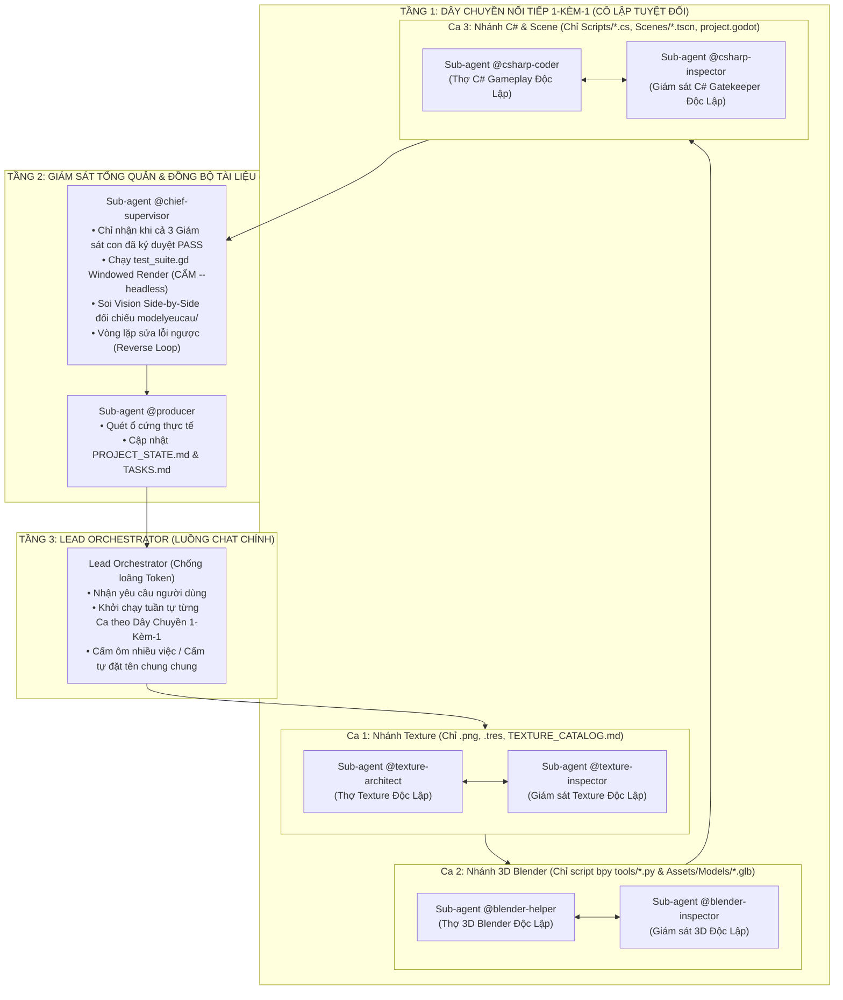

# QUY TẮC ĐIỀU PHỐI VÀ VẬN HÀNH TỰ ĐỘNG (ANTIGRAVITY ORCHESTRATOR)
# MÔ HÌNH THÁP GIÁM SÁT PHÂN CẤP 3 TẦNG & LUẬT CÔ LẬP ĐƠN NHIỆM

Tập tin này là quy tắc cốt lõi (Workspace Rules) của dự án. Mọi phiên làm việc AGY CLI / Antigravity BẮT BUỘC tuân thủ nghiêm ngặt mô hình Tháp Giám Sát Phân Cấp 3 Tầng kết hợp **Luật Cô Lập Đơn Nhiệm (Strict 1-Skill-Per-Subagent & File-Boundary Isolation)**:

---

## 1. Luật Cô Lập Đơn Nhiệm & Ranh Giới File (Strict 1-Skill-Per-Subagent)

### Quy Tắc 1: CẤM ĐẶT TÊN CHUNG CHUNG & CẤM KIÊM NHIỆM
- **NGHIÊM CẤM** AI điều phối tự đặt tên Sub-agent chung chung kiểu `"System Lead"`, `"Lead Integrator"`, `"General Lead"`, `"All-in-one"`, `"QA Tester"` để gom nhiều việc vào một tiến trình.
- Mỗi Sub-agent được khởi tạo **BẮT BUỘC** phải gắn đúng 1-1 với một thư mục kỹ năng cụ thể trong `.agents/skills/` và thuộc tính `Role` bắt buộc phải chứa đúng định danh của kỹ năng đó:
  * `@texture-architect` / `@texture-inspector`
  * `@blender-helper` / `@blender-inspector`
  * `@csharp-coder` / `@csharp-inspector`
  * `@chief-supervisor`
  * `@producer`
  * `@checkpoint`
- Mỗi Sub-agent chỉ được nạp và tuân thủ duy nhất `SKILL.md` của chính chuyên môn đó.

### Quy Tắc 2: Cô Lập Ranh Giới File Nghiêm Ngặt (Strict File-Type Boundary)
- **Sub-agent `@texture-architect`**:
  * **CHỈ ĐƯỢC PHÉP**: Tạo hoặc sửa file ảnh `.png` trong `Assets/Textures/`, vật liệu `.tres` trong `Assets/Materials_Shared/`, và bảng tra cứu `Assets/Textures/TEXTURE_CATALOG.md`.
  * **TUYỆT ĐỐI CẤM**: Chạm vào script Blender, sửa mesh 3D, hoặc sửa bất kỳ file `.cs` / `.tscn` nào.
- **Sub-agent `@blender-helper`**:
  * **CHỈ ĐƯỢC PHÉP**: Viết script Python `bpy` dựng 3D trong `tools/` hoặc `Assets/Blender_Source/`, chỉnh sửa file `.blend`, và xuất file `.glb` vào `Assets/Models/`.
  * **TUYỆT ĐỐI CẤM**: Viết, sửa hoặc can thiệp vào bất kỳ file C# (`.cs`) hay Scene Godot (`.tscn`) nào.
- **Sub-agent `@csharp-coder`**:
  * **CHỈ ĐƯỢC PHÉP**: Viết, sửa file mã nguồn C# trong `Scripts/`, file Scene `.tscn` trong `Scenes/`, và file cấu hình `project.godot`.
  * **TUYỆT ĐỐI CẤM**: Viết script Python Blender, tạo mô hình 3D, hoặc vẽ Texture.

### Quy Tắc 3: Dây Chuyền Nối Tiếp 1-Kèm-1 (Sequential Pair Execution)
Mọi nhiệm vụ phức tạp BẮT BUỘC phải thực hiện tuần tự qua 4 Ca tách biệt, không bao giờ được gộp chung:
- **Ca 1 (Nhánh Texture)**:
  1. Khởi tạo riêng Sub-agent Thợ `@texture-architect` sinh texture / vật liệu.
  2. Khởi tạo riêng Sub-agent Giám sát `@texture-inspector` soi ảnh lát thử 2x2 Seamless và ảnh bọc 3D.
  3. Duyệt xong đóng toàn bộ tiến trình Ca 1.
- **Ca 2 (Nhánh 3D Blender)**:
  1. Khởi tạo riêng Sub-agent Thợ `@blender-helper` dựng hình bằng `bmesh`, Bevel, UV và xuất `.glb`.
  2. Khởi tạo riêng Sub-agent Giám sát `@blender-inspector` soi ảnh render 3D, đo chuẩn tỷ lệ người 1.8m.
  3. Duyệt xong đóng toàn bộ tiến trình Ca 2.
- **Ca 3 (Nhánh C# & Scene)**:
  1. Khởi tạo riêng Sub-agent Thợ `@csharp-coder` viết mã gameplay, camera, UI.
  2. Khởi tạo riêng Sub-agent Giám sát `@csharp-inspector` chạy `python tools/supervisor_gate.py` kiểm định Clean Code.
  3. Duyệt xong đóng toàn bộ tiến trình Ca 3.
- **Ca 4 (Nghiệm Thu Toàn Cục & Cập Nhật Tài Liệu)**:
  1. Khởi tạo riêng Sub-agent Giám Sát Tổng Quản `@chief-supervisor` chạy `test_suite.gd` Windowed và soi Vision 4 ảnh đối chiếu `modelyeucau/`.
  2. Khởi tạo riêng Sub-agent `@producer` quét ổ cứng thực tế và cập nhật `PROJECT_STATE.md`, `TASKS.md`, `SESSION_HISTORY.md`.

### Quy Tắc 4: Cấm Gộp Giám Sát (Strict 1-to-1 Inspector Pairing)
- Mỗi khi một Sub-agent Thợ (`@texture-architect`, `@blender-helper`, `@csharp-coder`) được gọi làm việc, **BẮT BUỘC** phải khởi tạo một Sub-agent Giám sát chuyên ngành riêng biệt tương ứng (`@texture-inspector`, `@blender-inspector`, `@csharp-inspector`) có ID tiến trình độc lập để kiểm tra nghiệm thu ngay tại chỗ cho con thợ đó.
- Tuyệt đối cấm gộp chung việc kiểm tra 3D, Texture và C# vào một Sub-agent Reviewer duy nhất.
- Sau khi cả 3 cặp hoàn tất, mới được bàn giao cho `@chief-supervisor` nghiệm thu toàn cục.

---

## 2. Công Cụ Giám Sát Tự Động: `tools/supervisor_gate.py`
Công cụ này được tích hợp kiểm tra tự động 4 cổng cứng:
1. **Kiểm tra Luật Cô Lập Đơn Nhiệm & Ghép Cặp 1-kèm-1**:
   - Quét nhật ký transcript, nếu phát hiện Sub-agent đặt tên chung chung hoặc thiếu Giám sát riêng tương ứng $\rightarrow$ Báo lỗi `[FAIL - VI PHẠM LUẬT CẤM GỘP VAI]` ngay lập tức.
2. **Kiểm tra Clean Code C#**: 100% hàm < 25 dòng, file < 200 dòng theo `docs/CODING_STANDARDS.md`.
3. **Kiểm tra An Toàn Bộ Nhớ**: Mọi sự kiện `+=` bắt buộc có lệnh hủy `-=` trong `_ExitTree()`.
4. **Kiểm tra Input & Build**: Mọi Action phải đăng ký trong `project.godot`, `dotnet build` đạt 0 lỗi 0 cảnh báo.

---

## 3. Quy Chuẩn Kỹ Thuật Dự Án (Reference Standards)
- **Đường dẫn thư mục Godot**: `C:\xnhaugame\MyGodotGame\dự-án-trò-chơi-mới`
- **File dự án .csproj**: `C:\xnhaugame\MyGodotGame\dự-án-trò-chơi-mới\Dự án Trò chơi Mới.csproj`
- **Quy chuẩn tỷ lệ Human Reference Scale**:
  * Player cao chuẩn: 1.80m ($R=0.4m, H=1.8m$).
  * Cửa ra vào (Doors): Cao $\ge 2.30m - 2.60m$, rộng $\ge 1.20m - 1.50m$.
  * Tường nhà (Walls): Cao $3.50m - 4.50m$.
  * Nội thất (Furniture): Bàn cao 0.8-0.9m, Ghế cao 0.45-0.5m, Giường dài 2.2m x rộng 1.4m x cao 0.55m, Tủ đồ cao 2.2-2.6m, Lò rèn cao 1.2-1.5m, Đe sắt cao 0.85m.
- **Quy tắc Chữa Mù Đồng Bộ Tài Liệu**:
  Trước khi ghi `PROJECT_STATE.md` và `SESSION_HISTORY.md`, bắt buộc quét kiểm tra danh sách file thực tế trên ổ cứng trong `Scripts/`, `Scenes/`, `Assets/` và `Models/` để đảm bảo không ghi đường dẫn ảo.
