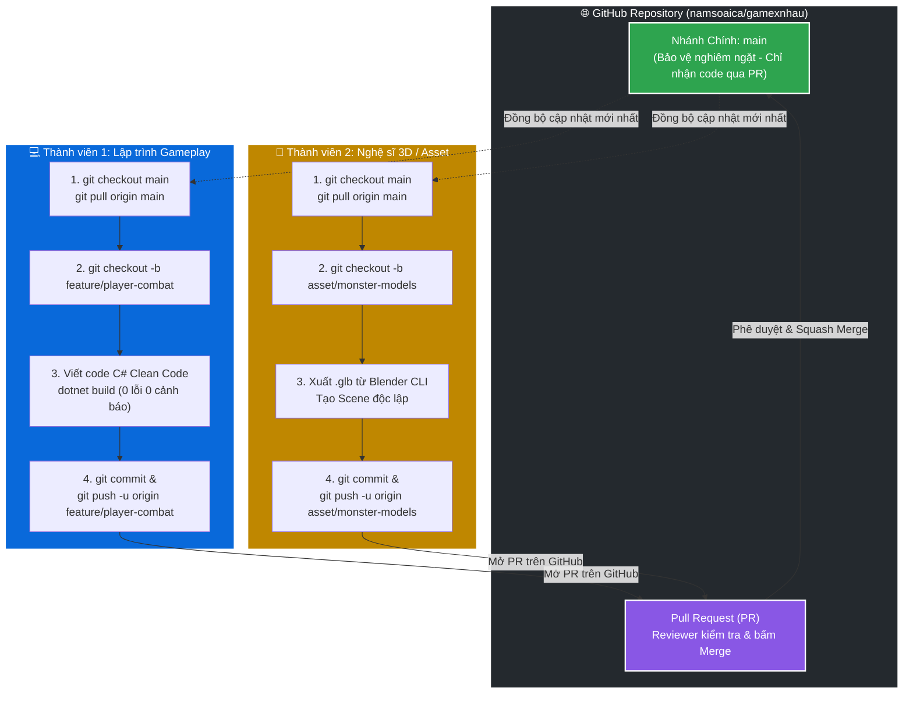
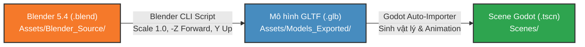

# ⚔️ DỰ ÁN TRÒ CHƠI MỚI (PROJECT 2.5D ISOMETRIC ACTION ADVENTURE)

[](https://godotengine.org/)
[](https://dotnet.microsoft.com/)
[](https://github.com/godot-jolt/godot-jolt)
[](https://www.blender.org/)
[](docs/CODING_STANDARDS.md)
[](AGENTS.md)
[-brightgreen?logo=checkmarx&logoColor=white)](MyGodotGame/dự-án-trò-chơi-mới/test_suite.gd)

> **Dự án Trò chơi Mới** là tựa game hành động / phiêu lưu thế giới mở phong cách 2.5D Isometric phát triển trên nền tảng **Godot Engine 4.7.2 Mono**, sử dụng hoàn toàn **C# (.NET 8)**, engine vật lý tân tiến **Jolt Physics 3D** và luồng dựng hình Stylized 3D từ **Blender 5.4**. Dự án áp dụng kiến trúc module hóa cao độ, tối ưu hóa cho cộng tác nhóm Git nhiều thành viên và tích hợp hệ thống điều phối AI Sub-agents chuyên biệt chống loãng ngữ cảnh.

---

## 📑 Mục Lục

1. [Tổng Quan Dự Án & Công Nghệ Cốt Lõi](#1-tổng-quan-dự-án--công-nghệ-cốt-lõi)
2. [Các Tính Năng Gameplay & Bản Đồ Nổi Bật](#2-các-tính-năng-gameplay--bản-đồ-nổi-bật)
3. [Bảng Điều Khiển Toàn Diện (Controls Matrix)](#3-bảng-điều-khiển-toàn-diện-controls-matrix)
4. [Bộ Công Cụ Dev Mode HUD Toàn Năng (F1 / ~ / Select)](#4-bộ-công-cụ-dev-mode-hud-toàn-năng-f1---select)
5. [Cấu Trúc Thư Mục Dự Án](#5-cấu-trúc-thư-mục-dự-án)
6. [Hướng Dẫn Cài Đặt & Khởi Chạy (Quick Start)](#6-hướng-dẫn-cài-đặt--khởi-chạy-quick-start)
7. [Quy Trình Cộng Tác Nhóm (Git & Collaboration Workflow)](#7-quy-trình-cộng-tác-nhóm-git--collaboration-workflow)
8. [Bí Quyết Tránh Xung Đột Merge Conflict Trong Godot](#8-bí-quyết-tránh-xung-đột-merge-conflict-trong-godot)
9. [Quy Chuẩn Clean Code C# (.NET 8)](#9-quy-chuẩn-clean-code-c-net-8)
10. [Pipeline Tài Nguyên Đồ Họa 3D (Blender to Godot)](#10-pipeline-tài-nguyên-đồ-họa-3d-blender-to-godot)
11. [Hệ Thống Tự Động Hóa AI Sub-Agents](#11-hệ-thống-tự-động-hóa-ai-sub-agents)
12. [Tài Liệu Kỹ Thuật Liên Quan](#12-tài-liệu-kỹ-thuật-liên-quan)

---

## 1. Tổng Quan Dự Án & Công Nghệ Cốt Lõi

| Thành Phần | Đặc Tả Kỹ Thuật | Vai Trò & Ghi Chú Kiến Trúc |
| :--- | :--- | :--- |
| **Game Engine** | Godot Engine 4.7.2 Stable (Mono / .NET 64-bit) | Hỗ trợ biên dịch C# JIT / AOT, hiệu năng cao, render pipeline hiện đại |
| **Framework Code** | .NET 8.0 SDK (C# 12) | Áp dụng Clean Code, Guard Clauses, an toàn bộ nhớ tuyệt đối trong `_ExitTree()` |
| **Physics Engine** | Jolt Physics 3D Integration | Va chạm Trimesh tự động, Backface Collision 2 mặt, Ramp Convex che bậc thang |
| **Góc Nhìn Camera** | Orthographic Isometric 45° & Perspective 6-DOF | Offset chuẩn `(-28, 23, 28)`, Size `17.5`, chuyển mượt Perspective FOV 75° khi Free Cam |
| **Ánh Sáng & Bầu Trời** | ACES Tonemapping + SSAO + ProceduralSky | Ánh nắng ấm `light_energy=1.15`, PSSM 4 splits, ProceduralSky tự nhiên không phông chắn |
| **Bản Đồ Màn Chơi** | `res://Scenes/Levels/WorldMap.tscn` | Đảo trung tâm đa tầng kết nối cánh đồng thảo nguyên phẳng 84x84m bao bọc bởi núi Bắc hùng vĩ |
| **Kiểm Thử Tự Động** | `test_suite.gd` (Godot Headless) | Bộ kiểm định tự động **131/131 Test Cases Passed (100% Pass)** |
| **Hệ Thống AI** | AGY Multi-Agent Orchestrator | Phân bổ 5 kỹ năng chuyên trách độc lập trong `.agents/skills/` chống loãng token |

---

## 2. Các Tính Năng Gameplay & Bản Đồ Nổi Bật

### 🏰 Đài Vọng Cảnh Tầng 2 Mở Rộng (6.27 m²)
- **Mở rộng diện tích gấp ~7 lần**: Nâng cấp từ diện tích cũ 0.94m x 0.97m (~0.91 m²) lên kích thước mới **2.60m x 2.41m (6.27 m²)**, gấp 2.76x chiều rộng và 2.48x chiều dài.
- **Móng nguyên khối đặc monolithic**: Độ cao Z=[2.10, 2.52] dày 0.42m dạng khối 3D đặc, triệt tiêu hoàn toàn hiện tượng lọt chân hay xuyên mesh.
- **Hàng rào gỗ 3 mặt tinh xảo (`SM_Fence_Wood_Overlook`)**: Gồm 9 cột gỗ (tiết diện 0.12x0.12m cao 0.78m có chóp nhọn) cùng hệ thanh ray ngang đôi vững chãi bao quanh 3 mặt Tây, Bắc, Đông.
- **Lối vào thang thông thoáng 1.24m (0 gap)**: Chừa lối thông suốt 1.24m tại mép Nam nối thẳng đỉnh cầu thang `SM_Staircase_02`. Mép paver tại Y=6.99m đè nhẹ 1.4cm lên đỉnh thang (Y=7.004m), đảm bảo chuyển tiếp **0 khe hở (0 gap)**.

### 🌿 Thảm Cỏ Tự Nhiên Không Ô Vuông (Clean Organic Grass)
- **Xóa bỏ 100% đường kẻ ô vuông / bàn cờ**: Loại bỏ hoàn toàn texture lưới grid ô vuông gây cảm giác bàn cờ nhân tạo.
- **Texture tự nhiên mịn màng (`tex_grass_clean.png`)**: Sử dụng texture cỏ hữu cơ seamless mềm mịn (512x512) với sắc xanh tự nhiên `#529934` (Color(0.32, 0.60, 0.20, 1.0)), Roughness = 0.85.
- **Đồng bộ toàn cảnh**: Toàn bộ bề mặt đảo trung tâm, nền paver đài cao và cánh đồng mở rộng 84m x 84m đều sử dụng chung thảm cỏ xanh mướt liền mạch.

### 🌄 Không Gian Bầu Trời & Dãy Núi Thoáng Đãng
- **Tinh giản chóp núi nón chật chội**: Loại bỏ 5 chóp núi nón tím chắn sát sau lưng đài ngắm cảnh (Peak 0, 2, 4, 5, 6).
- **Điểm nhấn hùng vĩ phía xa**: Giữ lại 2 ngọn núi nền ở xa thanh thoát (núi chính Peak 1 cao 9.8m phía Bắc và Peak 3 phía Đông) cùng dãy núi `Mountain_Mesh_North` làm phông nền background hùng vĩ.
- **Bầu trời khoáng đạt**: Loại bỏ hoàn toàn phông chắn trắng `SM_Sky_Backdrop_Plane`, mở rộng tầm nhìn trọn vẹn cho vòm trời ProceduralSky và các đám mây hoạt hình `SM_Cloud_*` trôi lơ lửng.

### 🪜 Cầu Thang Leo Mượt Mà (Stair Ramp Builder)
- **Bộ tạo dốc phẳng thông minh (`StairRampBuilder.cs`)**: Phân tích tự động hình học đỉnh và độ dốc thực tế của `SM_Staircase_01` (57.12°) và `SM_Staircase_02` (51.11°).
- **Khối dốc phẳng `ConvexPolygonShape3D`**: Sinh hình nêm lăng trụ tam giác che phủ các mặt đứng bậc thang 90°, mở rộng tiếp giáp 5cm êm ái với sàn dưới và thềm trên.
- **Vật lý bám dốc**: Cấu hình `PlayerMovement.FloorMaxAngle = 58°` và `FloorSnapLength = 0.40f`, giúp nhân vật chạy lên xuống cầu thang trơn tru tuyệt đối, không hề vấp khấc hay nảy chân.

### 🕳️ Vực Sâu Tự Hồi Sinh (VoidKillZone)
- **Vùng bảo vệ toàn diện (`VoidKillZone.cs`)**: Area3D bao bọc bên dưới toàn bộ cụm đảo lơ lửng.
- **Tự động cứu sinh & hồi vị**: Tự động ghi nhớ vị trí ban đầu của Player. Khi người chơi rơi khỏi mép đảo xuống vực sâu, hệ thống lập tức triệt tiêu gia tốc rơi và dịch chuyển tức thời (`TeleportTo`) an toàn về điểm xuất phát.

### 💬 NPC Tương Tác & Thoại Nổi 3D Billboard
- **Vị trí thuận tiện**: NPC được bố trí ngay trên mặt đất đảo trung tâm `(5.0, 0.5, -4.0)` sát lối đi chính.
- **Thoại nổi 3D rõ nét (`Label3D`)**: Cấu hình `FontSize = 36`, `OutlineSize = 8`, `NoDepthTest = true` đảm bảo chữ luôn hiển thị nổi bật phía trên đầu NPC, không bị che khuất bởi địa hình hay camera.
- **Tương tác linh hoạt**: Nhấn phím `E` hoặc nút tay cầm để mở lời thoại, tự động xoay vòng câu thoại, tự ẩn sau 4 giây và tự hiện nhãn gợi ý khi người chơi vẫn đứng gần.

---

## 3. Bảng Điều Khiển Toàn Diện (Controls Matrix)

Hệ thống điều khiển hỗ trợ đồng thời cả **Bàn phím & Chuột** và **Tay cầm Gamepad** (Xbox, PlayStation, Logitech, Switch Pro) với độ nhạy cao:

### 🎮 Chế Độ Chơi Mặc Định (Isometric Gameplay)

| Thao Tác Gameplay | Bàn Phím & Chuột | Tay Cầm Gamepad (Xbox / PlayStation) | Chi Tiết Kỹ Thuật |
| :--- | :--- | :--- | :--- |
| **Di chuyển (Move)** | `W / A / S / D` hoặc `↑ / ← / ↓ / →` | Cần gạt trái (**Left Stick**) hoặc D-Pad | Chuẩn hóa `Input.GetVector` theo góc nhìn camera Isometric 45° |
| **Xoay mặt nhân vật** | Tự động theo hướng di chuyển | Tự động theo hướng di chuyển | Công thức `Mathf.Atan2(horizontalVelocity.X, horizontalVelocity.Y)`, mặt quay chuẩn +Z |
| **Nhảy (Jump)** | Phím cách (`Space`) | Nút **A** (Xbox) / Nút **✕** (PS) | Hỗ trợ **Coyote Time 0.15s** và **Jump Buffer 0.15s** mượt mà |
| **Tương tác NPC** | Phím **E** | Nút **X** hoặc **Y** (Xbox) / **□** hoặc **△** (PS) | Bán kính quét `ScanRadius = 3.0m`, ưu tiên thực thể gần nhất |
| **Thu phóng Camera (Zoom)** | Cuộn con lăn chuột (**Wheel Up / Down**) | Cần gạt phải (**Right Stick** đẩy Lên / Xuống) | Tinh chỉnh Orthographic Size từ `8.0` (cận cảnh) đến `35.0` (toàn cảnh) |
| **Bật/Tắt Dev Mode HUD** | Phím **F1**, phím **~** (Tilde), phím **F3** | Nút **Back / Select**, **Start** hoặc nhấn cần phải **R3** | Mở bảng HUD tinh chỉnh và tự động mở khóa chuột |
| **Chuyển Tab Dev Mode** | Nhấp chuột chọn Tab | Nút vai **LB** (Tab trước) / **RB** (Tab tiếp theo) | Duyệt nhanh giữa Tab Nhân Vật, Tab NPC, Tab Môi Trường |

### 🎥 Chế Độ Camera Tự Do (Free Cam Mode 6-DOF)

| Thao Tác Bay Camera | Bàn Phím & Chuột | Tay Cầm Gamepad (Xbox / PlayStation) | Chi Tiết Kỹ Thuật |
| :--- | :--- | :--- | :--- |
| **Bay Ngang / Tiến Lùi** | Phím `W / A / S / D` | Cần gạt trái (**Left Stick**) | Di chuyển 4 hướng theo hệ trục cục bộ của Camera (`Transform.Basis`) |
| **Nâng Độ Cao (Bay lên)** | Phím `Space` hoặc `E` | Nút vai phải **RB** hoặc Cò phải **R2 / RT** | Bay thẳng đứng hướng lên bầu trời (`Vector3.Up`) |
| **Hạ Độ Cao (Bay xuống)** | Phím `Ctrl` hoặc `Q` | Nút vai trái **LB** hoặc Cò trái **L2 / LT** | Bay thẳng đứng hạ thấp xuống mặt đất (`Vector3.Down`) |
| **Xoay Góc Nhìn 360°** | Giữ **Chuột Phải** + Rê chuột | Cần gạt phải (**Right Stick**) xoay 360° | Xoay góc Pitch (ngẩng/cúi giới hạn ±89°) và Yaw (xoay vòng 360°) |
| **Thay Đổi Tốc Độ Bay** | Cuộn con lăn chuột Lên / Xuống | Nhấn cần gạt trái **L3** | Tốc độ trượt linh hoạt từ **5.0 m/s** đến **50.0 m/s** |
| **Khóa Đứng Im Nhân Vật** | **Tự động kích hoạt (Freeze Player)** | **Tự động kích hoạt (Freeze Player)** | Player lập tức dừng di chuyển, giữ tư thế `Idle` để dev tự do bay lượn |
| **Quay Về Góc Isometric** | Nút `[🔄 Quay Về Player]` trên HUD | Bấm nút Reset trên HUD hoặc tắt Dev Mode | Camera khôi phục góc nhìn Orthogonal Isometric khóa vào Player |

---

## 4. Bộ Công Cụ Dev Mode HUD Toàn Năng (F1 / ~ / Select)

Hệ thống **Dev Mode HUD** (`DevOverlay.cs`) được thiết kế theo phong cách tối giản hiện đại (Dark Glass Theme bán trong suốt bo góc 10px), hiển thị tại lớp trên cùng `CanvasLayer` (Layer 100). Hỗ trợ kiểm thử và cân chỉnh gameplay ngay khi đang chơi mà không cần mở Editor:

```mermaid
graph TD
    DevHUD["🛠️ DEV MODE OVERLAY (F1 / ~ / Select)"]
    DevHUD --> Tab1["🎮 Tab Nhân Vật (Player Tweaks)"]
    DevHUD --> Tab2["💬 Tab Hội Thoại NPC (Dialogue Editor)"]
    DevHUD --> Tab3["📷 Tab Thế Giới & Camera (World & Stats)"]

    Tab1 --> T1_A["Sliders: Tốc độ chạy (MoveSpeed 2-25)"]
    Tab1 --> T1_B["Sliders: Lực nhảy & Trọng lực"]
    Tab1 --> T1_C["Checkbox: Nhảy Vô Hạn (Infinite Jump)"]
    Tab1 --> T1_D["Button: TeleportTo về điểm xuất phát"]

    Tab2 --> T2_A["ItemList: Danh sách thoại thời gian thực"]
    Tab2 --> T2_B["LineEdit: Soạn thảo câu thoại mới"]
    Tab2 --> T2_C["Buttons: Thêm thoại / Nói ngay / Xoay vòng / Xóa"]

    Tab3 --> T3_A["Checkbox: Bật/Tắt Camera Tự Do (Free Cam 6-DOF)"]
    Tab3 --> T3_B["Slider: Tốc độ bay FreeCam (5.0 - 50.0)"]
    Tab3 --> T3_C["Button: Quay về góc nhìn Isometric Player"]
    Tab3 --> T3_D["Info Labels: FPS & Tọa độ Player (X, Y, Z)"]
    Tab3 --> T3_E["Button: Tải lại Màn chơi (Reload Scene)"]

    style DevHUD fill:#1e1e2e,stroke:#89b4fa,stroke-width:2px,color:#cdd6f4
    style Tab1 fill:#181825,stroke:#a6e3a1,stroke-width:1px,color:#cdd6f4
    style Tab2 fill:#181825,stroke:#f9e2af,stroke-width:1px,color:#cdd6f4
    style Tab3 fill:#181825,stroke:#cba6f7,stroke-width:1px,color:#cdd6f4
```



### ❄️ Cơ Chế Freeze Player Độc Quyền Khi Bật Free Cam
- **Vấn đề thực tế**: Trong các tựa game thông thường, khi bật Camera tự do để quan sát, các phím WASD hoặc cần gạt vừa làm di chuyển camera vừa khiến nhân vật dưới đất chạy lung tung và rơi xuống vực.
- **Giải pháp tối ưu**:
  1. `CameraFollow.cs` cung cấp thuộc tính `Instance.IsFreeCamActive`.
  2. `PlayerMovement.cs` áp dụng Guard Clause: Khi Free Cam bật, hệ thống lập tức gọi `StopHorizontalMovement()`, triệt tiêu vận tốc ngang (`Velocity = Vector3(0, Velocity.Y, 0)`), bỏ qua việc đọc input di chuyển và dừng xoay mặt. Vẫn duy trì trọng lực nhẹ để giữ chân nhân vật ổn định trên mặt sàn.
  3. `PlayerAnimation.cs` kích hoạt `PlayIdleState()`, giữ nguyên tư thế đứng `Idle` và triệt tiêu toàn bộ hiệu ứng nghiêng mình/nhấp nhô thủ tục.
  4. Khi tắt Free Cam: Nhân vật nhận lại quyền điều khiển ngay lập tức, chuyển động mượt mà không độ trễ.

---

## 5. Cấu Trúc Thư Mục Dự Án

```plaintext
C:/xnhaugame/
├── .agents/                                # Hệ thống Kỹ năng & Workflows của AI Sub-agents
│   ├── skills/                             # Kỹ năng độc lập: csharp-coder, code-reviewer, producer, blender-helper, checkpoint
│   │   ├── csharp-coder/SKILL.md           # Lập trình Clean Code C# (.NET 8)
│   │   ├── code-reviewer/SKILL.md          # Rà soát hàm < 25 dòng, file < 200 dòng, bắt lỗi bộ nhớ
│   │   ├── producer/SKILL.md               # Quản trị tiến độ, cập nhật TASKS.md & PROJECT_STATE.md
│   │   ├── blender-helper/SKILL.md         # Hỗ trợ Blender 5.4 CLI, xuất GLB chuẩn Godot
│   │   └── checkpoint/SKILL.md             # Đóng gói ngữ cảnh vào SESSION_HISTORY.md
│   └── workflows/                          # Kịch bản tự động: dev_and_review.py, checkpoint_and_reset.py
├── docs/                                   # Tài liệu kiến trúc & quy chuẩn phát triển (Junction đồng bộ)
│   ├── CODING_STANDARDS.md                 # Quy chuẩn viết code C# chuẩn Clean Code & Allman
│   ├── CONTRIBUTING.md                     # Hướng dẫn chi tiết cho thành viên mới tham gia đóng góp
│   ├── PROJECT_STATE.md                    # Bản đồ tài nguyên, UID và bối cảnh dự án nạp nhanh trong 3s
│   ├── SESSION_HISTORY.md                  # Lịch sử các phiên làm việc và mốc phát triển
│   └── TASKS.md                            # Bảng phân chia công việc giữa Human và AI Sub-agents
├── MyGodotGame/
│   └── dự-án-trò-chơi-mới/                 # Thư mục gốc chứa mã nguồn Godot Engine
│       ├── .editorconfig                   # Cấu hình chuẩn định dạng mã nguồn Allman style
│       ├── .gitattributes                  # Quy định kiểu xuống dòng CRLF/LF và định dạng file nhị phân
│       ├── .gitignore                       # Bộ lọc bỏ qua cache Godot, C#, IDE và Blender backup
│       ├── test_suite.gd                   # Kịch bản kiểm thử tự động Headless (131 test cases)
│       ├── Assets/                         # Tài nguyên game
│       │   ├── Blender_Source/             # File nguồn .blend gốc (VÙNG BẢO VỆ) & map_25d_fixed.blend
│       │   ├── Models_Exported/            # File .glb xuất ra chuẩn Godot (-Z forward, Y up)
│       │   │   ├── character_25d.glb       # Model nhân vật kèm animation: Idle, Walk, Jump, Attack
│       │   │   ├── map_25d.glb             # Bản đồ đảo trung tâm kèm đài vọng cảnh 6.27m², bậc thang
│       │   │   ├── map_surroundings.glb    # Cánh đồng 84x84m, 45 tảng đá, 63 cây, núi Bắc hùng vĩ
│       │   │   └── tex_grass_clean.png     # Texture cỏ mịn tự nhiên xanh mát (#529934) không ô vuông
│       │   └── Textures/                   # Hình ảnh texture bổ trợ
│       ├── Scenes/                         # Các Scene Godot (.tscn)
│       │   ├── Characters/                 # Player.tscn, NPC.tscn
│       │   ├── Levels/                     # WorldMap.tscn (Main Level), TestLevel.tscn
│       │   └── UI/                         # DevOverlay.tscn (Bảng điều khiển Dev Mode HUD)
│       ├── Scripts/                        # Mã nguồn C# phân theo Single Responsibility
│       │   ├── Core/                       # CameraFollow.cs, FreeCameraController.cs, MapAutoCollision.cs,
│       │   │                               # StairRampBuilder.cs, SimpleNpc.cs, VoidKillZone.cs,
│       │   │                               # IInteractable.cs, InteractableArea.cs
│       │   ├── Player/                     # PlayerMovement.cs, PlayerAnimation.cs, PlayerInteractor.cs
│       │   └── UI/                         # DevOverlay.cs, DevPlayerTab.cs, DevNpcTab.cs, DevWorldTab.cs
│       ├── project.godot                   # File cấu hình trung tâm của Godot Engine
│       └── Dự án Trò chơi Mới.csproj         # Project file C# .NET 8.0
├── AGENTS.md                               # Quy tắc điều phối luồng làm việc Orchestrator
└── README.md                               # Tài liệu hướng dẫn tổng quan dự án (File này)
```

---

## 6. Hướng Dẫn Cài Đặt & Khởi Chạy (Quick Start)

### Yêu Cầu Môi Trường Tiên Quyết
1. **.NET 8.0 SDK** (phiên bản `8.0.x` trở lên) - Kiểm tra bằng lệnh:
   ```bash
   dotnet --version
   ```
2. **Godot Engine 4.7.2 Mono (Windows 64-bit)**: Tải bản có hỗ trợ C#/.NET từ [Godot Engine Official](https://godotengine.org/).
3. **Blender 5.4+** (Dành cho bộ phận dựng hình và xuất tài nguyên 3D).
4. **IDE khuyên dùng**: Visual Studio 2022 (với gói .NET Desktop Development), JetBrains Rider, hoặc Visual Studio Code (kèm C# Dev Kit).

### Các Bước Cài Đặt & Chạy Game
1. **Clone kho chứa mã nguồn**:
   ```bash
   git clone https://github.com/namsoaica/gamexnhau.git
   cd gamexnhau
   ```

2. **Khôi phục gói phụ thuộc & Biên dịch mã nguồn C#**:
   ```bash
   cd MyGodotGame/dự-án-trò-chơi-mới
   dotnet restore "Dự án Trò chơi Mới.csproj"
   dotnet build "Dự án Trò chơi Mới.csproj"
   ```
   > Kết quả biên dịch chuẩn mực: `Build succeeded: 0 Warning(s), 0 Error(s)`.

3. **Chạy Kịch Bản Kiểm Thử Tự Động (Verification Suite)**:
   Để kiểm tra toàn bộ 131 tiêu chuẩn vật lý, camera, layer, ánh sáng và UI:
   ```powershell
   & "C:\xnhaugame\Godot_v4.7.2-stable_mono_win64\Godot_v4.7.2-stable_mono_win64\Godot_v4.7.2-stable_mono_win64_console.exe" --headless --path "C:\xnhaugame\MyGodotGame\dự-án-trò-chơi-mới" -s test_suite.gd
   ```
   > Kết quả hiển thị: `=== SUMMARY: Passed: 131 | Failed: 0 ===` (100% Pass).

4. **Mở dự án trong Godot Engine**:
   - Khởi động Godot Engine 4.7.2 Mono.
   - Chọn **Import**, trỏ đến file `MyGodotGame/dự-án-trò-chơi-mới/project.godot`.
   - Nhấn **Import & Edit** để Godot nạp tài nguyên.
   - Nhấn phím `F5` hoặc nút **Play** ở góc trên bên phải để bắt đầu trải nghiệm thế giới game tại `WorldMap.tscn`.

---

## 7. Quy Trình Cộng Tác Nhóm (Git & Collaboration Workflow)

Dự án được lưu trữ chính thức tại GitHub: **[https://github.com/namsoaica/gamexnhau](https://github.com/namsoaica/gamexnhau)**.  
Để nhiều thành viên (Lập trình viên C#, Nghệ sĩ 3D, Âm thanh, Thiết kế Game) cùng tham gia phát triển một cách mượt mà, toàn bộ đội ngũ bắt buộc tuân thủ quy trình chuẩn hóa:



### Quy Trình Thực Hành 7 Bước
1. **Bước 1: Tải kho mã nguồn**: `git clone https://github.com/namsoaica/gamexnhau.git`
2. **Bước 2: Đồng bộ nhánh chính**: `git checkout main` && `git pull origin main`
3. **Bước 3: Chọn đầu việc trên `docs/TASKS.md` & Tạo nhánh riêng**:
   - `git checkout -b feature/ten-tinh-nang` (đối với code C#)
   - `git checkout -b bugfix/ten-loi` (đối với sửa lỗi)
   - `git checkout -b asset/ten-tai-nguyen` (đối với đồ họa / âm thanh)
4. **Bước 4: Phát triển & Kiểm định chất lượng**:
   - Viết code C# tuân thủ [docs/CODING_STANDARDS.md](docs/CODING_STANDARDS.md).
   - Chạy `dotnet build` đạt **0 Warning, 0 Error**.
5. **Bước 5: Commit & Đẩy lên GitHub**:
   - `git add .`
   - `git commit -m "feat(combat): bổ sung cơ chế tấn công và hitbox cho nhân vật"`
   - `git push -u origin feature/ten-tinh-nang`
6. **Bước 6: Tạo Pull Request (PR) trên web GitHub**: Nhờ đồng đội kiểm duyệt chéo (Peer Review).
7. **Bước 7: Merge PR & Kéo code mới về máy**: `git checkout main` && `git pull origin main`.

---

## 8. Bí Quyết Tránh Xung Đột Merge Conflict Trong Godot

> [!WARNING]
> File `.tscn` và `.tres` trong Godot là các file text tuần tự hóa (YAML-like). Nếu hai người cùng sửa chung một file Scene lớn, xung đột Git có thể làm hỏng mã UID và cấu trúc phân cấp cây Node!

Để cộng tác nhóm mượt mà, dự án áp dụng **5 Nguyên Tắc Vàng**:

1. **Kiến Trúc Module Hóa Scene (Modular Scene Composition)**:
   - Tuyệt đối **KHÔNG** làm việc trực tiếp trên Scene gốc `WorldMap.tscn`.
   - Mỗi đối tượng độc lập phải là một Scene riêng biệt (Ví dụ: `Player.tscn`, `NPC.tscn`, `DevOverlay.tscn`). Khi cần đưa vào thế giới, chỉ kéo thả Instance của Scene đó vào `WorldMap.tscn`.
2. **Nguyên Tắc Phân Định Vùng (Area Ownership)**:
   - Trước khi sửa một Scene hay Script cụ thể, hãy cập nhật trạng thái trong [docs/TASKS.md](docs/TASKS.md).
   - Lập trình viên Gameplay chỉ làm việc trong `Scripts/Player/` và `Scenes/Characters/`.
   - Nghệ sĩ 3D chỉ làm việc trong `Assets/Blender_Source/` và xuất sang `Assets/Models_Exported/`.
3. **Bảo Vệ Mã Định Danh UID (Unique Identifier)**:
   - Mọi tài nguyên trong Godot 4 đều gắn liền với một UID (Ví dụ: `uid://ciy0uaygbkns3`). Khi tạo file mới, tuyệt đối không sửa tay mã UID trong file `.tscn` hay `.uid`.
4. **Không Thao Tác Chỉnh Sửa File Nhị Phân Trực Tiếp**:
   - Các file `.blend`, `.glb`, `.png`, `.wav` đã được đánh dấu `binary` trong `.gitattributes`. Nếu xảy ra xung đột, ưu tiên nhận bản cập nhật mới nhất từ người phụ trách chính (Asset Owner).
5. **Kéo Cập Nhật Thường Xuyên (Pull Early, Pull Often)**:
   - Luôn gõ lệnh `git pull origin main` trước mỗi phiên làm việc để hạn chế tối đa độ lệch nhánh.

---

## 9. Quy Chuẩn Clean Code C# (.NET 8)

Mọi dòng code C# trong dự án đều phải tuân thủ nghiêm ngặt theo tài liệu [docs/CODING_STANDARDS.md](docs/CODING_STANDARDS.md):

- 📏 **Giới hạn dòng mã**:
  - Mỗi file `.cs` **tối đa 150 - 200 dòng**. Đảm bảo đúng **Một Trách Nhiệm Duy Nhất (Single Responsibility)**.
  - Mỗi hàm **tối đa 25 dòng**. Tách các bước phụ thành hàm con có tên động từ rõ nghĩa.
- 🛡️ **Kiểm soát lồng ghép (Guard Clauses)**:
  - Tuyệt đối không lồng `if` quá 2 cấp độ.
  - Sử dụng Guard Clauses ở đầu hàm để thoát sớm: `if (!IsOnFloor()) return;`.
- 🔍 **Cú pháp tường minh & An toàn bộ nhớ**:
  - Không lạm dụng `var` khi kiểu dữ liệu không hiển nhiên.
  - **Bắt buộc dọn dẹp bộ nhớ**: Mọi sự kiện đăng ký (`+=`) trong `_Ready()` đều phải có lệnh hủy (`-=`) tương ứng trong `_ExitTree()` để ngăn chặn triệt để hiện tượng rò rỉ bộ nhớ (Memory Leaks).
- 🇻🇳 **Chú thích XML Tiếng Việt**: Toàn bộ class, hàm public và thuộc tính đều có chú thích `/// <summary>` ngắn gọn, giải thích rõ lý do thực hiện.

---

## 10. Pipeline Tài Nguyên Đồ Họa 3D (Blender to Godot)



### Nguyên Tắc Bất Khả Xâm Phạm:
1. **Vùng Cấm Ghi Đè**: Tuyệt đối **KHÔNG** ghi đè các file nguồn `.blend` gốc (`character_25d.blend`, `map_25d.blend`). Khi cần tinh chỉnh hoặc mở rộng, tạo bản lưu trữ an toàn riêng biệt (như `map_25d_fixed.blend`, `map_surroundings.blend`).
2. **Chuẩn Xuất Khẩu Model**:
   - Định dạng: `.glb` nhị phân (chứa đầy đủ UV planar projection, texture và Armature hoạt ảnh).
   - Hệ trục tọa độ: **Forward = -Z**, **Up = +Y** (`export_yup=True`).
   - Thư mục lưu trữ: `Assets/Models_Exported/`.
3. **Tự Động Sinh Va Chạm (MapAutoCollision & StairRampBuilder)**:
   - Script `MapAutoCollision.cs` tự động duyệt tìm các mesh địa hình, bật `BackfaceCollision = true` cho bề mặt Trimesh.
   - Script `StairRampBuilder.cs` tự động phát hiện bậc thang và tạo khối dốc va chạm phẳng `ConvexPolygonShape3D` giúp nhân vật leo trơn tru.

---

## 11. Hệ Thống Tự Động Hóa AI Sub-Agents

Dự án áp dụng mô hình điều phối độc quyền thông qua tập tin cấu hình [AGENTS.md](AGENTS.md). Khi phát triển cùng trợ lý lập trình AGY CLI / Antigravity, luồng làm việc được phân định thành 5 Sub-agents chuyên trách nhằm **CHỐNG LOÃNG TOKEN**:

| Kỹ Năng (Skill) | Tên Sub-agent | Vai Trò Chính |
| :--- | :--- | :--- |
| 🧑‍💼 **Producer** | `@producer` | Quản trị tiến độ dự án, điều phối công việc giữa Người và AI, cập nhật `PROJECT_STATE.md` & `TASKS.md`. |
| 💻 **C# Coder** | `@csharp-coder` | Viết code C# gameplay chuẩn Clean Code, chạy `dotnet build` xác nhận 0 cảnh báo. |
| 🕵️ **Code Reviewer** | `@code-reviewer` | Rà soát giới hạn (< 25 dòng/hàm, < 200 dòng/file), kiểm tra rò rỉ bộ nhớ, bảo vệ UID. |
| 🎨 **Blender Helper** | `@blender-helper` | Hỗ trợ kịch bản Blender CLI, xuất `.glb` tự động, bảo vệ an toàn file `.blend` gốc. |
| 📦 **Checkpoint** | `@checkpoint` | Đóng gói toàn bộ bối cảnh vào `SESSION_HISTORY.md` trước khi giải phóng ngữ cảnh. |

> **Nguyên tắc vàng của AI**: Mọi Sub-agent khi hoàn thành nhiệm vụ **BẮT BUỘC** cập nhật trạng thái mới nhất vào [docs/PROJECT_STATE.md](docs/PROJECT_STATE.md) để phiên làm việc tiếp theo có thể nạp bối cảnh ngay trong 3 giây mà không cần quét lại mã nguồn.

---

## 12. Tài Liệu Kỹ Thuật Liên Quan

- 📘 [Hướng Dẫn Đóng Góp Chi Tiết (CONTRIBUTING.md)](docs/CONTRIBUTING.md)
- 📐 [Quy Chuẩn Viết Mã C# Dễ Đọc (CODING_STANDARDS.md)](docs/CODING_STANDARDS.md)
- 📊 [Trạng Thái Dự Án & Bản Đồ Tài Nguyên (PROJECT_STATE.md)](docs/PROJECT_STATE.md)
- 📋 [Bảng Phân Chia Công Việc Nhóm (TASKS.md)](docs/TASKS.md)
- 📜 [Nhật Ký Lịch Sử Các Phiên Làm Việc (SESSION_HISTORY.md)](docs/SESSION_HISTORY.md)
- 🤖 [Quy Tắc Điều Phối Sub-agent AI (AGENTS.md)](AGENTS.md)

---
*Dự án phát triển bởi Đội ngũ Trò chơi 2.5D Isometric.*
