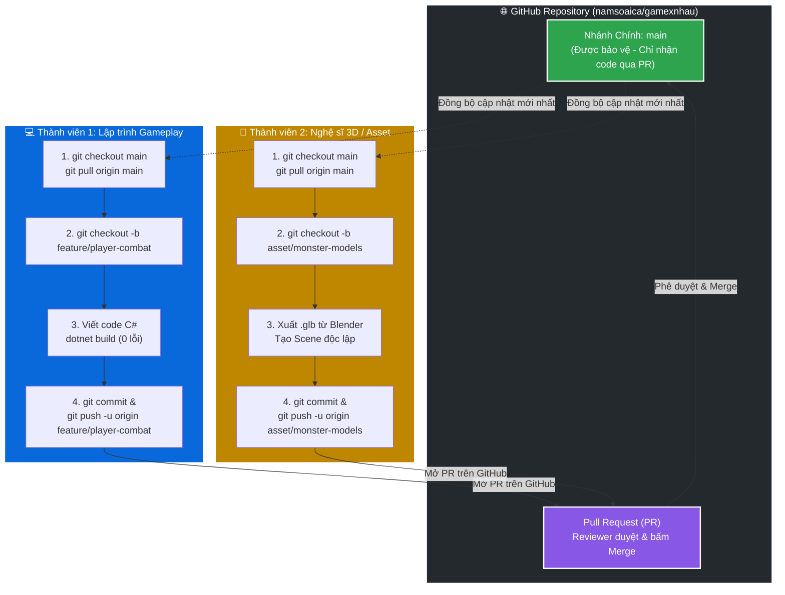

# ⚔️ DỰ ÁN TRÒ CHƠI MỚI (PROJECT 2.5D ISOMETRIC)

[](https://godotengine.org/)
[](https://dotnet.microsoft.com/)
[](https://github.com/godot-jolt/godot-jolt)
[](https://www.blender.org/)
[](docs/CODING_STANDARDS.md)
[](AGENTS.md)

> **Dự án Trò chơi Mới** là tựa game hành động / phiêu lưu đồ họa 2.5D Isometric phát triển trên nền tảng **Godot Engine 4.7.2 Mono**, sử dụng hoàn toàn **C# (.NET 8)**, engine vật lý tân tiến **Jolt Physics 3D** và luồng pipeline 3D Stylized từ **Blender 5.4**. Dự án được thiết kế theo mô hình kiến trúc module hóa cao độ, tối ưu hóa cho cộng tác nhóm nhiều thành viên và tích hợp hệ thống điều phối AI Sub-agent tự động chống loãng ngữ cảnh.

---

## 📑 Mục Lục

1. [Tổng Quan Kiến Trúc & Công Nghệ](#1-tổng-quan-kiến-trúc--công-nghệ)
2. [Cấu Trúc Thư Mục Dự Án](#2-cấu-trúc-thư-mục-dự-án)
3. [Hướng Dẫn Cài Đặt & Khởi Chạy (Quick Start)](#3-hướng-dẫn-cài-đặt--khởi-chạy-quick-start)
4. [Quy Trình Cộng Tác Nhóm (Git & Collaboration Workflow)](#4-quy-trình-cộng-tác-nhóm-git--collaboration-workflow)
5. [Bí Quyết Tránh Xung Đột Merge Conflict Trong Godot](#5-bí-quyết-tránh-xung-đột-merge-conflict-trong-godot)
6. [Quy Chuẩn Clean Code C# (.NET 8)](#6-quy-chuẩn-clean-code-c-net-8)
7. [Pipeline Tài Nguyên Đồ Họa 3D (Blender to Godot)](#7-pipeline-tài-nguyên-đồ-họa-3d-blender-to-godot)
8. [Hệ Thống Tự Động Hóa AI Sub-Agents](#8-hệ-thống-tự-động-hóa-ai-sub-agents)
9. [Điều Khiển Trong Game (Controls)](#9-điều-khiển-trong-game-controls)
10. [Tài Liệu Kỹ Thuật Liên Quan](#10-tài-liệu-kỹ-thuật-liên-quan)

---

## 1. Tổng Quan Kiến Trúc & Công Nghệ

| Thành phần | Đặc tả kỹ thuật | Ghi chú kiến trúc |
| :--- | :--- | :--- |
| **Game Engine** | Godot Engine 4.7.2 Stable (Mono / .NET) | Hỗ trợ biên dịch C# JIT / AOT, hiệu năng cao |
| **Framework** | .NET 8.0 SDK (C# 12) | Áp dụng Clean Code, Guard Clauses, Type-Safety |
| **Physics** | Jolt Physics 3D Integration | Va chạm Trimesh tự động, mô phỏng mượt mà |
| **Camera** | Orthographic Isometric 45° | Camera bám theo Player với offset chuẩn `(-28, 23, 28)`, size `17.5` |
| **Scene Khởi Động** | `res://Scenes/Levels/WorldMap.tscn` | Bản đồ thế giới mở rộng 84x84m bao bọc bởi núi đá ranh giới |
| **Hệ Thống AI** | AGY CLI Multi-Agent Orchestrator | Chia 5 kỹ năng độc lập, quản lý token tự động |

---

## 2. Cấu Trúc Thư Mục Dự Án

```plaintext
C:/xnhaugame/
├── .agents/                        # Hệ thống Kỹ năng (Skills) & Workflows của AI Sub-agents
│   ├── skills/                     # Kỹ năng độc lập: csharp-coder, code-reviewer, producer, blender-helper, checkpoint
│   └── workflows/                  # Kịch bản tự động: dev_and_review.py, checkpoint_and_reset.py
├── docs/                           # Tài liệu trạng thái & quy chuẩn phát triển (Junction đồng bộ)
│   ├── CODING_STANDARDS.md         # Quy chuẩn viết code C# dễ đọc cho con người
│   ├── CONTRIBUTING.md             # Hướng dẫn chi tiết cho thành viên mới tham gia đóng góp
│   ├── PROJECT_STATE.md            # Bản đồ tài nguyên, UID và bối cảnh dự án nạp nhanh trong 3s
│   ├── SESSION_HISTORY.md          # Lịch sử các phiên làm việc và mốc phát triển
│   └── TASKS.md                    # Bảng phân chia công việc giữa Human và AI
├── MyGodotGame/
│   └── dự-án-trò-chơi-mới/         # Thư mục gốc chứa mã nguồn Godot Engine
│       ├── .editorconfig           # Cấu hình định dạng mã nguồn chuẩn Allman style
│       ├── .gitattributes          # Quy định kiểu xuống dòng CRLF/LF và định dạng file nhị phân
│       ├── .gitignore               # Bộ lọc bỏ qua cache Godot, C#, IDE và Blender backup
│       ├── Assets/                 # Tài nguyên game
│       │   ├── Blender_Source/     # File nguồn .blend gốc (VÙNG BẢO VỆ, cấm ghi đè)
│       │   ├── Models_Exported/    # File .glb xuất ra chuẩn Godot (-Z forward, Y up)
│       │   └── Textures/           # Hình ảnh texture vật liệu
│       ├── Scenes/                 # Các Scene Godot (.tscn)
│       │   ├── Characters/         # Player.tscn và các thực thể nhân vật
│       │   └── Levels/             # WorldMap.tscn, TestLevel.tscn
│       ├── Scripts/                # Mã nguồn C# phân theo Single Responsibility
│       │   ├── Core/               # CameraFollow.cs, MapAutoCollision.cs
│       │   └── Player/             # PlayerMovement.cs, PlayerAnimation.cs
│       ├── project.godot           # File cấu hình trung tâm của Godot
│       └── Dự án Trò chơi Mới.csproj # Project file C# .NET 8
├── AGENTS.md                       # Quy tắc điều phối luồng làm việc Orchestrator
└── README.md                       # Tài liệu hướng dẫn tổng quan dự án
```

---

## 3. Hướng Dẫn Cài Đặt & Khởi Chạy (Quick Start)

### Yêu Cầu Môi Trường Tiên Quyết
1. **.NET 8.0 SDK** (phiên bản `8.0.x` trở lên) - Kiểm tra bằng lệnh:
   ```bash
   dotnet --version
   ```
2. **Godot Engine 4.7.2 Mono (Windows 64-bit)**: Tải bản có hỗ trợ C#/.NET từ trang chủ Godot.
3. **Blender 5.4+** (Dành cho bộ phận dựng hình 3D).
4. **IDE khuyên dùng**: Visual Studio 2022 (với gói .NET Desktop Development), JetBrains Rider, hoặc Visual Studio Code (với C# Dev Kit extension).

### Các Bước Cài Đặt
1. **Clone kho chứa mã nguồn**:
   ```bash
   git clone https://github.com/namsoaica/gamexnhau.git
   cd gamexnhau
   ```

2. **Khôi phục gói phụ thuộc & Biên dịch mã nguồn C#**:
   ```bash
   cd MyGodotGame/dự-án-trò-chơi-mới
   dotnet restore "Dự án Trò chơi Mới.csproj"
   dotnet build "Dự án Trò chơi Mới.csproj"
   ```
   > Đảm bảo kết quả hiển thị: `Build succeeded: 0 Warning(s), 0 Error(s)`.

3. **Mở dự án trong Godot Engine**:
   - Khởi động Godot Mono.
   - Nhấn **Import** (Nhập), chọn đường dẫn đến file `MyGodotGame/dự-án-trò-chơi-mới/project.godot`.
   - Nhấn **Import & Edit** để Godot quét và nhập các tài nguyên (Importing Assets).
   - Nhấn phím `F5` hoặc nút **Play** ở góc trên bên phải để bắt đầu chơi thử màn `WorldMap.tscn`.

---

## 4. Quy Trình Cộng Tác Nhóm (Git & Collaboration Workflow)

Dự án được lưu trữ chính thức tại GitHub: **[https://github.com/namsoaica/gamexnhau](https://github.com/namsoaica/gamexnhau)**.  
Để nhiều thành viên (Lập trình viên C#, Nghệ sĩ 3D, Âm thanh, Thiết kế Game) cùng tham gia phát triển một cách mượt mà, không xảy ra tình trạng đè code, mất tài nguyên hay hỏng Scene Godot, toàn bộ đội ngũ bắt buộc tuân thủ quy trình chuẩn hóa dưới đây.

---

### 4.1. Thiết Lập Quyền Dự Án (Dành Cho Trưởng Nhóm / Repository Owner)

Nếu bạn là Trưởng nhóm hoặc chủ sở hữu kho mã nguồn GitHub, hãy thực hiện 2 cấu hình quan trọng sau đây:

#### A. Thêm Thành Viên Vào Dự Án (Collaborators)
1. Truy cập vào kho chứa: **[https://github.com/namsoaica/gamexnhau](https://github.com/namsoaica/gamexnhau)**.
2. Nhấn vào tab **Settings** (Cài đặt) ở thanh điều hướng trên cùng.
3. Ở menu bên trái, tìm và chọn mục **Collaborators** (Cộng tác viên).
4. Nhấn nút xanh **Add people** (Thêm người).
5. Nhập **Username GitHub** hoặc **Địa chỉ Email** của thành viên cần mời -> Nhấn **Add [tên] to this repository**.
6. Thành viên được mời sẽ nhận được một email (hoặc thông báo trên GitHub) để bấm **Accept Invitation**. Sau khi chấp nhận, thành viên mới có quyền đẩy (push) mã nguồn lên kho chứa.

#### B. Thiết Lập Bảo Vệ Nhánh Chính (`main` Branch Protection)
Để đảm bảo nhánh `main` luôn hoạt động ổn định và **không ai có thể vô tình gõ nhầm lệnh đẩy đè (push direct) làm hỏng game**:
1. Trong tab **Settings**, chọn mục **Branches** ở cột bên trái.
2. Tại mục *Branch protection rules*, nhấn nút **Add branch protection rule** (hoặc nhấn nút *Edit* nếu đã có sẵn quy tắc cho nhánh `main`).
3. Trong ô **Branch name pattern**, điền chính xác: `main`.
4. Bật tích chọn các mục bảo vệ cốt lõi:
   - ✅ **Require a pull request before merging**: Bắt buộc mọi thay đổi phải thông qua Pull Request, chặn hoàn toàn lệnh `git push origin main` trực tiếp từ máy cá nhân.
   - ✅ **Require approvals**: Yêu cầu tối thiểu ít nhất 1 thành viên khác (hoặc Trưởng nhóm) rà soát và phê duyệt (Approve) code trước khi được phép gộp (Merge).
   - *(Khuyến nghị)* ✅ **Do not allow bypassing the above settings**: Áp dụng quy chuẩn nghiêm ngặt này cho tất cả mọi người, bao gồm cả Quản trị viên (Admin/Owner).
5. Cuộn xuống cuối trang và nhấn nút **Save changes** (hoặc **Create**) để kích hoạt bảo vệ.

---

### 4.2. Sơ Đồ Luồng Phối Hợp Nhóm (Collaboration Workflow Diagram)

Sơ đồ trực quan mô tả luồng làm việc giữa các thành viên và kho lưu trữ trung tâm GitHub:



---

### 4.3. Quy Trình Thực Hành Từng Bước (Dành Cho Mọi Thành Viên)

Mỗi khi bắt đầu làm việc, thành viên thực hiện tuần tự theo 7 bước với các khối lệnh Terminal (bash) cụ thể dưới đây:

#### 📥 Bước 1: Tải Dự Án Về Máy Cá Nhân (Clone Repository)
*(Chỉ cần thực hiện 1 lần duy nhất khi bạn mới tham gia dự án)*
```bash
git clone https://github.com/namsoaica/gamexnhau.git
cd gamexnhau
```

#### 🔄 Bước 2: Đồng Bộ Mã Nguồn Mới Nhất Từ Nhánh `main`
*(Luôn thực hiện trước mỗi phiên làm việc để đảm bảo đang làm việc trên nền code mới nhất)*
```bash
git checkout main
git pull origin main
```

#### 🌿 Bước 3: Xem Việc Trên `docs/TASKS.md` & Tạo Nhánh Làm Việc Riêng
1. Mở file [docs/TASKS.md](docs/TASKS.md), chọn đầu việc chưa có ai nhận tại danh mục **🎯 Việc Cần Làm Tiếp Theo (Backlog / Next Steps)**.
2. Đánh dấu tên bạn vào task để thông báo cho toàn đội ngũ, tránh trùng lặp.
3. ⚠️ **NGUYÊN TẮC CỐT TỬ**: Tuyệt đối **KHÔNG BAO GIỜ** sửa code trực tiếp trên nhánh `main`! Luôn tạo nhánh riêng biệt cho từng nhiệm vụ:

```bash
# Đối với tính năng gameplay / mã nguồn C# mới:
git checkout -b feature/ten-tinh-nang
# Ví dụ: git checkout -b feature/player-combat

# Đối với sửa lỗi:
git checkout -b bugfix/ten-loi
# Ví dụ: git checkout -b bugfix/camera-jitter

# Đối với bổ sung tài nguyên 3D / Đồ họa / Âm thanh:
git checkout -b asset/ten-tai-nguyen
# Ví dụ: git checkout -b asset/enemy-goblin
```

#### 🛠️ Bước 4: Làm Việc Trên Máy Cá Nhân & Kiểm Tra Chất Lượng
- Mở dự án trong Godot Engine 4.7.2 Mono và IDE (VS Code / Visual Studio / Rider).
- Viết mã C# tuân thủ nghiêm ngặt [docs/CODING_STANDARDS.md](docs/CODING_STANDARDS.md) (hàm < 25 dòng, file < 200 dòng, Guard Clauses, XML tiếng Việt).
- Nếu làm 3D: Dựng hình trong Blender, chạy script xuất file `.glb` sang `Assets/Models_Exported/` (tuyệt đối không ghi đè `.blend` gốc).
- **Trước khi commit, BẮT BUỘC biên dịch kiểm tra đạt 0 lỗi 0 cảnh báo**:
```bash
cd MyGodotGame/dự-án-trò-chơi-mới
dotnet build "Dự án Trò chơi Mới.csproj"
cd ../..
```
> Nếu xuất hiện cảnh báo (Warning) hoặc lỗi (Error), hãy sửa triệt để trước khi chuyển sang bước tiếp theo.

#### 💾 Bước 5: Commit Và Đẩy Nhánh Lên GitHub (Push)
- Kiểm tra các tập tin đã được thay đổi:
```bash
git status
```
- Đưa các thay đổi vào danh sách chuẩn bị lưu:
```bash
git add .
```
- Tạo commit với thông điệp rõ ràng theo quy chuẩn Conventional Commits:
```bash
git commit -m "feat(combat): bổ sung cơ chế tấn công và hitbox cho nhân vật"
```
- Đẩy nhánh lên kho GitHub (dùng cờ `-u` ở lần đầu tiên để liên kết nhánh):
```bash
git push -u origin feature/ten-tinh-nang
```
*(Từ lần thứ hai trở đi trên cùng một nhánh, bạn chỉ cần gõ `git push`).*

#### 🚀 Bước 6: Tạo Pull Request (PR) Trên Web GitHub
1. Mở trình duyệt web và truy cập vào: **[https://github.com/namsoaica/gamexnhau](https://github.com/namsoaica/gamexnhau)**.
2. Bạn sẽ thấy một thanh thông báo màu vàng nổi bật: `feature/... had recent pushes less than a minute ago` -> Nhấn nút **Compare & pull request**.
3. Điền tiêu đề và mô tả chi tiết:
   - **Tóm tắt thay đổi**: Bạn đã làm những gì, thêm/sửa những file nào?
   - **Cách kiểm thử (How to test)**: Hướng dẫn người duyệt mở Scene nào, ấn phím gì để thử nghiệm tính năng.
4. Tại cột bên phải mục **Reviewers**: Gán tên Trưởng nhóm hoặc đồng đội vào để yêu cầu kiểm duyệt chéo (Peer Review).
5. Nhấn nút xanh **Create pull request**.

#### ✅ Bước 7: Phê Duyệt (Merge PR) & Đồng Bộ Lại Máy Cá Nhân
1. Người kiểm duyệt (Reviewer) vào tab **Files changed**, rà soát mã nguồn, chạy thử và bấm **Review changes** -> **Approve**.
2. Nhấn nút **Squash and merge** (hoặc **Merge pull request**) -> Bấm **Confirm merge**.
3. Nhấn nút **Delete branch** trên GitHub để dọn dẹp các nhánh đã hoàn thành xong.
4. Tất cả thành viên trong nhóm (kể cả người vừa tạo PR) quay trở lại Terminal trên máy cá nhân để kéo mã nguồn mới nhất về máy:
```bash
# Chuyển về nhánh main và kéo mã nguồn mới nhất:
git checkout main
git pull origin main

# (Tùy chọn) Xóa nhánh cục bộ trên máy đã merge xong để giữ sạch Git:
git branch -d feature/ten-tinh-nang
```

---

### 4.4. Quy Chuẩn Commit Message (Conventional Commits)
Mỗi commit message phải ngắn gọn, rõ ràng theo cấu trúc chuẩn: `<loại>(<phạm-vi>): <mô-tả-ngắn>`
- `feat`: Thêm tính năng gameplay mới (Ví dụ: `feat(combat): bổ sung hitbox cho kiếm`).
- `fix`: Sửa lỗi logic hoặc lỗi va chạm (Ví dụ: `fix(physics): sửa lỗi nhân vật rơi xuyên qua dốc`).
- `refactor`: Tái cấu trúc mã nguồn theo Clean Code, không đổi tính năng (Ví dụ: `refactor(movement): tách hàm CalculateVelocity < 25 dòng`).
- `docs`: Cập nhật tài liệu hướng dẫn (Ví dụ: `docs(readme): cập nhật hướng dẫn cài đặt .NET 8`).
- `chore`: Cập nhật cấu hình build, `.gitignore`, dependencies (Ví dụ: `chore(git): chuẩn hóa gitattributes cho file 3D`).
- `test`: Viết thêm scene hoặc kịch bản kiểm thử (Ví dụ: `test(level): thêm TestLevel kiểm tra trượt dốc`).

---

## 5. Bí Quyết Tránh Xung Đột Merge Conflict Trong Godot

> [!WARNING]
> File `.tscn` và `.tres` trong Godot là các file text tuần tự hóa (YAML-like). Nếu hai người cùng sửa chung một file Scene lớn, xung đột Git có thể làm hỏng mã UID và cấu trúc phân cấp cây Node!

Để cộng tác mượt mà giữa nhiều lập trình viên và nghệ sĩ đồ họa, dự án bắt buộc áp dụng **5 Nguyên Tắc Vàng**:

1. **Kiến Trúc Module Hóa Scene (Modular Scene Composition)**:
   - Tuyệt đối **KHÔNG** làm việc trực tiếp trên Scene gốc `WorldMap.tscn`.
   - Mỗi đối tượng độc lập phải là một Scene riêng biệt (Ví dụ: `Player.tscn`, `EnemyGoblin.tscn`, `HealthBar.tscn`).
   - Khi cần ráp vào bản đồ lớn, chỉ thêm Instance của Scene đó vào `WorldMap.tscn`.
2. **Nguyên Tắc "Mỗi Người Một Vùng" (Area Ownership)**:
   - Trước khi sửa một Scene hay Script cụ thể, thông báo trên kênh trao đổi nhóm hoặc ghi nhận trong `docs/TASKS.md`.
   - Lập trình viên Gameplay chỉ làm việc trong thư mục `Scripts/Player/` và `Scenes/Characters/`.
   - Nghệ sĩ 3D chỉ làm việc trong `Assets/Blender_Source/` và xuất sang `Assets/Models_Exported/`.
3. **Bảo Vệ Mã Định Danh UID (Unique Identifier)**:
   - Từ Godot 4, mọi file đều có mã UID (ví dụ: `uid://ciy0uaygbkns3`).
   - Khi tạo Scene mới hoặc đổi tên file, kiểm tra file `.uid` hoặc phần đầu file `.tscn` để đảm bảo không bị trùng lặp hoặc mất liên kết.
4. **Không Thao Tác Chỉnh Sửa File Nhị Phân Trực Tiếp**:
   - Các file `.blend`, `.glb`, `.png`, `.wav` đã được đánh dấu `binary` trong `.gitattributes`.
   - Nếu có xung đột file nhị phân, quy tắc giải quyết là chấp nhận bản cập nhật mới nhất từ người phụ trách chính (Asset Owner).
5. **Kéo Cập Nhật Thường Xuyên (Pull Early, Pull Often)**:
   - Luôn `git pull` nhánh `develop` trước khi bắt đầu phiên làm việc trong ngày để giảm thiểu độ lệch mã nguồn.

---

## 6. Quy Chuẩn Clean Code C# (.NET 8)

Mọi dòng code C# trong dự án đều phải tuân thủ nghiêm ngặt theo tài liệu [docs/CODING_STANDARDS.md](docs/CODING_STANDARDS.md):

- 📏 **Kích thước file & hàm**:
  - Mỗi file `.cs` **tối đa 150 - 200 dòng**. Đảm bảo đúng **Một Trách Nhiệm Duy Nhất (Single Responsibility)**.
  - Mỗi hàm **tối đa 25 dòng**. Tách các bước phụ thành hàm con có tên động từ rõ nghĩa.
- 🛡️ **Kiểm soát lồng ghép (Guard Clauses)**:
  - Tuyệt đối không lồng `if` quá 2 cấp độ.
  - Dùng câu lệnh kiểm tra sớm ở đầu hàm: `if (!IsOnFloor()) return;`.
- 🔍 **Cú pháp tường minh**:
  - Không lạm dụng `var` khi kiểu dữ liệu không hiển nhiên.
  - Không viết chuỗi LINQ phức tạp trong `_Process` hoặc `_PhysicsProcess` để tránh ép bộ thu gom rác (Garbage Collector).
  - Không dùng số ma thuật (No Magic Numbers), phải khai báo `[Export]` hoặc hằng số `private const float`.
- 📝 **Cấu trúc sắp xếp mẫu trong một file C#**:
  ```csharp
  public partial class PlayerMovement : CharacterBody3D
  {
      // 1. [Signal] / Events
      [Signal] public delegate void PlayerJumpedEventHandler();

      // 2. [Export] Inspector Properties
      [Export] public float MoveSpeed { get; set; } = 7.0f;

      // 3. Private Fields
      private Vector3 _velocity;

      // 4. Godot Lifecycle Methods
      public override void _Ready() { ... }
      public override void _PhysicsProcess(double delta) { ... }

      // 5. Public Methods
      public void SetSpeedModifier(float multiplier) { ... }

      // 6. Private Helper Methods (< 25 dòng)
      private void ApplyGravity(float delta) { ... }
  }
  ```
- 🇻🇳 **Chú thích XML Tiếng Việt**: Toàn bộ class và hàm quan trọng đều có chú thích `/// <summary>` ngắn gọn giải thích lý do thực hiện.

---

## 7. Pipeline Tài Nguyên Đồ Họa 3D (Blender to Godot)


### Nguyên Tắc Bất Khả Xâm Phạm:
1. **Vùng Cấm Ghi Đè**: Tuyệt đối **KHÔNG** ghi đè các file nguồn `.blend` gốc (`character_25d.blend`, `map_25d.blend`). Khi cần mở rộng hoặc thiết kế mới, tạo file blend riêng biệt (như `map_surroundings.blend`).
2. **Chuẩn Xuất Khẩu**:
   - Định dạng: `.glb` nhị phân (chứa đầy đủ UV, Texture, Animation Armature).
   - Hệ trục tọa độ: **Forward = -Z**, **Up = +Y**.
   - Vị trí lưu trữ: `Assets/Models_Exported/`.
3. **Va Chạm Vật Lý Tự Động (Auto Collision)**:
   - Không cần vẽ Collider bằng tay cho địa hình phức tạp.
   - Script `MapAutoCollision.cs` sẽ quét toàn bộ Mesh có tên chứa `Terrain`, `Staircase`, `Path`, `Rock`, `Mountain` và tự động sinh va chạm vật lý `Trimesh Collision` chuẩn xác.

---

## 8. Hệ Thống Tự Động Hóa AI Sub-Agents

Dự án áp dụng mô hình điều phối độc quyền thông qua tập tin cấu hình [AGENTS.md](AGENTS.md). Khi phát triển cùng trợ lý lập trình AGY CLI / Antigravity, luồng làm việc được phân định thành 5 Sub-agents chuyên trách nhằm **CHỐNG LOÃNG TOKEN**:

| Kỹ năng (Skill) | Tên Sub-agent | Vai trò chính |
| :--- | :--- | :--- |
| 🧑‍💼 **Producer** | `@producer` | Quản lý tiến độ, điều phối task giữa Người và AI, cập nhật `PROJECT_STATE.md` và `TASKS.md`. |
| 💻 **C# Coder** | `@csharp-coder` | Viết code C# gameplay chuẩn Clean Code, chạy `dotnet build` xác nhận 0 cảnh báo. |
| 🕵️ **Code Reviewer** | `@code-reviewer` | Rà soát giới hạn dòng code (< 25 dòng/hàm, < 200 dòng/file), kiểm tra rò rỉ bộ nhớ, bảo vệ UID. |
| 🎨 **Blender Helper** | `@blender-helper` | Hỗ trợ lệnh Blender CLI, xuất `.glb` tự động, bảo vệ an toàn file `.blend` gốc. |
| 📦 **Checkpoint** | `@checkpoint` | Đóng gói trạng thái phiên làm việc vào `SESSION_HISTORY.md` trước khi giải phóng ngữ cảnh. |

> **Nguyên tắc vàng của AI**: Mọi Sub-agent khi hoàn thành tác vụ **BẮT BUỘC** cập nhật trạng thái mới nhất vào `docs/PROJECT_STATE.md` để phiên làm việc tiếp theo có thể nạp bối cảnh ngay lập tức mà không phải đọc lại toàn bộ code.

---

## 9. Điều Khiển Trong Game (Controls)

| Thao tác | Bàn phím | Mô tả hành vi |
| :--- | :--- | :--- |
| **Di chuyển** | `W / A / S / D` hoặc `↑ / ← / ↓ / →` | Nhân vật di chuyển tương đối theo góc nhìn màn hình Isometric 45°. |
| **Xoay hướng** | Tự động theo hướng đi | Nhân vật xoay mặt mượt mà về hướng di chuyển bằng phép nội suy góc `LerpAngle`. |
| **Nhảy** | Phím cách (`Space`) | Kích hoạt gia tốc nhảy, tự động chuyển đổi sang hoạt ảnh `Jump`. |
| **Camera** | Tự động bám theo | Camera Orthographic bám theo vị trí nhân vật với độ trễ nội suy mượt mà. |

---

## 10. Tài Liệu Kỹ Thuật Liên Quan

- 📘 [Hướng dẫn Đóng góp Chi tiết (CONTRIBUTING.md)](docs/CONTRIBUTING.md)
- 📐 [Quy chuẩn Viết Mã C# Dễ Đọc (CODING_STANDARDS.md)](docs/CODING_STANDARDS.md)
- 📊 [Trạng thái Dự án & Bản đồ Tài nguyên (PROJECT_STATE.md)](docs/PROJECT_STATE.md)
- 📋 [Bảng Phân chia Công việc Nhóm (TASKS.md)](docs/TASKS.md)
- 📜 [Nhật ký Lịch sử Các Phiên Làm Việc (SESSION_HISTORY.md)](docs/SESSION_HISTORY.md)
- 🤖 [Quy tắc Điều phối Sub-agent AI (AGENTS.md)](AGENTS.md)

---
*Dự án phát triển bởi Đội ngũ Trò chơi 2.5D Isometric.*

> [!TIP]
> **Cấu hình AI Agent Prompt mẫu**:
> `@agy-customizations @run-workflow Hãy cấu hình dự án này để từ nay mỗi khi tôi giao việc, bạn sẽ tự động điều phối qua Sub-agent hoặc run_workflow dựa trên các kỹ năng trong .agents/skills/ và tự động lưu trạng thái vào docs/PROJECT_STATE.md sau mỗi nhiệm vụ theo đúng file AGENTS.md.`