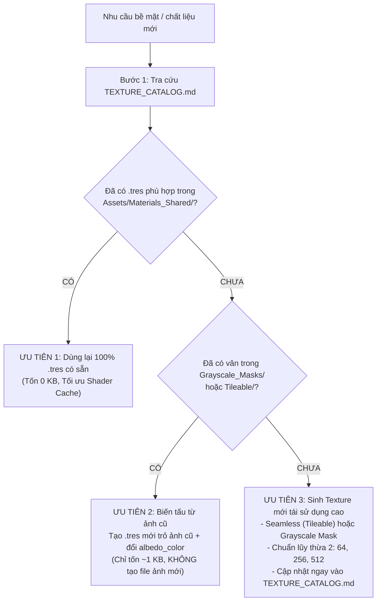
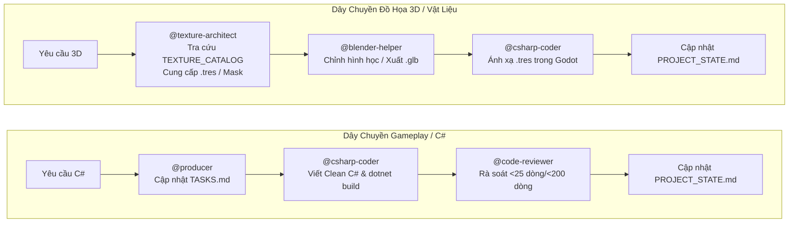

# ⚔️ DỰ ÁN TRÒ CHƠI MỚI (PROJECT 2.5D ISOMETRIC ACTION ADVENTURE)

[](https://godotengine.org/)
[](https://dotnet.microsoft.com/)
[](https://github.com/godot-jolt/godot-jolt)
[](https://www.blender.org/)
[](docs/CODING_STANDARDS.md)
[](AGENTS.md)
[-brightgreen?logo=checkmarx&logoColor=white)](test_suite.gd)

> **Dự án Trò chơi Mới** là tựa game hành động / phiêu lưu thế giới mở phong cách 2.5D Isometric được phát triển trực tiếp bên trong thư mục `C:\xnhaugame\MyGodotGame\dự-án-trò-chơi-mới`. Dự án vận hành trên nền tảng **Godot Engine 4.7.2 Mono (.NET 8.0)**, tích hợp engine vật lý tân tiến **Jolt Physics 3D**, đường ống đồ họa Stylized tối ưu tài nguyên VRAM từ **Blender 5.4**, và hệ thống điều phối **Antigravity AI Multi-Agent** vận hành tự động theo chuỗi 5 kỹ năng chuyên trách độc lập.

---

> [!TIP]
> **Khởi động AI CLI lần đầu tiên**: Khi mở AI CLI (`agy`) lần đầu tại thư mục dự án, hãy nhập ngay câu lệnh sau vào thanh chat để hệ thống tự động thiết lập toàn bộ môi trường:
> ```text
> @agy-customizations @run-workflow Hãy tự động cấu hình toàn diện dự án này theo chuẩn Workspace của Antigravity CLI gồm 4 việc sau: (1) Di chuyển toàn bộ 4 kỹ năng hiện có trong .gemini/skills/ (csharp-coder, code-reviewer, producer, blender-helper) sang đúng thư mục chuẩn .agents/skills/{skill_name}/SKILL.md để hệ thống tự động nạp mỗi khi mở agy, đồng thời tạo thêm kỹ năng thứ 5 là .agents/skills/texture-architect/SKILL.md. (2) Tạo hệ thống kho tài nguyên dùng chung tại Assets/Textures/ (gồm Palettes, Tileable, Grayscale_Masks), Assets/Materials_Shared/ và file danh mục Assets/Textures/TEXTURE_CATALOG.md; thiết lập quy tắc trong texture-architect và blender-helper để AI luôn chủ động kiểm tra TEXTURE_CATALOG.md và ưu tiên tái sử dụng texture/material (.tres) có sẵn nhằm chống phình dung lượng, chỉ tự động tạo mới khi tài nguyên cũ không đáp ứng được nhưng bắt buộc phải tạo dưới dạng tái sử dụng cao (Seamless/Grayscale) và ghi ngay vào TEXTURE_CATALOG.md. (3) Cấu hình description của cả 5 SKILL.md và tạo/cập nhật file AGENTS.md cùng GEMINI.md ở thư mục gốc để mỗi lần tôi mở agy lên và gõ lệnh bất kỳ (không cần gõ @tên-skill), bạn sẽ tự động kích hoạt dây chuyền 5 kỹ năng này, tuân thủ tuyệt đối CODING_STANDARDS.md (code C# dễ đọc như người viết, hàm < 25 dòng, file < 200 dòng, kiểm tra dotnet build 0 lỗi). (4) Thiết lập cơ chế điều phối qua Sub-agent hoặc công cụ run_workflow để các tác vụ đọc/viết code và xử lý tài nguyên chạy ở tiến trình con độc lập, sau mỗi nhiệm vụ bắt buộc tự động cập nhật lịch sử vào PROJECT_STATE.md và TASKS.md rồi đóng tiến trình con để giải phóng 100% token nháp, giữ cho luồng chat chính luôn nhẹ và thông minh. Sau khi tạo và cấu hình xong toàn bộ các file trên, hãy nhắc tôi gõ /skills reload lần cuối để hoàn tất.
> ```

---

## 📑 Mục Lục

1. [Tổng Quan Kiến Trúc Dự Án](#1-tổng-quan-kiến-trúc-dự-án)
2. [Cấu Trúc Thư Mục Nội Bộ Dự Án](#2-cấu-trúc-thư-mục-nội-bộ-dự-án)
3. [Các Tính Năng Gameplay & Bản Đồ Đã Hoàn Thiện](#3-các-tính-năng-gameplay--bản-đồ-đã-hoàn-thiện)
4. [Hệ Thống Kho Texture & Vật Liệu Dùng Chung (Zero-Bloat)](#4-hệ-thống-kho-texture--vật-liệu-dùng-chung-zero-bloat)
5. [Bảng Điều Khiển Toàn Diện (Controls Matrix)](#5-bảng-điều-khiển-toàn-diện-controls-matrix)
6. [Bộ Công Cụ Dev Mode HUD Toàn Năng (F1 / ~ / Select)](#6-bộ-công-cụ-dev-mode-hud-toàn-năng-f1---select)
7. [Hướng Dẫn Cài Đặt & Khởi Chạy (Quick Start)](#7-hướng-dẫn-cài-đặt--khởi-chạy-quick-start)
8. [Quy Chuẩn Clean Code C# (.NET 8)](#8-quy-chuẩn-clean-code-c-net-8)
9. [Hệ Thống Tự Động Hóa 5 Kỹ Năng Antigravity Orchestrator](#9-hệ-thống-tự-động-hóa-5-kỹ-năng-antigravity-orchestrator)
10. [Tài Liệu Kỹ Thuật Liên Quan](#10-tài-liệu-kỹ-thuật-liên-quan)

---

## 1. Tổng Quan Kiến Trúc Dự Án

Toàn bộ tài nguyên, kịch bản gameplay và mô hình của game đều nằm tập trung tại:
`C:\xnhaugame\MyGodotGame\dự-án-trò-chơi-mới`

| Thành Phần | Đặc Tả Kỹ Thuật | Vai Trò & Ghi Chú Kiến Trúc |
| :--- | :--- | :--- |
| **Thư mục dự án** | `C:\xnhaugame\MyGodotGame\dự-án-trò-chơi-mới` | Cội nguồn chứa toàn bộ mã nguồn C#, Scenes, Assets và cấu hình Godot |
| **File cấu hình game** | `project.godot` | Cấu hình trung tâm màn hình, input actions, Jolt Physics, ACES Tonemap |
| **File dự án C#** | `Dự án Trò chơi Mới.csproj` | Cấu hình .NET 8.0 SDK, Nullable disabled, cảnh báo nghiêm ngặt |
| **Game Engine** | Godot Engine 4.7.2 Stable (Mono / .NET 64-bit) | Pipeline render hiện đại, hỗ trợ JIT/AOT C#, tải resource nhanh |
| **Physics Engine** | Jolt Physics 3D | Va chạm Trimesh kèm Backface Collision 2 mặt, Convex Ramp leo cầu thang |
| **Góc Nhìn Camera** | Orthographic Isometric 45° & Perspective 6-DOF | Offset chuẩn `(-28, 23, 28)`, Size `17.5`, chuyển Perspective khi Free Cam |
| **Màn Chơi Mặc Định** | `res://Scenes/Levels/WorldMap.tscn` | Đảo trung tâm đa tầng kết nối thảo nguyên 84x84m bao bọc bởi núi xa |
| **Kiểm Thử Tự Động** | `test_suite.gd` (Godot Headless) | Bộ kiểm định tự động toàn diện **203 / 203 Test Cases Passed (100%)** |

---

## 2. Cấu Trúc Thư Mục Nội Bộ Dự Án

Dưới đây là sơ đồ chi tiết các thành phần bên trong `C:\xnhaugame\MyGodotGame\dự-án-trò-chơi-mới`:

```plaintext
C:/xnhaugame/MyGodotGame/dự-án-trò-chơi-mới/
├── .agents/                                # Hệ sinh thái Kỹ năng & Workflows tự động
│   ├── skills/                             # 5 Kỹ năng cốt lõi + 1 Kỹ năng quản trị bối cảnh
│   │   ├── csharp-coder/SKILL.md           # Lập trình Clean C# Gameplay (hàm < 25 dòng, file < 200 dòng)
│   │   ├── code-reviewer/SKILL.md          # Rà soát chất lượng code, bắt lỗi bộ nhớ, kiểm tra build
│   │   ├── producer/SKILL.md               # Quản lý tiến độ TASKS.md và PROJECT_STATE.md
│   │   ├── blender-helper/SKILL.md         # Hỗ trợ 3D Blender, xuất GLB không nhúng trùng texture
│   │   ├── texture-architect/SKILL.md      # Tối ưu hóa Texture/Material dùng chung, tra cứu TEXTURE_CATALOG
│   │   └── checkpoint/SKILL.md             # Đóng gói ngữ cảnh vào SESSION_HISTORY.md
│   └── workflows/                          # Kịch bản tự động hóa tuần tự
│       ├── dev_and_review.py               # Chuỗi: Viết C# -> Rà soát Clean Code -> dotnet build -> Lưu State
│       ├── asset_and_material_pipeline.py  # Chuỗi: Tối ưu Texture -> Xuất GLB Blender -> Tích hợp Godot
│       └── checkpoint_and_reset.py         # Chuỗi: Đóng gói trạng thái phiên làm việc
├── Assets/                                 # Tài nguyên đồ họa & mô hình 3D dùng chung
│   ├── Blender_Source/                     # File nguồn 3D Blender (.blend)
│   │   ├── character_25d.blend             # [VÙNG CẤM GHI ĐÈ] File nguồn nhân vật gốc
│   │   ├── map_25d.blend                   # [VÙNG CẤM GHI ĐÈ] File nguồn bản đồ gốc
│   │   ├── map_25d_fixed.blend             # Bản đồ đã cải tiến đài cao 6.27m², bậc thang êm, cỏ sạch
│   │   └── map_surroundings.blend          # Cánh đồng 84x84m, 45 đá, 63 cây, núi Bắc hùng vĩ
│   ├── Models_Exported/                    # File .glb xuất chuẩn Godot (Y-up, export_apply=True)
│   │   ├── character_25d.glb               # Model nhân vật: Idle, Walk, Jump, Attack
│   │   ├── map_25d.glb                     # Đảo trung tâm kèm đài vọng cảnh 6.27m², hàng rào gỗ 9 cột
│   │   └── map_surroundings.glb            # Cánh đồng phẳng 84x84m liền mạch Z=0.00m
│   ├── Textures/                           # Thư viện Texture nền tảng tái sử dụng cao
│   │   ├── Palettes/                       # Bảng màu Stylized chuẩn (palette_standard_stylized.png)
│   │   ├── Tileable/                       # 5 Texture Seamless 512x512: Cỏ, Đất, Đá, Gỗ, Kim loại
│   │   ├── Grayscale_Masks/                # 5 Mặt nạ trắng đen 512x512 đổi màu tự do bằng albedo_color
│   │   └── TEXTURE_CATALOG.md              # BẢNG DANH MỤC TRA CỨU BẮT BUỘC cho AI và Artist
│   └── Materials_Shared/                   # 13 Vật liệu StandardMaterial3D (.tres) chuẩn dùng chung
│       ├── M_Grass.tres, M_Dirt.tres, M_Rock.tres, M_Wood.tres, M_Metal.tres, M_Palette_Stylized.tres
│       ├── M_Wood_Fence.tres, M_Rock_Mountain_Purple.tres, M_Grass_Dry.tres, M_Dirt_RedClay.tres, M_Metal_DarkIron.tres
│       └── M_Character_Body.tres, M_Character_Face.tres
├── docs/                                   # Tài liệu kiến trúc & quy chuẩn vận hành
│   ├── CODING_STANDARDS.md                 # Quy chuẩn viết Clean Code C# dễ đọc như người viết
│   ├── CONTRIBUTING.md                     # Hướng dẫn cộng tác nhóm Git và branching strategy
│   ├── PROJECT_STATE.md                    # Bản đồ tài nguyên, UID và bối cảnh toàn diện dự án
│   ├── SESSION_HISTORY.md                  # Nhật ký chi tiết từng phiên làm việc và mốc nâng cấp
│   └── TASKS.md                            # Danh sách công việc phân chia giữa Human và AI
├── Scenes/                                 # Các Scene Godot (.tscn)
│   ├── Characters/                         # Player.tscn (CharacterBody3D), NPC.tscn (SimpleNpc)
│   ├── Levels/                             # WorldMap.tscn (Màn chơi chính), TestLevel.tscn
│   └── UI/                                 # DevOverlay.tscn (Bảng điều khiển Dev Mode HUD)
├── Scripts/                                # Mã nguồn C# phân theo trách nhiệm đơn nhất (SRP)
│   ├── Core/                               # CameraFollow.cs, FreeCameraController.cs, MapAutoCollision.cs,
│   │                                       # StairRampBuilder.cs, SimpleNpc.cs, VoidKillZone.cs,
│   │                                       # IInteractable.cs, InteractableArea.cs
│   ├── Player/                             # PlayerMovement.cs, PlayerAnimation.cs, PlayerInteractor.cs
│   └── UI/                                 # DevOverlay.cs, DevPlayerTab.cs, DevNpcTab.cs, DevWorldTab.cs
├── project.godot                           # File cấu hình trung tâm Godot Engine
├── Dự án Trò chơi Mới.csproj                 # Project file C# (.NET 8.0)
├── test_suite.gd                           # Bộ kiểm thử tự động Godot Headless (203/203 Pass)
├── AGENTS.md                               # Quy tắc điều phối và phân bổ chuỗi 5 kỹ năng
├── GEMINI.md                               # Bản sao quy tắc tương thích cho mọi phiên bản CLI
└── README.md                               # Tài liệu hướng dẫn nội bộ dự án (File này)
```

---

## 3. Các Tính Năng Gameplay & Bản Đồ Đã Hoàn Thiện

### 🏰 Đài Vọng Cảnh Tầng 2 Mở Rộng (6.27 m²)
- **Mở rộng diện tích gấp ~7 lần**: Nâng cấp từ diện tích cũ 0.94m x 0.97m (~0.91 m²) lên kích thước mới **2.60m x 2.41m (6.27 m²)**.
- **Móng nguyên khối đặc monolithic**: Độ cao Z=[2.10, 2.52] dày 0.42m đặc khối, chống xuyên sàn tuyệt đối.
- **Hàng rào gỗ 3 mặt tinh xảo (`SM_Fence_Wood_Overlook`)**: 9 cột gỗ chóp nhọn và hệ thanh ray ngang đôi vững chãi bao quanh 3 mặt Tây, Bắc, Đông.
- **Lối vào thang thông thoáng 1.24m (0 gap)**: Mép paver đè nhẹ 1.4cm lên đỉnh cầu thang `SM_Staircase_02`, triệt tiêu hoàn toàn khe hở.

### 🌿 Thảm Cỏ Hữu Cơ Không Ô Vuông (Clean Grass)
- **Xóa bỏ 100% vết kẻ ô vuông bàn cờ**: Toàn bộ đảo trung tâm, nền paver đài cao và cánh đồng mở rộng 84m x 84m sử dụng texture cỏ seamless tự nhiên [`tex_grass_seamless.png`](file:///C:/xnhaugame/MyGodotGame/d%E1%BB%B1-%C3%A1n-tr%C3%B2-ch%C6%A1i-m%E1%BB%9Bi/Assets/Textures/Tileable/tex_grass_seamless.png) với sắc xanh mướt mát mắt `#529934`.
- **Đồng bộ vật liệu dùng chung**: Tự động gán [`M_Grass.tres`](file:///C:/xnhaugame/MyGodotGame/d%E1%BB%B1-%C3%A1n-tr%C3%B2-ch%C6%A1i-m%E1%BB%9Bi/Assets/Materials_Shared/M_Grass.tres), giảm thiểu bộ nhớ đệm shader.

### 🌄 Bầu Trời Khoáng Đạt & Dãy Núi Thoáng Mắt
- **Dọn sạch phông trắng**: Loại bỏ hoàn toàn tấm plane chắn trắng `SM_Sky_Backdrop_Plane`, để lộ bầu trời tự nhiên ProceduralSky.
- **Giữ nền núi hùng vĩ**: Giữ lại 2 ngọn núi nền phía xa thanh thoát và dãy núi phía Bắc `Mountain_Mesh_North` làm phông nền background hùng vĩ.

### 🪜 Cầu Thang Leo Mượt Mà (Stair Ramp Builder)
- **Tự động sinh dốc nêm phẳng (`StairRampBuilder.cs`)**: Phân tích góc dốc của 2 cầu thang (51.11° & 57.12°), tự động sinh khối dốc phẳng `ConvexPolygonShape3D` che phủ mặt bậc 90°.
- **Vật lý bám dốc**: `FloorMaxAngle = 58°` và `FloorSnapLength = 0.40f` giúp nhân vật bước lên thang êm ái, không khấc, không nảy.

### 💬 NPC Tương Tác & Thoại Nổi 3D Billboard
- **Vị trí thuận tiện**: NPC bố trí ngay trên mặt đất đảo trung tâm `(5.0, 0.5, -4.0)` cạnh lối đi chính.
- **Thoại nổi Billboard (`Label3D`)**: `FontSize = 36`, `OutlineSize = 8`, `NoDepthTest = true` đảm bảo chữ luôn nổi rõ phía trên đầu NPC.
- **Tương tác linh hoạt**: Nhấn phím `E` hoặc nút tay cầm để mở lời thoại, tự động xoay vòng câu thoại và tự ẩn sau 4 giây.

---

## 4. Hệ Thống Kho Texture & Vật Liệu Dùng Chung (Zero-Bloat)

Để chống phình dung lượng kho chứa Git và tối ưu bộ nhớ VRAM khi chơi game, toàn bộ dự án tuân thủ nghiêm ngặt **Cây Quyết Định 3 Bước** ghi chép tại [`Assets/Textures/TEXTURE_CATALOG.md`](file:///C:/xnhaugame/MyGodotGame/d%E1%BB%B1-%C3%A1n-tr%C3%B2-ch%C6%A1i-m%E1%BB%9Bi/Assets/Textures/TEXTURE_CATALOG.md):



### Danh Mục Vật Liệu Dùng Chung Hiện Có (`Assets/Materials_Shared/`):
- `M_Grass.tres`: Thảm cỏ xanh mượt `#529934`.
- `M_Dirt.tres`: Đường mòn đất nâu tự nhiên `#8A5C35`.
- `M_Rock.tres`: Vách đá xám phiến Stylized.
- `M_Wood.tres`: Vân gỗ sồi ấm áp.
- `M_Wood_Fence.tres`: Gỗ sồi tối màu rustic cho hàng rào.
- `M_Rock_Mountain_Purple.tres`: Núi tím huyền ảo (biến tấu từ `mask_rock_detail.png` + `albedo_color` tím, chỉ tốn 1KB).
- `M_Grass_Dry.tres`: Cỏ khô vàng úa (từ `mask_grass_detail.png`).
- `M_Dirt_RedClay.tres`: Đất đỏ bazan (từ `mask_dirt_detail.png`).
- `M_Metal_DarkIron.tres`: Sắt đen rèn thô (từ `mask_metal_surface.png`).
- `M_Character_Body.tres` & `M_Character_Face.tres`: Thân và mặt nhân vật Player.

---

## 5. Bảng Điều Khiển Toàn Diện (Controls Matrix)

Hỗ trợ đồng bộ cả **Bàn phím & Chuột** và **Tay cầm Gamepad** (Xbox, PlayStation, Logitech, Switch Pro):

### 🎮 Chế Độ Gameplay Mặc Định (Isometric)

| Thao Tác Gameplay | Bàn Phím & Chuột | Tay Cầm Gamepad (Xbox / PlayStation) | Chi Tiết Kỹ Thuật |
| :--- | :--- | :--- | :--- |
| **Di chuyển** | `W / A / S / D` hoặc `↑ / ← / ↓ / →` | Cần gạt trái (**Left Stick**) hoặc D-Pad | Chuẩn hóa `Input.GetVector` theo góc nhìn camera Isometric 45° |
| **Xoay mặt** | Tự động theo hướng đi | Tự động theo hướng đi | Công thức `Mathf.Atan2(horizontalVelocity.X, horizontalVelocity.Y)`, mặt hướng +Z |
| **Nhảy** | Phím cách (`Space`) | Nút **A** (Xbox) / Nút **✕** (PS) | Hỗ trợ **Coyote Time 0.15s** và **Jump Buffer 0.15s** |
| **Tương tác NPC** | Phím **E** | Nút **X** hoặc **Y** (Xbox) / **□** hoặc **△** (PS) | Bán kính quét `ScanRadius = 3.0m`, ưu tiên thực thể gần nhất |
| **Thu phóng Camera (Zoom)** | Cuộn con lăn chuột (**Wheel Up / Down**) | Cần gạt phải (**Right Stick** Lên / Xuống) | Tinh chỉnh Orthographic Size từ `8.0` đến `35.0` mượt mà |
| **Bật/Tắt Dev HUD** | Phím **F1**, phím **~** (Tilde), phím **F3** | Nút **Back / Select**, **Start** hoặc nhấn cần phải **R3** | Mở bảng HUD tinh chỉnh và tự động mở khóa chuột |
| **Chuyển Tab Dev HUD** | Nhấp chuột chọn Tab | Nút vai **LB** (Tab trước) / **RB** (Tab tiếp theo) | Duyệt nhanh giữa các tab trong Dev HUD |

### 🎥 Chế Độ Camera Tự Do (Free Cam 6-DOF)

| Thao Tác Bay Camera | Bàn Phím & Chuột | Tay Cầm Gamepad (Xbox / PlayStation) | Chi Tiết Kỹ Thuật |
| :--- | :--- | :--- | :--- |
| **Bay Ngang / Tiến Lùi** | Phím `W / A / S / D` | Cần gạt trái (**Left Stick**) | Di chuyển theo hệ trục tọa độ của Camera |
| **Nâng Độ Cao (Bay lên)** | Phím `Space` hoặc `E` | Nút vai phải **RB** hoặc Cò phải **R2 / RT** | Bay thẳng đứng hướng lên bầu trời (`Vector3.Up`) |
| **Hạ Độ Cao (Bay xuống)** | Phím `Ctrl` hoặc `Q` | Nút vai trái **LB** hoặc Cò trái **L2 / LT** | Bay thẳng đứng hạ xuống mặt đất (`Vector3.Down`) |
| **Xoay Góc Nhìn 360°** | Giữ **Chuột Phải** + Rê chuột | Cần gạt phải (**Right Stick**) xoay 360° | Xoay Pitch (±89°) và Yaw (360°) tự do |
| **Đổi Tốc Độ Bay** | Cuộn chuột Lên / Xuống | Nhấn cần gạt trái **L3** | Tốc độ bay linh hoạt từ **5.0 m/s** đến **50.0 m/s** |
| **Khóa Nhân Vật (Freeze)** | **Tự động kích hoạt (Freeze Player)** | **Tự động kích hoạt (Freeze Player)** | Player lập tức dừng di chuyển, giữ tư thế `Idle` để dev quan sát |
| **Quay Về Player** | Nút `[🔄 Quay Về Player]` | Nút Reset trên HUD hoặc tắt Dev Mode | Camera khôi phục góc Isometric khóa vào Player |

---

## 6. Bộ Công Cụ Dev Mode HUD Toàn Năng (F1 / ~ / Select)

Giao diện **Dev Mode HUD** (`DevOverlay.cs`) thiết kế theo phong cách Dark Glass Theme bán trong suốt bo góc 10px, hiển thị tại lớp trên cùng `CanvasLayer` (Layer 100):

- **Tab 1 - Nhân Vật (Player Tweaks)**: Sliders điều chỉnh tốc độ chạy (`MoveSpeed` 2-25), lực nhảy (`JumpVelocity`), trọng lực (`Gravity`), Checkbox nhảy vô hạn (`InfiniteJump`), nút `TeleportTo` đưa Player về điểm xuất phát tức thì.
- **Tab 2 - Hội Thoại NPC (Dialogue Editor)**: Live Dialogue Editor sửa trực tiếp danh sách câu thoại NPC khi đang chạy game: thêm câu thoại mới, phát thoại ngay lập tức, xoay vòng câu thoại, hoặc xóa câu thoại đã chọn.
- **Tab 3 - Thế Giới & Camera (World & Stats)**: Checkbox kích hoạt `[🎥 Free Cam]`, Slider tốc độ bay Free Cam (5.0 - 50.0), Nút quay về góc Isometric, nhãn hiển thị FPS và tọa độ Player thời gian thực, nút tải lại màn chơi (`Reload Scene`).

---

## 7. Hướng Dẫn Cài Đặt & Khởi Chạy (Quick Start)

### Yêu Cầu Môi Trường
1. **.NET 8.0 SDK** (`dotnet --version` >= 8.0.x).
2. **Godot Engine 4.7.2 Mono (Windows 64-bit)**.
3. **Blender 5.4+** (cho các tác vụ 3D).

### Khởi Chạy Dự Án
1. **Mở terminal tại thư mục dự án**:
   ```powershell
   cd C:\xnhaugame\MyGodotGame\dự-án-trò-chơi-mới
   ```

2. **Biên dịch mã nguồn C#**:
   ```powershell
   dotnet build "Dự án Trò chơi Mới.csproj"
   ```
   *Yêu cầu bắt buộc*: `Build succeeded. 0 Warning(s), 0 Error(s)`.

3. **Chạy bộ kiểm thử tự động toàn diện (203 Tests)**:
   ```powershell
   & "C:\xnhaugame\Godot_v4.7.2-stable_mono_win64\Godot_v4.7.2-stable_mono_win64\Godot_v4.7.2-stable_mono_win64_console.exe" --headless --path "." -s test_suite.gd
   ```
   *Kết quả*: `=== SUMMARY: Passed: 203 | Failed: 0 ===` (100% Pass).

4. **Chạy game trên Godot Engine**:
   - Mở Godot Engine 4.7.2 Mono, chọn **Import** trỏ vào `project.godot`.
   - Nhấn **Import & Edit** và nhấn `F5` để khởi chạy màn chơi `WorldMap.tscn`.

---

## 8. Quy Chuẩn Clean Code C# (.NET 8)

Tất cả các file mã nguồn C# trong dự án tuân thủ tuyệt đối [`docs/CODING_STANDARDS.md`](file:///C:/xnhaugame/MyGodotGame/d%E1%BB%B1-%C3%A1n-tr%C3%B2-ch%C6%A1i-m%E1%BB%9Bi/docs/CODING_STANDARDS.md):
- **Độ dài giới hạn**: Mỗi file `.cs` $\le$ 200 dòng. Mỗi hàm $\le$ 25 dòng.
- **Cấu trúc Guard Clauses**: Không lồng ghép `if` quá 2 cấp.
- **Thân thiện Inspector**: Khai báo `[Export]` cho các thuộc tính số và Node tham chiếu để dễ dàng kéo thả.
- **An toàn bộ nhớ**: Mọi sự kiện đăng ký `+=` bắt buộc phải hủy `-=` trong hàm `_ExitTree()`.
- **Chú thích XML tiếng Việt**: Rõ ràng, dễ đọc như người lập trình kinh nghiệm viết.

---

## 9. Hệ Thống Tự Động Hóa 5 Kỹ Năng Antigravity Orchestrator

Theo quy tắc tại [`AGENTS.md`](file:///C:/xnhaugame/MyGodotGame/d%E1%BB%B1-%C3%A1n-tr%C3%B2-ch%C6%A1i-m%E1%BB%9Bi/AGENTS.md) và [`GEMINI.md`](file:///C:/xnhaugame/MyGodotGame/d%E1%BB%B1-%C3%A1n-tr%C3%B2-ch%C6%A1i-m%E1%BB%9Bi/GEMINI.md):
- Luồng chat chính đóng vai trò **Tổng Điều Phối Viên (Lead Orchestrator)**, tuyệt đối không viết code dài trực tiếp trong chat để **chống loãng token (Token Preservation)**.
- Khi người dùng đưa ra bất kỳ yêu cầu nào (không cần gõ `@tên-skill`), Orchestrator tự động kích hoạt dây chuyền phù hợp:



- Mọi tác vụ nặng chạy trong Sub-agent độc lập (`invoke_subagent` hoặc `run_workflow`). Sau khi hoàn thành, Sub-agent lưu trạng thái vào `PROJECT_STATE.md` và `TASKS.md` rồi **đóng tiến trình để giải phóng 100% token nháp**, giữ cho luồng chat chính luôn nhẹ và thông minh.

---

## 10. Tài Liệu Kỹ Thuật Liên Quan

- 📖 [Bản Đồ Trạng Thái Dự Án (PROJECT_STATE.md)](file:///C:/xnhaugame/MyGodotGame/d%E1%BB%B1-%C3%A1n-tr%C3%B2-ch%C6%A1i-m%E1%BB%9Bi/docs/PROJECT_STATE.md)
- 📋 [Bảng Phân Chia Công Việc (TASKS.md)](file:///C:/xnhaugame/MyGodotGame/d%E1%BB%B1-%C3%A1n-tr%C3%B2-ch%C6%A1i-m%E1%BB%9Bi/docs/TASKS.md)
- 🎨 [Danh Mục Texture & Material (TEXTURE_CATALOG.md)](file:///C:/xnhaugame/MyGodotGame/d%E1%BB%B1-%C3%A1n-tr%C3%B2-ch%C6%A1i-m%E1%BB%9Bi/Assets/Textures/TEXTURE_CATALOG.md)
- 💻 [Quy Chuẩn Clean Code C# (CODING_STANDARDS.md)](file:///C:/xnhaugame/MyGodotGame/d%E1%BB%B1-%C3%A1n-tr%C3%B2-ch%C6%A1i-m%E1%BB%9Bi/docs/CODING_STANDARDS.md)
- 🤝 [Hướng Dẫn Đóng Góp & Cộng Tác Nhóm (CONTRIBUTING.md)](file:///C:/xnhaugame/MyGodotGame/d%E1%BB%B1-%C3%A1n-tr%C3%B2-ch%C6%A1i-m%E1%BB%9Bi/docs/CONTRIBUTING.md)
- 📜 [Nhật Ký Các Phiên Làm Việc (SESSION_HISTORY.md)](file:///C:/xnhaugame/MyGodotGame/d%E1%BB%B1-%C3%A1n-tr%C3%B2-ch%C6%A1i-m%E1%BB%9Bi/docs/SESSION_HISTORY.md)
