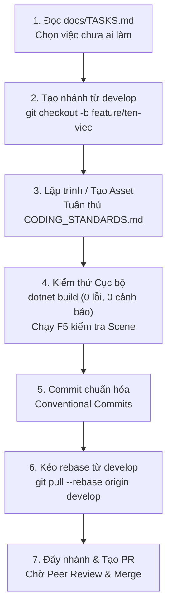

# 🤝 HƯỚNG DẪN ĐÓNG GÓP DỰ ÁN (CONTRIBUTING GUIDE)

Chào mừng bạn đến với đội ngũ phát triển **Dự án Trò chơi 2.5D Isometric**! Tài liệu này cung cấp hướng dẫn toàn diện từ A đến Z dành cho các thành viên mới (Lập trình viên C#, Nghệ sĩ 3D, Âm thanh, Thiết kế Game) để bắt đầu cộng tác một cách hiệu quả, mượt mà và tránh mọi xung đột kỹ thuật.

---

## 📑 Mục Lục
1. [Chuẩn Bị Môi Trường Phát Triển (Environment Setup)](#1-chuẩn-bị-môi-trường-phát-triển-environment-setup)
2. [Quy Trình Nhận Việc & Phát Triển (Workflow Step-by-Step)](#2-quy-trình-nhận-việc--phát-triển-workflow-step-by-step)
3. [Quy Chuẩn Viết Mã & Tiêu Chí Đánh Giá (Code Quality Checklist)](#3-quy-chuẩn-viết-mã--tiêu-chí-đánh-giá-code-quality-checklist)
4. [Hướng Dẫn Dành Cho Nghệ Sĩ 3D & Âm Thanh (Assets Guide)](#4-hướng-dẫn-dành-cho-nghệ-sĩ-3d--âm-thanh-assets-guide)
5. [Chiến Lược Chống Xung Đột Scene Trong Godot](#5-chiến-lược-chống-xung-đột-scene-trong-godot)
6. [Quy Trình Tạo Pull Request & Mẫu Chuẩn (PR Template)](#6-quy-trình-tạo-pull-request--mẫu-chuẩn-pr-template)
7. [Phối Hợp Với Hệ Thống AI Sub-Agents](#7-phối-hợp-với-hệ-thống-ai-sub-agents)

---

## 1. Chuẩn Bị Môi Trường Phát Triển (Environment Setup)

### Bộ Công Cụ Yêu Cầu
- **.NET 8.0 SDK**: Cần thiết để biên dịch mã nguồn C# của Godot.
- **Godot Engine 4.7.2 Mono (win64)**: Bản hỗ trợ .NET.
- **Blender 5.4+**: Cho việc dựng hình và tinh chỉnh mô hình 3D.
- **Git**: Quản lý phiên bản mã nguồn.

### Cấu Hình Git Cá Nhân
Trước khi bắt đầu commit, cấu hình định dạng xuống dòng và danh tính của bạn:
```bash
git config --global user.name "Tên Của Bạn"
git config --global user.email "email-cua-ban@example.com"
git config --global core.autocrlf true
```

### Cấu Hình IDE Khuyên Dùng
- **Visual Studio 2022**: Cài đặt Workload *"Desktop development with .NET"*.
- **JetBrains Rider**: Hỗ trợ Godot Engine tuyệt vời thông qua plugin *"Godot Support"*.
- **Visual Studio Code**: Cài đặt extension *"C# Dev Kit"* và *"Godot Tools"*.
- Đảm bảo IDE nhận diện tập tin `.editorconfig` ở thư mục gốc để tự động định dạng mã nguồn (Allman Style, 4 spaces indent, Allman braces).

---

## 2. Quy Trình Nhận Việc & Phát Triển (Workflow Step-by-Step)



### Chi Tiết Từng Bước

#### Bước 1: Nhận việc từ Bảng Việc (`docs/TASKS.md`)
- Kiểm tra danh mục **Việc Cần Làm Tiếp Theo (Backlog / Next Steps)**.
- Ghi tên bạn hoặc đánh dấu đang làm vào file `docs/TASKS.md` để tránh người khác làm trùng.

#### Bước 2: Tạo nhánh phát triển mới
Luôn bắt đầu từ nhánh `develop` mới nhất:
```bash
git checkout develop
git pull origin develop
git checkout -b feature/<tên-tính-năng-ngắn-gọn>
# Hoặc sửa lỗi:
git checkout -b bugfix/<tên-lỗi-cần-sửa>
```

#### Bước 3: Phát triển tính năng
- Viết code C# trong thư mục `Scripts/`.
- Tạo Scene con trong `Scenes/`.
- Xuất mô hình 3D vào `Assets/Models_Exported/`.

#### Bước 4: Kiểm thử cục bộ (Pre-commit Validation)
Chạy lệnh biên dịch C# bắt buộc:
```bash
dotnet build "MyGodotGame/dự-án-trò-chơi-mới/Dự án Trò chơi Mới.csproj"
```
Kết quả phải đạt: **`0 Warning(s), 0 Error(s)`**.

#### Bước 5: Commit với thông điệp chuẩn hóa (Conventional Commits)
```bash
git add .
git commit -m "feat(combat): thêm hiệu ứng vung kiếm cho Player"
```

#### Bước 6: Đồng bộ nhánh trước khi đẩy lên remote
```bash
git checkout develop
git pull origin develop
git checkout feature/<tên-tính-năng>
git rebase develop
```

#### Bước 7: Đẩy nhánh lên Remote Repository
```bash
git push origin feature/<tên-tính-năng>
```

---

## 3. Quy Chuẩn Viết Mã & Tiêu Chí Đánh Giá (Code Quality Checklist)

Mọi đóng góp mã nguồn C# BẮT BUỘC phải vượt qua danh sách kiểm tra sau trước khi được chấp thuận:

- [ ] **Kích thước file**: File `.cs` không vượt quá 200 dòng (mục tiêu 150 dòng).
- [ ] **Kích thước hàm**: Không có bất kỳ hàm nào dài quá 25 dòng.
- [ ] **Độ sâu lồng ghép**: Tuyệt đối không lồng `if`/`for` quá 2 cấp. Sử dụng **Guard Clauses** (`if (...) return;`) ở đầu hàm.
- [ ] **Kiểm soát rác bộ nhớ (GC)**: Không dùng LINQ nặng trong `_Process` hoặc `_PhysicsProcess`.
- [ ] **Giải phóng sự kiện**: Mọi sự kiện C# được đăng ký bằng toán tử `+=` phải được hủy bằng `-=` trong hàm `_ExitTree()` hoặc `Dispose()`.
- [ ] **Không số ma thuật (No Magic Numbers)**: Mọi giá trị số cố định đều phải khai báo `[Export]` hoặc `private const`.
- [ ] **Chú thích XML tiếng Việt**: Tất cả các hàm và thuộc tính quan trọng đều có chú thích `/// <summary>` rõ ràng.
- [ ] **Biên dịch sạch**: Chạy `dotnet build` đạt 0 lỗi và 0 cảnh báo.

---

## 4. Hướng Dẫn Dành Cho Nghệ Sĩ 3D & Âm Thanh (Assets Guide)

### Quy Chuẩn Mô Hình 3D (Blender to Godot)
1. **Quy tắc bảo vệ file nguồn**:
   - Thư mục `Assets/Blender_Source/` chứa các file nguồn `.blend`.
   - **TUYỆT ĐỐI KHÔNG** ghi đè lên các file gốc: `character_25d.blend`, `map_25d.blend`.
   - Khi tạo thêm tài nguyên mới, hãy lưu thành file blend riêng (ví dụ: `monster_slime.blend`, `props_dungeon.blend`).
2. **Quy chuẩn xuất khẩu sang định dạng `.glb`**:
   - Định dạng xuất: **glTF 2.0 Binary (`.glb`)**.
   - Tọa độ: **Forward = -Z**, **Up = +Y**.
   - Đơn vị đo: **Metric (Mét)**, tỉ lệ nhân vật tương quan (Player cao xấp xỉ 1.8m).
   - Thư mục xuất: `Assets/Models_Exported/`.
3. **Quy chuẩn đặt tên Mesh**:
   - Để kích hoạt tính năng sinh va chạm tự động của `MapAutoCollision.cs`, hãy đặt tên Mesh có chứa từ khóa:
     + Địa hình đi lại được: `Terrain`, `Plains`, `Dirt`, `Path`, `Paver`, `Staircase`.
     + Vật cản / Ranh giới: `Rock`, `Mountain`, `Cliff`, `Fence`.

### Quy Chuẩn Tài Nguyên Âm Thanh (Audio)
- **Hiệu ứng âm thanh ngắn (SFX)**: Lưu dưới định dạng **WAV (16-bit, 44.1kHz hoặc 48kHz)** để giảm độ trễ giải mã.
- **Nhạc nền (BGM) / Âm thanh môi trường (Ambient)**: Lưu dưới định dạng **OGG Vorbis** để tối ưu dung lượng và hỗ trợ lặp vô tận (Looping).
- Thư mục lưu trữ: `Assets/Audio/SFX/` và `Assets/Audio/Music/`.

---

## 5. Chiến Lược Chống Xung Đột Scene Trong Godot

Godot lưu trữ Scene dưới dạng văn bản `.tscn`. Nếu hai người cùng sửa một file Scene, việc giải quyết xung đột (Merge Conflict) bằng tay rất dễ dẫn đến lỗi hỏng cây Node hoặc mất UID. Hãy làm theo hướng dẫn sau:

1. **Scene Phân Rã (Prefab / Sub-scene)**:
   - Hãy tạo các Scene nhỏ và độc lập cho từng đối tượng (Ví dụ: `UI_HealthBar.tscn`, `Prop_Chest.tscn`).
   - Chỉ đưa Instance của các Scene nhỏ này vào Scene cấp cao hơn.
2. **Không commit file cấu hình cá nhân**:
   - `.gitignore` đã được cấu hình tự động loại bỏ các file tạm của IDE, file `.blend1`, `.godot/`. Không bao giờ dùng lệnh `git add -f` để ép commit các file này.
3. **Nếu xảy ra Conflict file `.tscn`**:
   - Không tự ý sửa file `.tscn` trong Text Editor nếu bạn không nắm rõ cú pháp Node UID.
   - Hãy mở một bản sao lưu, dùng Godot Engine kiểm tra trực quan, hoặc trao đổi với người cùng sửa file để quyết định phiên bản chuẩn.

---

## 6. Quy Trình Tạo Pull Request & Mẫu Chuẩn (PR Template)

Khi gửi Pull Request lên nhánh `develop`, hãy sao chép và điền đầy đủ mẫu sau vào phần mô tả PR:

```markdown
### 📝 Tóm tắt Thay đổi
- Mô tả ngắn gọn tính năng hoặc lỗi đã xử lý:
- Các Scene / Script bị ảnh hưởng:

### 🎯 Phân Loại Thay Đổi
- [ ] Tính năng mới (feat)
- [ ] Sửa lỗi (fix)
- [ ] Tái cấu trúc Clean Code (refactor)
- [ ] Cập nhật tài liệu (docs)
- [ ] Cập nhật tài nguyên đồ họa / âm thanh (assets)

### ✅ Danh Sách Kiểm Tra (Self-Checklist)
- [ ] Đã chạy `dotnet build` và đạt 0 Warning(s), 0 Error(s).
- [ ] Đã kiểm tra tuân thủ `CODING_STANDARDS.md` (hàm < 25 dòng, file < 200 dòng, Guard Clauses).
- [ ] Đã hủy sự kiện `-=` trong `_ExitTree()` (nếu có sử dụng event).
- [ ] Đã chạy thử Scene trên Godot Engine và không có lỗi đỏ (Error).
- [ ] Đã cập nhật `docs/PROJECT_STATE.md` và `docs/TASKS.md` tương ứng.
```

---

## 7. Phối Hợp Với Hệ Thống AI Sub-Agents

Dự án này được thiết kế để tận dụng sức mạnh của các Sub-agent AI thông qua AGY CLI / Antigravity:
- Nếu bạn sử dụng AI hỗ trợ lập trình, hãy tuân thủ quy tắc trong [AGENTS.md](../AGENTS.md).
- Ủy thác các tác vụ phù hợp cho các chuyên gia:
  - `@csharp-coder`: Viết mã gameplay chuẩn mực.
  - `@code-reviewer`: Rà soát vi phạm độ dài hàm và rò rỉ bộ nhớ.
  - `@producer`: Cập nhật tiến độ dự án.
  - `@blender-helper`: Xuất model 3D qua CLI.
- **Quy tắc cốt lõi**: Trước khi kết thúc bất kỳ phiên làm việc nào của AI, hãy đảm bảo cập nhật trạng thái mới nhất vào `docs/PROJECT_STATE.md` và `docs/SESSION_HISTORY.md`.

---
*Cảm ơn sự đóng góp của bạn để tạo nên một trò chơi tuyệt vời!*
